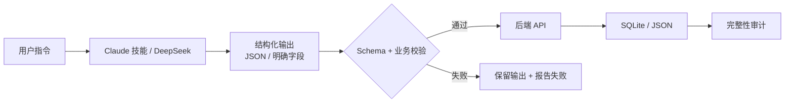

# AI 生成与写回契约

- 状态：已建立
- 日期：2026-10-24
- 范围：Claude Code 技能、DeepSeek 调用、结构化输出、API 写回与失败处理

## 1. 核心设计决策

1. **AI 输出不是可信数据**：Claude / DeepSeek 生成的内容必须经过 Schema 与业务不变量校验后才能落库。
2. **写回只走后端 API**：不允许绕过 API 直接改 SQLite 或 JSON 字段。
3. **结构化字段优先**：生成物中的页码、旁白、标红、对话、机位、角色变量必须能被结构化字段校验或重建。
4. **失败不静默**：解析失败、校验失败、网络失败时，保留对话输出并明确报告未写入或写入失败。
5. **AI 不负责派生值**：显示页码、章节归属、完成数等由后端计算，Claude 不得自行改写。
6. **建议类输出需要过滤**：别名建议、文案方案、角色同步结果在返回前按业务规则过滤/校验。

## 2. 数据流拓扑

边界约束：

- AI 输出不能直接作为数据库字段值。
- 写回 API 是唯一入口。
- 校验失败不得降级为「先写入再修」。
- 生成物与结构化字段冲突时，以结构化字段为准。
- 失败时必须告诉用户结果是否已写入。

## 3. 生成模式与写回边界

| 模式 | 产出 | 写回 |
|---|---|---|
| 分镜对照 | `mapping` | PATCH breakdown；不写 pages |
| 分镜头脚本 | `pages` | 逐页 PUT；不批量重排 |
| 章节规划 | `chapters` | PATCH chapters；不写 pages |
| 章节正文脚本 | 本章 `pages` | 按全局页码逐页 PUT；不 DELETE 全部 pages |
| 章节封面 / 引导卡 | `chapters[].cover/guide.image_prompt` | PATCH chapters；只改目标字段 |
| 章节封面 AI 优化 | 用户建议 → 新版主标题 / 副标题 / 画面提示词 | 结构化 JSON；前端三字段弹窗展示，用户确认后回填编辑表单，随章节保存 |
| 小红书文案 | 2–4 个方案 | 前端选择后 PUT post-config |
| 别名建议 | 候选别名 | 用户确认后 PATCH zhihu |
| 角色优化 / 同步 | 角色卡 / character_review | PATCH characters / pages |

## 4. 业务不变量

| 编号 | 不变量 |
|---|---|
| A-01 | 所有 AI 结构化输出必须能映射到明确 Schema；解析失败不得落库。 |
| A-02 | 写回只能通过后端 API；不得直接修改数据库或 JSON 文件。 |
| A-03 | 页面写回必须带 `mapping_page_number` / `chapter_number` / `chapter_page_number`，并满足数据模型 I-01～I-12。 |
| A-04 | 正文页 `image_prompt` 的页码必须通过 `PROMPT_PAGE_MISMATCH` 校验。 |
| A-05 | 章节封面 / 引导卡只写 `chapters`，不得写入 `pages`。 |
| A-06 | 别名建议、文案方案等候选输出必须经过业务过滤；不能直接成为最终别名或已保存文案。 |
| A-07 | 校验失败、网络失败、部分写入失败必须报告；不得声称全部成功。 |
| A-08 | AI 不得自行新增角色变量、画风或章节；缺失时先补数据或询问用户。 |
| A-09 | 章节封面 AI 优化只允许输出 `narration_main` / `narration_sub` / `image_prompt`；不得输出或修改顶部小字、标红词、章节标题、引导卡。 |
| A-10 | 封面 AI 优化结果是结构化 JSON；主标题 <15 字、副标题 <35 字，标红词必须仍出现在新主/副标题中。 |
| A-11 | 封面 AI 优化结果只填入编辑表单，不自动写回；用户点击保存后才落库。 |

## 5. 检查与失败处理

- Claude 写回前运行 `mapping_check.py` / `script_check.py` / `chapter_check.py`。
- 后端写入口再做一次 Schema 与跨字段校验。
- 写回失败：
  - 4xx 校验失败：按错误字段修正后重试一次；仍失败则报告具体字段。
  - 5xx / 网络错误：重试一次；仍失败则保留完整输出，明确告知未写入。
- 部分写入：明确列出成功与失败页，不允许静默忽略。

## 6. Impacted Files

- `backend/app/services/deepseek.py`
- `backend/app/routers/posts.py`
- `backend/app/routers/stories.py`
- `backend/app/routers/breakdowns.py`
- `backend/app/schemas.py`
- `.claude/skills/story-breakdown/SKILL.md`
- `.claude/skills/story-breakdown/mapping_check.py`
- `.claude/skills/story-breakdown/script_check.py`
- `.claude/skills/story-breakdown/chapter_check.py`
- `frontend/src/components/StoryCompareModal.tsx`
- `frontend/src/components/CharacterCardsTab.tsx`
- `frontend/src/components/PostConfigTab.tsx`
- `frontend/src/components/ZhihuInfoCard.tsx`

## 7. 风险与遗留

- DeepSeek 的部分输出仍是自由文本（如提示词），需要通过渲染器与写回校验兜底。
- Claude 技能与后端各有一份校验逻辑，必须保持契约一致；后续可考虑共享校验规则。
- 文案方案数量允许 2–4 个，避免模型偶尔少给/多给直接失败；但推荐方案必须唯一。

## 8. 变更历史

- **2026-10-24**：建立蓝图。固化 AI 输出校验、API 唯一写回入口、失败报告与结构化字段优先原则。
- **2026-10-25**：新增章节封面 AI 优化模式；SSE 返回完整提示词，前端确认后填入章节编辑表单，不自动落库。
- **2026-10-25（范围修正）**：改为非流式结构化 JSON，只返回主标题、副标题、画面提示词；新增字数与标红词校验，其他封面字段不允许改动。
