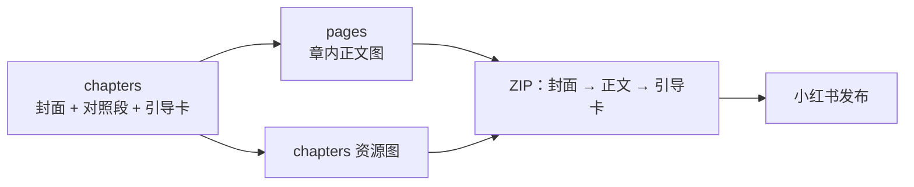

# 章节发布与资源契约

- 状态：已建立
- 日期：2026-10-24
- 范围：章节封面 / 正文 / 引导卡顺序、图片目录、ZIP 导出、单章 18 张上限

## 1. 核心设计决策

1. **一章 = 一篇小红书笔记**：1 张封面 + 1–16 张正文 + 1 张引导卡，总图 ≤ 18。
2. **封面 / 引导卡不是正文页**：不写入 `pages`，不显示页码，不参与正文覆盖。
3. **正文图片路径**：
   ```text
   backend/uploads/pages/<故事ID>/chapter-<章节号>/page-<全局页码四位>.<ext>
   ```
   旧版平铺的 `page-<全局页码>.<ext>` 启动时迁移到章节目录。
4. **章节资源路径**：
   ```text
   backend/uploads/chapters/<故事ID>/chapter-<章节号>-cover.<ext>
   backend/uploads/chapters/<故事ID>/chapter-<章节号>-guide.<ext>
   ```
5. **ZIP 导出顺序**：封面 → 正文（章内页码顺序）→ 引导卡；按章节分文件夹，只打包实际存在的图片。
6. **清空正文页不删除章节资源**：封面 / 引导卡独立于 `pages`，清空正文、重做正文都保留。
7. **章节结构变化受页面保护**：已有正文页时，重规划章节或修改对照表必须被阻止，除非只改文字字段。
8. **封面提示词支持 AI 优化**：编辑章节时可在「封面生图提示词」旁打开 AI 优化抽屉，用自然语言提建议；AI 只改提示词，不改封面文字，应用后仍需保存章节。

## 2. 数据流拓扑



边界约束：

- ZIP 只按 `chapters` 的分组顺序生成。
- 正文图按 `chapter_page_number` 排序，不按文件名或上传时间。
- 封面 / 引导卡没有页码，不参与正文顺序。
- 缺失的图片跳过，不生成占位图。
- 章节结构变化必须先处理正文页。

## 3. 业务不变量

| 编号 | 不变量 |
|---|---|
| C-01 | 每章正文档数 1–16；总图 ≤ 18。 |
| C-02 | 正文图的章内页码必须与 `chapters[].mapping_page_numbers` 顺序一致。 |
| C-03 | 章节封面 / 引导卡的 `image_url` 由文件是否存在计算，不接受客户端写入。 |
| C-04 | ZIP 顺序固定：封面 → 正文（章内页码升序）→ 引导卡。 |
| C-05 | 封面 / 引导卡不显示页码，不出现对话气泡。 |
| C-06 | 清空正文页不得删除章节封面、引导卡或其他章节资源。 |
| C-07 | 已有正文页时，章节号或对照段分配变化必须拒绝；只改标题 / 封面 / 引导卡文字允许保存。 |
| C-08 | 删除故事时，同时清理该故事的正文图、章节封面、引导卡与角色资产。 |
| C-09 | 封面 AI 优化只允许修改 `narration_main` / `narration_sub` / `image_prompt`；不得修改 `label` / `narration_highlight`，不得自动保存。 |

## 4. 写入与导出边界

- **上传章节封面 / 引导卡**：按章节号 + 类型保存，重复上传覆盖旧图。
- **删除章节封面 / 引导卡**：只删除目标文件，不影响正文页。
- **清空正文页**：只删除 `pages` 中的页与正文图，不删除 `chapters` 资源。
- **重新规划章节**：已有正文页且结构变化时返回 `409 CHAPTERS_LOCKED_BY_PAGES`；已有正文页且修改对照表时返回 `409 MAPPING_LOCKED_BY_PAGES`。
- **ZIP 导出**：从 `image_url` 还原本地路径；路径必须位于上传目录内。

## 5. Impacted Files

- `backend/app/services/files.py`
- `backend/app/routers/breakdowns.py`
- `backend/app/schemas.py`
- `backend/tests/test_page_images.py`
- `frontend/src/api/client.ts`
- `frontend/src/components/StoryboardChaptersTab.tsx`
- `frontend/src/pages/StoryDetailPage.tsx`
- `frontend/src/types.ts`

## 6. 风险与遗留

- 章节资源图已纳入 `delivery-check/audit.py` 的文件存在性检查；ZIP 内容顺序仍由单元/集成测试覆盖。
- 已有正文页时，章节文字字段仍可修改；如果修改封面 / 引导卡文字，提示词需要同步重新生成。
- 章节重规划目前采用「阻止」策略，未实现事务内自动重算页面章号与文件目录。

## 7. 变更历史

- **2026-10-24**：建立蓝图。确认章节资源路径、ZIP 顺序、清空正文页与章节资源隔离；新增已有正文页时的章节 / 对照表结构保护。
- **2026-10-24（第二批）**：`delivery-check/audit.py` 增加正文图、章节封面/引导卡文件存在性检查。
- **2026-10-25**：章节编辑弹窗增加封面「AI 优化」入口；AI 只改主标题、副标题、画面提示词三项，顶部小字、标红词、章节标题、引导卡保持不变，应用后仍需保存。
