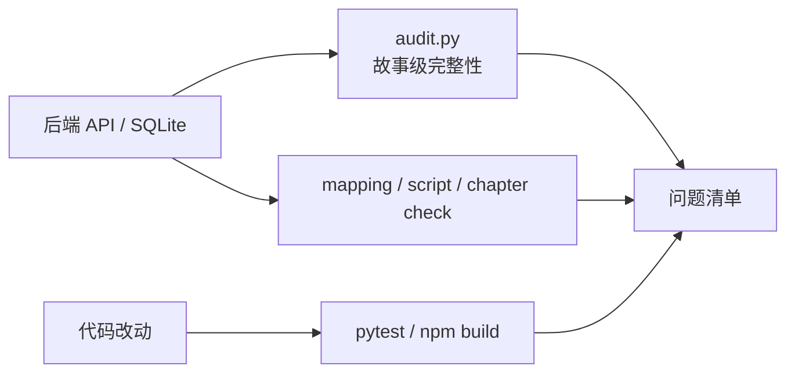

# 完整性审计与交付检查

- 状态：已建立
- 日期：2026-10-24
- 范围：业务不变量审计、测试矩阵、交付前检查

## 1. 核心决策

1. **审计不是可选项**：章节、页码、提示词、角色引用、别名前缀必须有可执行检查。
2. **写入校验与交付审计分离**：
   - 写入口负责阻止新脏数据；
   - 审计脚本负责发现历史数据与跨层不一致。
3. **检查脚本不得为了通过而修改数据**：只报告问题，修复由显式操作完成。
4. **交付前必须跑全量审计**：任一故事不通过，不得声明交付完成。

## 2. 数据流



## 3. 检查矩阵

| 检查 | 覆盖 |
|---|---|
| `backend/tests/` | 后端 API、章节/页面写入、页码校验、别名等 |
| `mapping_check.py` | mapping 拼接覆盖优化文 |
| `script_check.py` | 全局页码、章内页码、来源对照段、旁白字数、提示词页码 |
| `chapter_check.py` | 章节覆盖、18 张上限、封面文字字数 |
| `delivery-check/audit.py` | 跨故事：章节归属、display_page_number、页面来源、提示词页码、封面/引导卡无页码、角色引用、别名前缀、发布图片文件存在性 |
| `npm test` | Vitest：提示词渲染、页码复制、标红定位 |
| `npm run build` | TypeScript 类型与前端构建 |

## 4. 业务不变量来源

- 数据模型与页码：见 `2026-10-24-story-data-model-and-numbering.md` 的 I-01～I-12。
- 提示词渲染：见 `2026-10-24-prompt-contract-and-rendering.md` 的 P-01～P-10。
- 别名与发文：见 `2026-10-24-zhihu-alias-and-post-config.md`。
- 资源与导出：见 `2026-10-24-chapter-publishing-and-assets.md`。

## 5. 交付命令

```bash
cd backend && uv run pytest
cd frontend && npm run build
cd ..
python .claude/skills/story-breakdown/mapping_check.py --story-id <ID>
python .claude/skills/story-breakdown/script_check.py --story-id <ID>
python .claude/skills/story-breakdown/chapter_check.py --story-id <ID>
python .claude/skills/delivery-check/audit.py
```

## 6. Impacted Files

- `.claude/skills/delivery-check/SKILL.md`
- `.claude/skills/delivery-check/audit.py`
- `.claude/skills/story-breakdown/mapping_check.py`
- `.claude/skills/story-breakdown/script_check.py`
- `.claude/skills/story-breakdown/chapter_check.py`
- `backend/tests/`
- `frontend/src/`

## 7. 遗留问题

- 故事封面 / 角色资产图缺失按警告处理，不阻断发布检查；正文图、章节封面/引导卡缺失按错误处理。
- 章节重规划目前采用阻止策略，尚未实现事务内自动重算。
- 前端已有 Vitest 覆盖提示词渲染与页码；ZIP 导出、剪贴板等真实交互仍待 Playwright。

## 8. 变更历史

- **2026-10-24**：建立蓝图；新增 `delivery-check/audit.py`，覆盖故事 3 / 2 / 1 全量通过；`script_check.py` 增加提示词页码校验；后端增加 `display_page_number` 与写回页码校验。
- **2026-10-24（第二批）**：`audit.py` 增加图片文件存在性检查；发布用图缺失为错误，故事封面 / 角色资产缺失为警告；全量审计通过（故事 2 有 1 条已知封面文件警告）。
- **2026-10-24（第三批）**：增加前端 Vitest（`formatPrompt.test.ts`），覆盖章内页码、全局页码残留、文字区重建与标红定位；`delivery-check` 固定执行 `npm test`。
