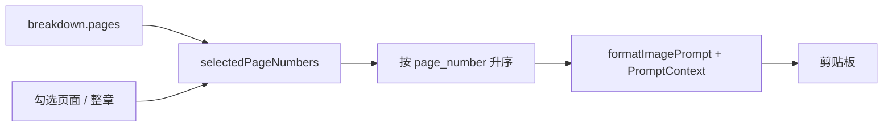

# 多页提示词批量复制

- 状态：已建立
- 日期：2026-10-24
- 范围：分镜头脚本 tab 的多选与批量复制

## 1. 核心设计决策

1. 多选状态只存在于前端当前页面，不写入数据库、不跨会话保存。
2. 批量复制复用单页复制渲染器 `formatImagePrompt(prompt, toPromptContext(page))`，不新增页码、文字区或对话的渲染逻辑。
3. 选中页按全局 `page_number` 升序输出，不按勾选顺序；跨章时每页额外带章节标签。
4. 批量文本头部声明「按顺序生成 N 张、每张单独一张、不合并、不分格」，页块之间用 `---` 分隔。
5. 章节标题栏提供整章全选；工具栏提供全故事全选、清空选择和复制选中。

## 2. 数据流



## 3. 契约

```ts
interface BulkCopyInput {
  pages: StoryboardPage[]                 // 来自 breakdown.pages
  chapters: StoryboardChapterRead[]       // 用于章节标签
}

// 输出结构
// 请按顺序生成以下 N 张条漫图片……
// === 第1张 / 共N张 ===
// [第X章 · 标题 · ]【第Y页】……
// 麻烦帮我生图
// ---
// === 第2张 / 共N张 ===
// ……
```

## 4. 不变量

| 编号 | 不变量 |
|---|---|
| M-01 | 每个页面块与单页「复制提示词」的正文完全一致，只允许额外增加批量序号和章节标签。 |
| M-02 | 输出顺序按全局 `page_number` 升序，不按勾选顺序。 |
| M-03 | 跨章选择时每页必须带章节标签，避免章内页码重复造成歧义。 |
| M-04 | 选中集合只包含当前 `breakdown.pages` 中存在的页面；数据刷新后清理失效页码。 |
| M-05 | 批量复制不得修改任何页面数据、提示词或图片文件。 |

## 5. Impacted Files

- `frontend/src/components/StoryboardTab.tsx`
- `frontend/src/styles.css`
- `.ai/blueprints/INDEX.md`

## 6. 风险与遗留

- 外部生图 AI 对一次多图请求的支持程度不同；用明确序号和分隔线降低歧义。
- 本期只做批量复制，不做批量生成、批量上传或选择状态持久化。

## 7. 变更历史

- **2026-10-24**：建立蓝图。确定多选仅前端、复用单页渲染器、按全局页码排序、跨章带章节标签。
