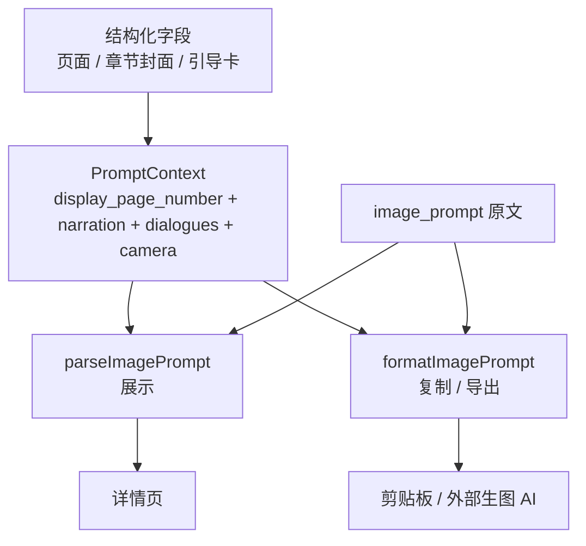

# 提示词契约与渲染

- 状态：已建立
- 日期：2026-10-24
- 范围：正文分镜 `image_prompt`、章节封面提示词、引导卡提示词的生成、展示、复制与校验

## 1. 核心设计决策

1. **结构化字段是源数据，`image_prompt` 是生成物**：
   - 源字段：`narration_main` / `narration_highlight` / `narration_sub` / `dialogues` / `camera_angle` / `characters` / `scene` / `action_state` / `character_review` / `chapter_page_number`；
   - `image_prompt` 中的文字区、对话、机位、页码必须能从这些字段重新渲染。
2. **页码只有一个来源**：

   ```text
   display_page_number = chapter_page_number ?? page_number
   ```

   页面提示词的【页码】、复制首行、展示标签都必须使用它；禁止使用 `mapping_page_number` 或全局 `page_number`。
3. **展示与复制共用同一个 context**：`toPromptContext(page)` 同时供页面展示和复制使用，不允许复制时再传一个独立页码参数。
4. **复制由统一渲染器生成**：`formatImagePrompt(prompt, context)` 只从 `context.pageNumber` 取页码；正文区、对话、机位由 `parseImagePrompt` 统一重建。
5. **封面 / 引导卡不是正文页**：不写 `pages`，不显示页码，不参与正文覆盖检查；提示词分类中不出现【页码】。
6. **文字区模板固定**：
   - 顶部留白 → 主旁白 →（有标红时的绝对禁止）→ 副旁白 → 对话气泡；
   - 标红词必须内嵌在所在句内，禁止单独成行或另做第三块文字区。
7. **引导卡 CTA 规则**：主文案包含「关注我」时，仅「关注我」3 个字红色手写加粗并内嵌在整句中；主文案不含时不标红，副文案中的「关注我」不自动标红。

## 2. 渲染拓扑



边界约束：

- `image_prompt` 只作为渲染输入或缓存，不作为页码、旁白、对话的第二份源数据。
- 展示与复制必须使用同一个 `PromptContext`。
- 封面 / 引导卡不读取 `chapter_page_number`。
- 任何渲染器都不得从 `mapping_page_number` 推导显示页码。
- 生成物与结构化字段冲突时，以结构化字段为准。

## 3. 渲染契约

```ts
interface ImagePromptContext {
  pageNumber: number              // display_page_number
  narration: {
    main: string
    highlight: string
    sub: string
  }
  dialogues: string[]
  cameraAngle: string
}

function parseImagePrompt(prompt: string, context: ImagePromptContext): PromptSection[]
function formatImagePrompt(prompt: string, context: ImagePromptContext): string
```

契约：

- `formatImagePrompt` 首行为 `【第{context.pageNumber}页】`；
- 【页码】分块必须被重写为 `第{context.pageNumber}页`；
- 正文页必须有【画风】【画面】【角色一致性】【画面形式】【文字区】【页码】【负面提示词】；
- 封面 / 引导卡必须有【画风】【画面】【角色一致性】【画面形式】【文字区】【负面提示词】，不得有【页码】；
- 角色外形只能通过 `{{角色名}}` 变量引用，并带垫图优先声明；
- 复制、展示、导出不得各自实现一套页码或文字区逻辑。

## 4. 业务不变量

| 编号 | 不变量 |
|---|---|
| P-01 | 正文页复制首行页码 = 展示页码 = `image_prompt`【页码】= `display_page_number`。 |
| P-02 | 正文页 `image_prompt` 不得出现全局 `page_number` 或 `mapping_page_number` 作为显示页码。 |
| P-03 | 正文页五个文字字段必须与结构化字段一致：主旁白、标红词、副旁白、对话、机位。 |
| P-04 | 标红词必须内嵌在所在旁白句内；找不到时整页按无标红处理，不得编造。 |
| P-05 | 角色只使用角色卡中存在的 `{{角色名}}`；不得在提示词里展开整段外形描述。 |
| P-06 | 封面 / 引导卡不显示页码，不出现对话气泡、水印、logo 或额外文字。 |
| P-07 | 封面顶部小字、主旁白、标红词、副旁白必须逐字使用 `chapters` 中的字段。 |
| P-08 | 引导卡主文案含「关注我」时，仅这 3 字红色加粗并内嵌；其他文字保持黑色。 |
| P-09 | 封面 / 引导卡提示词不使用【页码】分类；正文页必须包含【页码】分类。 |
| P-10 | 展示、复制、ZIP 导出必须使用同一套渲染上下文，不得各自计算。 |

## 5. Impacted Files

- `frontend/src/utils/formatPrompt.ts`
- `frontend/src/utils/storyBreakdown.ts`
- `frontend/src/components/StoryboardTab.tsx`
- `frontend/src/components/StoryboardChaptersTab.tsx`
- `frontend/src/utils/clipboard.ts`
- `.claude/skills/story-breakdown/SKILL.md`
- `.claude/skills/story-breakdown/script_check.py`
- `.claude/skills/story-breakdown/chapter_check.py`
- `backend/app/schemas.py`
- `backend/app/routers/breakdowns.py`
- `backend/app/services/prompts.py`

## 6. 风险与遗留

- 旧 `image_prompt` 可能没有【页码】分块或使用旧格式；渲染器需要兼容，但新写入必须满足 P-09。
- `image_prompt` 是自由文本，仍然可能在未被渲染器覆盖的段落中出现旧页码；写回校验必须检查整个【页码】分块。
- 章节封面 / 引导卡的文字字段与提示词文字重复；修改文字后必须重新生成或重写提示词文字区。
- ZIP 导出当前按章节目录组织；新增导出路径必须复用同一渲染器，不得直接复制原始文件内容。

## 7. 变更历史

- **2026-10-24**：建立蓝图。记录页码复制错误根因（展示用章内页码、复制用全局页码、原始提示词用对照段号）；固化 `formatImagePrompt(prompt, context)` 单页码来源；补充引导卡「关注我」红色加粗规则。
- **2026-10-24（第二批）**：后端新增 `services/prompts.py`，页面写入时校验【页码】分块；`display_page_number` 由后端返回，前端 `pageImageNumber` 优先使用服务端值。
