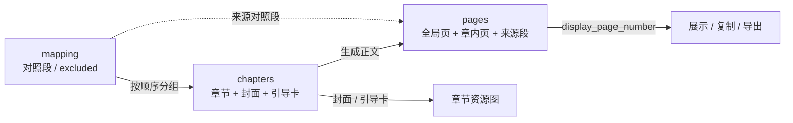

# Story 数据模型与页码契约

- 状态：已建立
- 日期：2026-10-24
- 范围：`Story` / `StoryBreakdown` / `mapping` / `chapters` / `pages` 的关系、三种页码、章节覆盖与页面归属

## 1. 核心设计决策

1. **一个事实一个 owner**：
   - 原文与优化文：`Story.content` / `StoryBreakdown.optimized_content`
   - 原文来源与顺序：`mapping`
   - 章节分组、封面、引导卡：`chapters`
   - 页面脚本、全局页序、章节归属：`pages`
2. **三种页码职责分离**：
   - `mapping.page_number`：对照段号，只用于追溯原文与选段；弃用段可造成空号，**永不显示给读者**。
   - `page.page_number`：全局脚本页码，从 1 连续编号；只用于 API URL、图片文件顺序和跨章排序，**不显示在图片里**。
   - `page.chapter_page_number`：章内页码，从 1 连续编号；图片【页码】、复制提示词、展示标签都以它为准。
3. **显示页码是派生值**：

   ```text
   display_page_number = chapter_page_number ?? page_number
   ```

   有章节时必须使用 `chapter_page_number`；只有未启用章节的旧数据才回退到全局页码。
4. **章节是分组的唯一来源**：`chapters[].mapping_page_numbers` 按顺序覆盖全部未弃用对照段，不重不漏。
5. **页面必须属于章节**：启用章节后，每页必须同时写入 `chapter_number`、`chapter_page_number`、`mapping_page_number`。
6. **封面 / 引导卡不是正文页**：不进入 `pages`，不显示页码，不参与正文覆盖；每章图片总量 = 正文档数 + 2 ≤ 18。
7. **重新规划章节是结构性变更**：已有页面时，必须同事务重算页面章号与页码，或阻止修改并要求先清空页面；不允许留下旧章节字段。

## 2. 数据流拓扑



边界约束：

- `mapping` 只决定原文来源，不决定成片章内页码。
- `chapters` 只决定分组，不保存正文内容。
- `pages` 是正文脚本的唯一来源。
- 封面 / 引导卡只存在于 `chapters`，不得混入 `pages`。
- 所有展示页码从页面关系派生，不读取 `mapping.page_number`。

## 3. 关键类型契约

```ts
interface StoryboardMappingItem {
  page_number: number            // 对照段号，永不显示
  source_text: string
  summary: string
  paragraph: string
  part: string
  excluded: boolean
}

interface StoryboardChapter {
  chapter_number: number         // 1..N 连续
  title: string
  mapping_page_numbers: number[] // 覆盖全部未弃用段，按顺序
  cover: ChapterCover
  guide: ChapterGuide
}

interface StoryboardPage {
  page_number: number            // 全局脚本页码，API / 文件用
  chapter_number: number | null
  chapter_page_number: number | null // 图片显示页码
  mapping_page_number: number | null // 来源对照段
  image_prompt: string           // 生成物，不是源数据
}
```

## 4. 业务不变量

| 编号 | 不变量 |
|---|---|
| I-01 | `chapter.chapter_number` 必须从 1 连续编号。 |
| I-02 | 所有 `excluded=false` 的对照段必须按 mapping 顺序分配到章节，不重不漏。 |
| I-03 | `excluded=true` 的对照段不得分入章节，也不得生成正文页。 |
| I-04 | 每页的 `chapter_page_number` 必须等于来源段在本章 `mapping_page_numbers` 中的位置。 |
| I-05 | 每页的全局 `page_number` = 前面章节正文档数之和 + `chapter_page_number`。 |
| I-06 | 同一对照段最多对应一个脚本页；同一脚本页最多对应一个对照段。 |
| I-07 | 启用章节后，`pages.page_number` 必须从 1 连续、无空号。 |
| I-08 | 每章正文档数 ≤ 16，封面 + 正文 + 引导卡 ≤ 18。 |
| I-09 | 封面 / 引导卡不进入 `pages`，不显示页码。 |
| I-10 | 页面 `image_prompt` 的【页码】必须等于 `display_page_number`，不得写全局页码或对照段号。 |
| I-11 | 章节重规划后，已有页面必须重算或阻止修改；不得保留失效的章号 / 章内页码。 |
| I-12 | 页面引用的角色名必须存在于角色卡；页面引用的画风必须与故事绑定画风一致。 |

## 5. 写入边界

- **PATCH chapters**：校验 I-01、I-02、I-03、I-08；已有页面时额外校验 I-11。
- **PUT page**：校验 I-04、I-05、I-06、I-07、I-10。
- **DELETE pages / 重新规划章节**：不得误删章节封面、引导卡或其他章节页面。
- **AI 写回**：仍必须走上述 API 校验，不能因为来源是 Claude 就跳过。

## 6. Impacted Files

- `backend/app/models.py`
- `backend/app/database.py`
- `backend/app/config.py`
- `backend/app/schemas.py`
- `backend/app/routers/breakdowns.py`
- `backend/app/services/prompts.py`
- `backend/tests/test_breakdowns.py`
- `backend/tests/test_page_images.py`
- `frontend/src/types.ts`
- `frontend/src/utils/storyBreakdown.ts`
- `frontend/src/components/StoryboardMappingTab.tsx`
- `frontend/src/components/StoryboardChaptersTab.tsx`
- `frontend/src/components/StoryboardTab.tsx`
- `.claude/skills/story-breakdown/SKILL.md`
- `.claude/skills/story-breakdown/script_check.py`
- `.claude/skills/story-breakdown/chapter_check.py`
- `.claude/skills/story-breakdown/mapping_check.py`

## 7. 风险与遗留

- 旧数据可能缺少 `chapter_number` / `chapter_page_number`，展示层必须回退到全局页码；新数据不得继续产生缺失字段。
- 章节重规划目前可能使已有页面字段失效，后续应改为事务内重算或强制清空。
- `image_prompt` 是自由文本，页码仍可能被 AI 写错；必须依赖渲染器与写回校验，不能只靠生成指令。

## 8. 变更历史

- **2026-10-24**：建立蓝图。固化三种页码职责；记录故事 3 的 11 页历史页码修复（全局第 7–17 页的提示词页码改为章内页码）；确认 `script_check.py` 增加 image_prompt 页码校验。
- **2026-10-24（第二批）**：后端 `StoryboardPageRead` 增加服务端计算的 `display_page_number`；前端展示与复制优先使用该字段；页面 PUT 增加 `PROMPT_PAGE_MISMATCH` 校验（有【页码】分块时必须等于章内页码，旧数据缺少分块时保持兼容）。
