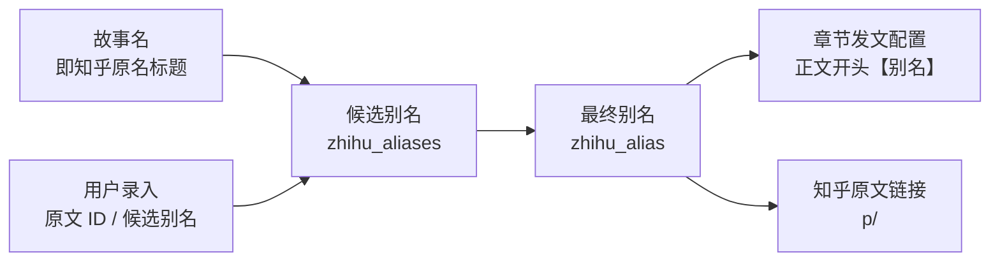

# 知乎别名与发文配置契约

- 状态：已建立
- 日期：2026-10-24
- 范围：故事名即知乎原名标题、原文 ID、候选别名、最终别名、按章发文配置、正文前缀同步

## 1. 核心设计决策

1. **别名约束**：
   - 6–8 个汉字；
   - 不含字母、数字、标点、空格；
   - 不得复用知乎原名标题中的连续两个字。
2. **知乎原名标题即故事名**：
   - `Story.name` 是唯一来源，不单独存储知乎标题；
   - `StoryRead.zhihu_title` 由 `name` 派生，只用于兼容读取；
   - 知乎推广写接口不接收标题，改标题只能改故事名。
3. **候选与最终分离**：
   - `zhihu_aliases`：候选别名，最多 20 个；
   - `zhihu_alias`：最终使用并写进正文的那一个，唯一来源；
   - 最终别名必须存在于候选列表；保存时如缺失会自动补入。
4. **本地唯一**：最终别名不能与其他故事重复。
5. **正文前缀唯一来源**：
   - 有最终别名时，发文正文开头必须是 `【最终别名】`；
   - 别名变化时，所有已保存的章节文案与旧版文案同步替换开头；
   - 清除别名时移除旧前缀。
6. **发文配置按章节**：`story_chapter_post_configs` 以 `(story_id, chapter_number)` 唯一；一章一份标题与正文。
7. **原文链接**：知乎原文 ID 只接受数字，前端按 `https://zhuanlan.zhihu.com/p/<ID>` 生成链接。

## 2. 数据流拓扑

边界约束：

- 候选别名不是正文来源，只有 `zhihu_alias` 会写进正文。
- 别名变化必须级联到所有已保存文案，不能只改故事字段。
- 发文配置只属于一个章节，不能跨章复用。
- 别名建议由 AI 生成，但最终是否可用由用户在知乎确认。
- 原文 ID 不是别名，不参与正文前缀。
- 知乎原名标题没有独立写入入口，只能通过故事名修改。

## 3. 业务不变量

| 编号 | 不变量 |
|---|---|
| Z-01 | `zhihu_alias` 非空时必须存在于 `zhihu_aliases`。 |
| Z-02 | 所有别名必须是 6–8 个汉字，且不能复用故事名（知乎原名标题）的连续两个字。 |
| Z-03 | 最终别名在本地全部故事中唯一。 |
| Z-04 | 有最终别名时，每章已保存正文必须以 `【最终别名】` 开头。 |
| Z-05 | 最终别名变化时，旧前缀被替换，不允许残留两个别名。 |
| Z-06 | 清除最终别名时，正文开头的旧别名前缀被移除。 |
| Z-07 | 章节发文配置必须绑定存在的章节号；一章只有一份。 |
| Z-08 | AI 生成的候选别名必须在写回前经过格式、标题复用、重复与本地唯一性过滤。 |
| Z-09 | 知乎原名标题必须等于 `Story.name`；不存在独立可编辑的标题字段，故事名为空时不得设置别名。 |

## 4. 写入边界

- `PATCH /api/stories/{id}/zhihu`：只接收原文 ID 与别名，标题取故事名；校验 Z-01～Z-03，保存后级联 Z-04～Z-06。
- `POST /api/stories/{id}/zhihu/alias-suggestions`：以故事名为标题生成候选，并按 Z-02/Z-08 过滤；不自动标注最终别名。
- `PUT /api/stories/{id}/post-config?chapter=N`：校验章节存在，保存前套用最终别名前缀。
- 删除故事：同时删除章节发文配置与旧版发文配置。

## 5. Impacted Files

- `backend/app/models.py`
- `backend/app/schemas.py`
- `backend/app/config.py`
- `backend/app/database.py`
- `backend/app/services/zhihu.py`
- `backend/app/routers/stories.py`
- `backend/app/routers/post_configs.py`
- `backend/app/routers/posts.py`
- `backend/tests/test_zhihu.py`
- `backend/tests/test_post_configs.py`
- `frontend/src/api/client.ts`
- `frontend/src/components/ZhihuInfoCard.tsx`
- `frontend/src/components/PostConfigTab.tsx`
- `frontend/src/pages/StoryDetailPage.tsx`
- `frontend/src/pages/StoriesPage.tsx`
- `frontend/src/types.ts`

## 6. 风险与遗留

- 旧候选别名可能不符合 6–8 字规则；UI 目前提示并提供「移除不合规候选」，不会静默删除。
- 别名前缀同步依赖 `apply_alias_prefix`；新增写文案路径时必须复用，不得自行拼接。
- 候选别名的本地唯一性目前只校验最终别名；多个故事使用同一候选别名是允许的，因为最终只注册一个。

## 7. 变更历史

- **2026-10-24**：建立蓝图。固化 6–8 字别名、候选 / 最终分离、正文前缀同步与按章发文配置。
- **2026-10-27**：知乎原名标题改为直接使用故事名。移除 `stories.zhihu_title` 字段与知乎写接口的标题参数；`StoryRead.zhihu_title` 由 `name` 派生；别名复用校验和 AI 候选生成均改用故事名。
