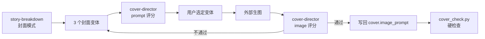

# 封面点击质量门

- 状态：实施中
- 日期：2026-10-27
- 范围：章节封面点击钩子、3 个变体、`cover-director` 审片、`cover_check.py` 硬检查、页面复制指令

## 1. 背景与目标

小红书对故事 4 第 1 章封面的反馈：双人构图和红黑标题成立，但整体色调偏淡雅、人物表情克制、缺少视觉冲击和悬念，快速滑动时缺乏“非点不可”的冲动。

现有问题：

- 封面沿用了正文的「低饱和暖色调、柔和暖光」画风，没有封面模式
- 提示词明确写了「神情沉静而坚定」「安静而紧绷」「氛围紧张而克制」
- 副标题是前情说明，不是悬念钩子
- 双人中远景，脸和关键道具不够大
- 没有独立的封面点击率审片

目标：每章封面默认生成 3 个不同钩子的变体，经独立 agent 评分和脚本硬检查后才允许定稿。

## 2. 核心设计决策

1. **封面第一目标是点击，不是画风纯净**：封面必须让读者在 3 秒内停下来并点进来；画风一致性、背景干净、无全图黑描边都是服务目标，不得反过来压制冲击线。技术上“合规”但不吸引人的封面视为不合格。
2. **每章 3 个变体**：道具特写、真相揭示、面对面强化；每个变体必须有不同视觉钩子。
3. **副标题写悬念，不写前情**：副标题必须给出代价、反差或信息差；不得只交代设定。
4. **独立审片**：新增只读 `cover-director`，分 `prompt` / `image` 两种模式；不写回。
5. **硬检查单列**：`cover_check.py` 检查标题/副标题字数、标红内嵌、无页码、提示词分块与关键钩子词；语义评分交给 agent。
6. **封面只有一条路径：原画风 + 封面专用冲击层**：
   - 原句保留：背景保留可识别环境的淡线提示、不得压成纯黑；人物周围加入漫画黑色震动短线、放射状集中冲击线、锯齿情绪漫符；夸张表情、动态张力、手绘涂鸦感；冲击线和关键轮廓用较粗的黑色手绘线，人物面部与皮肤仍保持淡色铅笔的柔和质感，不做全图粗黑描边；
   - 冲击层最低力度：至少 3 条粗黑集中的手绘射线、线条有手绘抖动感；至少 2 处尺寸可辨的锯齿情绪漫符；射线与漫符避开眼睛、脸、文字区和关键道具轮廓；
   - 背景标准见 `2026-11-06-background-and-impact-style.md`：浅米纸底、只保留 1–3 个淡线元素、逐项排除、不压暗；
   - **不整体提高对比度/饱和度，不压暗背景**；需要局部强调时用冲击层，不用全局滤镜；
   - 【画风】以 `art_style_content` 原文开头；画风可以写“避免全图硬边黑描边”，但不得用“避免硬边黑轮廓”压制冲击线与关键轮廓。
7. **通过线**：3 秒抓眼、情绪强度、悬念三项均 ≥4，总分 ≥26/35；任一维度 <3 不通过。
8. **人做最终选择**：agent 只给评分与建议，最终封面由用户从 3 个变体中选定。
9. **冲击层不是封面专属**：正文峰值页也可用，但必须按评分卡判定；引导卡禁止使用。
10. **冲击线必须有 choreography**：每个封面变体在 `content` 里写清线条起点（关键道具/动作/视线）、方向、密度（少量/只围绕谁/不铺满）和保护区（脸、眼睛、文字、关键道具轮廓）；禁止只写“局部加入冲击线”。
11. **材质分工是硬约束**：冲击线与关键轮廓用较粗黑色手绘线；人物面部与皮肤保持淡色铅笔柔和质感；不做全图粗黑描边。
12. **背景规则不得误伤前景冲击线**：故事 5 的“简化背景”反馈只约束背景装饰、背景纹理和背景光效；人物/道具周围的冲击线属于封面语言，不计入背景杂乱。

## 3. 数据流

边界约束：

- 3 个变体在用户选定前不写回 `chapters[].cover.image_prompt`。
- agent 只读，不写数据库、不改项目文件。
- 封面评分只看点击钩子与画风一致性，不替代正文审片。
- 硬检查通过不代表封面合格；必须同时通过 agent 评分。
- 封面文字改动仍需用户确认。

## 4. 封面规则

### 4.1 文字

| 字段 | 规则 |
|---|---|
| `label` | 第X章 · 章节标题 |
| `narration_main` | ≤12 个汉字，强钩子；字多时先缩短文案，不压缩字号；不写剧情摘要 |
| `narration_highlight` | 从主旁白中选连续片段 |
| `narration_sub` | <35 个汉字；写代价/反差/信息差，不写前情说明 |

副标题合格例：

- 「上一世，我放走了他们。」
- 「上一世我放走了他们，爷爷死在了那天。」

副标题不合格例：

- 「在车站做安检三年，重生回到拦下五个学生的这一天。」（前情说明）
- 「重生后我决定改变命运。」（空泛）

### 4.2 画面

每个变体必须包含：

- **1 个关键道具**：警报按钮、X 光屏幕、车票、离婚协议、治疗单等，放在前景或视觉中心
- **1 个强表情**：眼神锋利、含泪、挑衅、惊恐、下颌绷紧；禁止沉静、克制、平静、微笑
- **冲突光线**：只用局部红光/冷光/边缘光做情绪锚点；不整体提高对比度、不压暗背景
- **冲击线 choreography**：写明起点（关键道具/动作/视线）、方向、密度（少量/只围绕谁/不铺满）和保护区（脸、眼睛、文字、关键道具轮廓）；线从动作长出来，不随机贴边
- **材质分工**：冲击线与关键轮廓用较粗黑色手绘线；人物面部与皮肤保持淡色铅笔柔和质感；不做全图粗黑描边
- **近景/前景层次**：关键道具前景，脸中景，背景只做信息
- **背景**：浅米色素描纸底，与顶部文字带同色；只保留 1–3 个点明地点与动作的关键环境元素，用浅棕褐色淡铅笔线轮廓勾出；其余元素逐项排除；不压暗、不发黑、无暗部；人物/道具周围的冲击线不算背景装饰；背景不得纯黑（详见 `2026-11-06-background-and-impact-style.md`）
- **文字区**：主标题 ≤12 字、大号红黑、单行尽量占上部安全区 60%–75% 宽度；主副标题至少留半个字高、不堆叠；主标题不被人物/道具/背景线遮挡；副标题一行小字、字号不超过主标题 45%；标红内嵌，不显示页码

### 4.3 3 个变体

| 变体 | 钩子 |
|---|---|
| A 道具特写 | 关键道具占前景 1/3，人物表情在中景 |
| B 真相揭示 | X 光/屏幕/文件揭示关键信息，人物反应在旁 |
| C 面对面强化 | 低机位近距离双人，表情张力最大化，道具在两者之间 |

### 4.4 冲击层判定

冲击层元素：漫画黑色震动短线、放射集中冲击线、锯齿情绪漫符、夸张表情、动态张力、手绘涂鸦、粗线强调。

只允许作为局部强调，不做全图粗黑描边、不 Q 版、不遮文字和脸。

封面额外要求：冲击线必须有明确起点（关键道具/动作/视线）和方向；只围绕主体与关键道具；人物面部与皮肤保持淡色铅笔柔和质感；不遮脸、眼睛、文字、关键道具轮廓；不随机贴边、不铺满全图、不变成脏线或贴图。

**最低力度（硬门槛）**：至少 3 条粗黑集中的手绘射线，线条有手绘抖动感，不是细线、不是均匀速度线；至少 2 处尺寸清晰可辨的锯齿情绪漫符，不是小点；射线与漫符避开眼睛、脸、文字区与关键道具轮廓。

| 条件 | 建议 |
|---|---|
| `page_role` = 爆点 / 情绪高潮 / 反转 | 优先强冲击 |
| 单一视觉焦点 | 适合 |
| 强情绪、强动作、关键道具揭示 | 适合 |
| 3 人以上、场景复杂、信息页 | 不适合 |
| `page_role` = 铺垫 / 收尾 / 日常过渡 | 不用 |
| 回忆页 | 最多轻冲击，优先不用 |
| 相邻页已用 | 不再用 |
| 本章已用 2 页 | 不再用 |
| 封面 | 默认允许，可选 |
| 引导卡 | 禁止 |

评分卡：

| 加分项 | 分值 |
|---|---:|
| `page_role` 是爆点 / 情绪高潮 / 反转 | +2 |
| 单一视觉焦点 | +1 |
| 强情绪或强动作 | +1 |
| 关键道具 | +1 |
| 3 人以上或场景复杂 | -1 |
| 回忆页 | -1 |
| 相邻页已用 | -2 |
| 本章已用 2 页 | -2 |

- ≥3 分：强冲击
- 1–2 分：轻冲击
- ≤0 分：不用

正文使用冲击层时，在 `image_prompt` 增加 `【冲击层】` 分块；不用时不写。引导卡禁止出现冲击层。

## 5. Agent 契约

`cover-director`：

| 模式 | 输入 | 输出 |
|---|---|---|
| `prompt` | 章节封面文字、3 个变体提示词、画风 | 每个变体 7 维评分、推荐变体、具体改写建议 |
| `image` | 成品封面图、封面文字、提示词、画风 | 7 维评分、问题清单、是否通过、重做建议 |

评分卡：

| 维度 | 1–5 |
|---|---|
| 3 秒抓眼 | 快速滑动时是否停下 |
| 情绪强度 | 表情、动作、张力 |
| 悬念/信息差 | 是否想知道后续 |
| 色彩对比 | 红/黑/冷白是否形成冲击 |
| 关键道具 | 是否有明确视觉焦点 |
| 文字可读性 | 标题、副标题、标红是否清楚 |
| 画风一致性 | 是否仍是这个故事 |

通过线：3 秒抓眼、情绪强度、悬念均 ≥4，总分 ≥26/35，任一维度 <3 不通过。

额外硬门槛：**冲击层贴合度 1–5 分，<3 不通过**。判断线是否从关键道具/动作/视线出发、方向是否服务构图、密度是否局部、脸和皮肤是否保持柔和、是否遮脸/眼睛/文字。

## 6. 脚本契约

`cover_check.py --story-id <ID> --chapter <N>`：

硬规则：

- `cover.image_prompt` 非空
- 不出现 `【页码】` 或「第X页」
- 包含【画风】【画面】【角色一致性】【画面形式】【文字区】【负面提示词】分块
- `narration_main` ≤12、`narration_sub` <35
- 标红词在主/副旁白中

警告：

- 副标题疑似前情说明（包含「重生回到」「三个月前」「在车站做」等）
- 提示词缺少关键钩子词（特写/前景/高对比/压暗/红光/冷光/眼神/表情/道具/按钮/屏幕）
- 缺少「封面模式」或「封面加成」字样
- 有冲击标记但缺少「冲击线起点/方向/密度/保护区」说明
- 缺少冲击层最低力度（至少 3 条粗黑射线 / 手绘抖动 / 至少 2 处锯齿漫符）
- 正句出现「细线」「淡线」「均匀速度线」且未带否定
- 背景描述缺少「浅米色 / 素描纸」或出现「氛围人群」
- 负面提示词缺少冲击线失败模式（铺满全图/糊成脏线/像贴图/涂鸦遮脸或文字/线条穿过眼睛）
- 同时出现「避免硬边黑轮廓」和「较粗的黑色手绘线/冲击线」

退出码：0 = 通过（可带警告）；1 = 硬规则失败。

## 7. 页面指令

「复制封面生成指令」改为：

1. 读取章节封面文字与画风
2. 生成 3 个变体（A 道具特写 / B 真相揭示 / C 面对面强化）
3. 调用 `cover-director` prompt 模式评分
4. 输出变体表，等用户选定
5. 只把选中的 `image_prompt` 写回 `chapters[N-1].cover.image_prompt`
6. 运行 `cover_check.py`
7. 外部生图后，可再用 `cover-director` image 模式审成品图

## 8. 业务不变量

| 编号 | 不变量 |
|---|---|
| CV-01 | 封面提示词不得出现页码。 |
| CV-02 | 每章封面必须提供 3 个不同钩子的变体。 |
| CV-03 | 副标题必须是悬念/代价，不得只是前情说明。 |
| CV-04 | 所有封面统一走「原画风 + 封面专用冲击层」；不得整体提高对比度/饱和度、压暗背景。 |
| CV-08 | 封面【画风】必须以 `art_style_content` 原文开头，逐字一致；不得摘要、缩写或改写。 |
| CV-09 | 封面提示词必须包含一个明确的封面模式分块；构图变体 A/B/C 与封面模式是两件事，不得混用字母。 |
| CV-05 | 3 秒抓眼、情绪强度、悬念任一 <4 不通过。 |
| CV-06 | agent 只读，不写回；用户选定后才写 `image_prompt`。 |
| CV-07 | 封面文字改动需要用户确认，不自动改 `narration_sub`。 |
| CV-10 | 封面第一目标是点击/3 秒抓眼；画风与背景约束不得压制冲击线；技术合规但不吸引人的封面不合格。 |
| CV-11 | 封面冲击线必须写明起点/方向/密度/保护区；脸和皮肤保持柔和，只有冲击线与关键轮廓用较粗黑色手绘线。 |
| CV-12 | 封面提示词不得同时出现「避免硬边黑轮廓」与「粗黑冲击线」；画风统一写「避免全图硬边黑描边」。 |
| CV-13 | 封面冲击层必须达到最低力度：至少 3 条粗黑集中手绘射线（有抖动感，不是细线/均匀速度线）、至少 2 处尺寸可辨的锯齿情绪漫符。 |
| CV-14 | 封面背景只保留 1–3 个淡线环境元素，逐项排除多余元素；不得出现「氛围人群」，不得压暗或纯黑。 |

## 9. Impacted Files

- `.ai/blueprints/INDEX.md`
- `.claude/agents/cover-director.md`（新增）
- `.claude/agents/storyboard-director.md`
- `.claude/skills/story-breakdown/SKILL.md`
- `.claude/skills/story-breakdown/cover_check.py`（新增）
- `.claude/skills/story-breakdown/script_check.py`
- `frontend/src/utils/storyBreakdown.ts`
- `frontend/src/utils/storyBreakdown.test.ts`
- `backend/app/config.py`
- `backend/app/services/prompt_templates.py`
- `backend/tests/test_prompt_templates.py`
- `README.md`

## 10. MVP 与后续

### P0

- 封面规则写入 SKILL。
- `cover-director` prompt / image 两种模式。
- `cover_check.py` 硬检查。
- 页面封面指令改为 3 个变体 + 自动 prompt 审片。
- 故事 4 第 1 章试点。

### P1

- 成品图 image 模式接入页面「封面审片」按钮。
- 3 个变体的选择结果持久化，便于复盘。
- 封面 A/B 点击数据回填，校准评分卡。

## 11. 风险与待确认

- 3 个变体会增加生图成本；只对封面，不扩到正文页。
- 封面模式提高对比度，可能与正文低饱和画风有差异；必须保留同一画风和角色。
- agent 视觉评分存在主观性；通过线用于拦截明显不合格，不替代用户审美。
- 副标题改动涉及封面文字，第一版只给建议，不自动改。
- 故事 4 第 1 章当前副标题是前情说明，试点时需要用户确认改为悬念句。

## 12. 变更历史

- **2026-10-27**：建立蓝图。根据小红书封面反馈，确定 3 变体、封面模式、`cover-director` 评分卡与 `cover_check.py`；先以故事 4 第 1 章试点。
- **2026-10-28**：冲击层不再限定封面。新增正文冲击层评分卡：只允许爆点 / 情绪高潮 / 反转等峰值页使用，单章最多 2 页、不得相邻、回忆页优先不用、引导卡禁止；`script_check.py` 增加页型/相邻/频率检查；`storyboard-director` 增加冲击建议列；封面允许「原画风 + 冲击层」路径。
- **2026-10-31**：用户确认故事 4 的封面方向才是期望。封面规则简化为**唯一路径**「原画风 + 封面专用冲击层」，删除高对比/压暗背景的封面选项；新增 CV-08/09，要求【画风】逐字使用 `art_style_content`、封面模式必须显式声明。故事 5 现有高对比封面保留为历史，不自动改写。
- **2026-11-01（小红书点击反馈）**：根据单篇笔记的点击分析，主标题上限从 <15 收紧为 ≤12 字；新增标题层级（单行占上部 60%–75% 宽度、主副标题不堆叠、副标题 ≤主标题 45%）和背景焦点要求（1 个主场景焦点 + 必要氛围人群，不出现抢主体的装饰线/光效，不得纯黑）。先在故事 5 第 1 章试跑，效果确认后通过全局规则推广，不写模板。
- **2026-11-04（故事 4 封面路径回归）**：用户反馈故事 4 首版冲击线最贴合、流量最高，后续封面冲击线变丑、不贴合。根因：故事 4 的“封面加成”原句被压缩成通用“局部加入冲击线”，丢了材质分工（粗黑线只给冲击线/关键轮廓，脸和皮肤保持柔和）、空间锚点（线从道具/动作/视线出发）、密度控制和冲击线专属负面词；同时画风原文“避免硬边黑轮廓”与封面“粗黑冲击线”直接冲突，故事 5 的背景简化规则被泛化成“人物周围保持干净”。恢复故事 4 原句为唯一封面路径，新增线条 choreography、材质分工、背景规则豁免和 CV-10/11/12；封面第一目标明确为点击/3 秒抓眼。
- **2026-11-06（术语纠偏）**：用户指出封面模式字段出现内部试点名「故事 4」。契约与默认 `cover_mode` 统一改为「原画风 + 封面专用冲击层」；`故事 4` 只保留在变更历史作为试点来源，不再进入任何生成提示词、技能指令或审片文案。
- **2026-11-06（冲击力度与纸底背景）**：用户实测故事 9 第 1 章后确认：浅米纸底 + 1–3 个淡线元素成立，但冲击线偏细、锯齿漫符偏小。封面模式增加最低力度（至少 3 条粗黑手绘射线 + 抖动感、至少 2 处可辨锯齿漫符）；背景从「1 个焦点 + 必要氛围人群」改为「1–3 个淡线元素 + 逐项排除」，规则扩到正文。新增 CV-13 / CV-14；详见 `2026-11-06-background-and-impact-style.md`。
