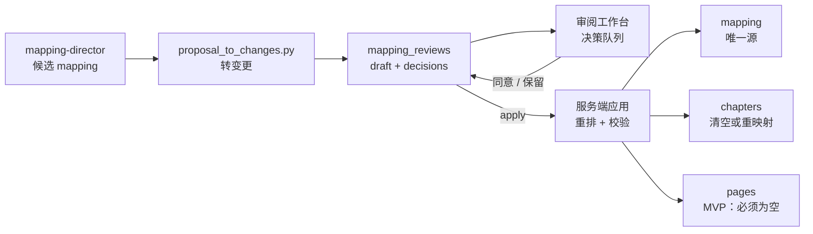

# 分镜对照审阅工作台

- 状态：实施中（P0 已完成）
- 日期：2026-10-27
- 范围：mapping 提案草稿、人工决策、服务端应用、页码重排、章节 / 页面安全闸门

## 1. 背景与目标

当前 mapping 由 Claude Code 拆完后直接写回，页面只读。拆分是否过载、是否过碎，只能靠聊天里看，无法逐项确认。

故事 5 的对照实验：现有 55 段，其中 22 段超过 60 个汉字、7 段超过 2 组台词；独立 agent 按视觉单元标准拆成 86 段，过载明显减少，但出现了需要人工判断的边界（5 段 `visual_load=3`、2 段仍偏长）。

目标：把「agent 提案」变成「可审阅、可决策、可安全落库」的闭环；只让人决定真正有分歧的项，低风险项自动通过但仍可见。

## 2. 核心设计决策

1. **提案不是源数据**：草稿存在 `mapping_reviews`，`mapping` 仍是唯一源；应用前不写入 `mapping`。
2. **只让人决定有分歧的项**：每个变更带风险等级；`high` / `medium` 进入决策队列，`low` 自动通过但折叠可见、可改判。
3. **决策对象是变更，不是页**：拆分 / 合并 / 保留以 change 为单位；只改分段边界，不改写原文。
4. **后端应用，前端不拼 mapping**：前端只展示提案、保存决策；重排页码、覆盖校验、章节处理全部由后端完成。
5. **提案绑定基线**：草稿创建时由服务端记录当前 mapping 的哈希；mapping 已变化时拒绝应用，避免旧提案覆盖新数据。
6. **MVP 安全闸门**：已有分镜页时禁止应用；已有章节时必须显式确认清空章节。清空章节时同时删除该故事的章节发文配置，章节封面 / 引导卡图片移入 `uploads/chapters-archive/` 备份，不在 MVP 做自动重映射。
7. **应用是 all-or-nothing**：任一步校验失败整体回滚，不允许留下半套 mapping / chapters。
8. **自动通过不等于不可见**：低风险项默认通过，但在摘要中列出，用户可展开改判。

## 3. 数据流拓扑



边界约束：

- 提案只读，不直接修改 `mapping`。
- 应用前必须通过逐字覆盖校验（含标点与换行）。
- 已有 `pages` 时拒绝应用（MVP）。
- 变更不得跨越 `excluded=true` 的对照段。
- 应用失败整体回滚。

## 4. 数据模型

### 4.1 `mapping_reviews`

| 字段 | 类型 | 说明 |
|---|---|---|
| `id` | int | 主键 |
| `story_id` | int | 外键，一个故事只保留一条当前草稿 |
| `status` | enum | `draft` / `applied` / `discarded` |
| `base_mapping_hash` | string | 创建草稿时的 mapping SHA-256，由服务端写入，不接受客户端传入 |
| `proposal` | JSON | `MappingReviewChange[]` |
| `decisions` | JSON | `{change_id: approved / rejected / undecided}` |
| `created_at` | datetime | |
| `updated_at` | datetime | |
| `applied_at` | datetime | 可空 |

约束：`story_id` 唯一；随故事删除级联清理。

### 4.2 `MappingReviewChange`

| 字段 | 类型 | 说明 |
|---|---|---|
| `id` | string | 变更唯一 ID |
| `kind` | `split` / `merge` / `keep` | 操作类型 |
| `risk` | `high` / `medium` / `low` | 服务端取 agent 风险与确定性风险的上限 |
| `old_page_numbers` | int[] | 影响的原对照段，必须连续且不重叠 |
| `proposed_segments` | `ProposedSegment[]` | 拆 / 并后的新段；`keep` 时为空 |
| `reason` | string | 为什么建议这样拆 / 并 |
| `page_delta` | int | 服务端计算，不信任客户端 |
| `crosses_chapter` | bool | 服务端计算，用于影响提示 |

### 4.3 `ProposedSegment`

| 字段 | 类型 | 说明 |
|---|---|---|
| `source_text` | string | 必须是 `optimized_content` 的连续原文子串 |
| `summary` | string | 完整句：谁 + 在哪 + 做了什么 + 结果 / 情绪 |
| `paragraph` | string | 可空；应用时写入 mapping |
| `part` | string | 可空；应用时写入 mapping |
| `beat_type` | string | 仅审阅用，不写入 mapping |
| `time_place` | string | 仅审阅用，不写入 mapping |
| `characters` | string[] | 仅审阅用 |
| `visual_load` | 1 / 2 / 3 | 仅审阅用 |

### 4.4 决策状态

| 状态 | 含义 |
|---|---|
| `approved` | 应用该变更 |
| `rejected` | 保留原样 |
| `undecided` | 暂未决定；应用时按保留处理 |

低风险变更创建时默认 `approved`；中 / 高风险默认 `undecided`。

初始风险校准（实现时可调）：

| 条件 | 最低风险 |
|---|---|
| agent 标记 `high` | high |
| 单段引号台词或【】消息 > 2 条 | high |
| 单段汉字数 > 60 | medium |
| 单段句末标点 > 5 个 | medium |
| 单段汉字数 > 90 | high |
| 出现多个时间 / 地点转换词 | high |

## 5. API 契约

| 方法 / 路径 | 作用 | 关键校验 |
|---|---|---|
| `PUT /api/stories/{id}/breakdown/mapping-review` | 创建 / 替换草稿 | 变更引用的原段存在、连续、不重叠；新段拼接等于原段原文；不跨 excluded |
| `GET /api/stories/{id}/breakdown/mapping-review` | 读取草稿 + 决策 + 影响摘要 | 无草稿返回 404 |
| `PATCH /api/stories/{id}/breakdown/mapping-review` | 保存决策 | change_id 必须存在；状态只能是三种之一 |
| `POST /api/stories/{id}/breakdown/mapping-review/apply` | 应用已同意项 | 基线哈希、pages 为空、章节闸门、逐字覆盖 |
| `DELETE /api/stories/{id}/breakdown/mapping-review` | 丢弃草稿 | 幂等 |

应用请求体只包含 `clear_chapters: bool`；决策以 PATCH 保存的为准。

错误码：

| 错误码 | HTTP | 触发条件 |
|---|---|---|
| `MAPPING_REVIEW_NOT_FOUND` | 404 | 没有草稿 |
| `MAPPING_REVIEW_INVALID_CHANGE` | 422 | 原段不存在、不连续、重叠、跨 excluded |
| `MAPPING_REVIEW_COVERAGE_INVALID` | 422 | 新段拼接不等于原文，或整体无法逐字覆盖 |
| `MAPPING_REVIEW_STALE` | 409 | 当前 mapping 与草稿基线不一致 |
| `MAPPING_REVIEW_PAGES_EXIST` | 409 | 已有分镜页 |
| `MAPPING_REVIEW_CHAPTERS_LOCKED` | 409 | 已有章节且未确认清空 |
| `MAPPING_REVIEW_NO_APPROVED_CHANGES` | 422 | 没有已同意的变更 |

## 6. 应用语义

1. 读取草稿，校验 `status=draft` 与基线哈希。
2. 校验 `pages` 为空；否则返回 `MAPPING_REVIEW_PAGES_EXIST`。
3. 收集 `approved` 变更；`rejected` / `undecided` 保留原段。
4. 按原 mapping 顺序替换已同意的区间，重排 `page_number` 为 1..N。
5. 校验拼接后的 `source_text` 与 `optimized_content` **归一化后一致**（忽略标点与空白）；严格逐字一致作为 `strict_coverage` 结果返回，不阻断。
6. 章节处理：
   - `chapters=[]`：直接应用；
   - 有章节且 `clear_chapters=true`：清空章节后应用；
   - 有章节且未确认：返回 `MAPPING_REVIEW_CHAPTERS_LOCKED`。
7. 单事务写入 `mapping`（及章节清空），标记草稿 `applied`，返回新的 breakdown。

MVP 不做章节自动重映射；86 页提案通常需要重新规划章节，清空后由用户重新规划是更安全的路径。

## 7. 前端交互

### 7.1 入口

`StoryboardMappingTab` 顶部在存在草稿时显示：

```text
有 5 处需要你决定 · 81 段自动通过
[开始审阅]
```

没有草稿时保持现状，只显示只读对照表。

### 7.2 审阅工作台

- 顶部摘要：总变更数、待决策数、自动通过数、预计总页数、章节影响。
- 决策队列：只列 `high` / `medium`，按风险与原文顺序排序。
- 每张决策卡：现状原文、建议拆 / 并结果、理由、页数变化、`[同意] [保留] [稍后]`。
- 自动通过区：默认折叠，显示「81 段低风险变更已自动通过，查看」。
- 底部应用栏：`[应用已同意的 N 项]`，并显示「当前 4 章将被清空，需要重新规划」。
- 应用前二次确认；应用后刷新 breakdown，显示覆盖校验结果。
- 未决项按保留处理，应用按钮文案明确「未决 N 项将保留原样」。

### 7.3 后续交互

- P1：手动调整拆分点（只拖边界，不改原文）。
- P1：键盘决策（同意 / 保留 / 下一项）。
- P1：单项影响预览（该变更让总页数从 55 变到多少）。

## 8. 业务不变量

| 编号 | 不变量 |
|---|---|
| MR-01 | 提案不得修改 `optimized_content`，`source_text` 必须是原文连续子串。 |
| MR-02 | 单个变更的新段拼接必须与旧段原文逐字一致。 |
| MR-03 | 应用后整体 mapping 拼接必须与 `optimized_content` 归一化后一致；严格逐字一致作为 `strict_coverage` 返回，不阻断。 |
| MR-04 | 应用是 all-or-nothing，失败不得留下部分写入。 |
| MR-05 | 已有 `pages` 时禁止应用。 |
| MR-06 | 变更不得跨越 `excluded=true` 的对照段。 |
| MR-07 | 草稿基线哈希与当前 mapping 不一致时禁止应用。 |
| MR-08 | 前端不得自行计算新 mapping 或页码；只展示服务端结果和提交决策。 |
| MR-09 | 风险等级取 agent 风险与确定性风险（字数、气泡数等）的上限；低风险自动通过但必须可见、可改判。 |
| MR-10 | 有章节时，应用必须显式确认清空；不得留下引用旧页码的章节。 |
| MR-11 | 未知 change_id、非法决策状态必须拒绝，不得静默忽略。 |

## 9. Impacted Files

- `.ai/blueprints/INDEX.md`
- `backend/app/models.py`
- `backend/app/schemas.py`
- `backend/app/routers/breakdowns.py`
- `backend/app/services/mapping_reviews.py`（新增）
- `backend/app/services/files.py`
- `backend/tests/test_mapping_reviews.py`（新增）
- `backend/tests/test_migrations.py`（新表创建）
- `frontend/src/types.ts`
- `frontend/src/api/client.ts`
- `frontend/src/components/StoryboardMappingTab.tsx`
- `frontend/src/components/MappingReviewPanel.tsx`（新增）
- `frontend/src/pages/StoryDetailPage.tsx`
- `frontend/src/styles.css`
- `README.md`
- `.claude/skills/story-breakdown/SKILL.md`
- `.claude/skills/story-breakdown/proposal_to_changes.py`（新增，候选 mapping → 变更）

## 10. MVP 与后续

### P0（MVP）

- `mapping_reviews` 表与草稿读写。
- 候选 mapping → 变更转换脚本。
- 审阅入口、决策队列、自动通过折叠、批量应用。
- 同意 / 保留 / 稍后；低风险自动通过。
- 服务端应用、页码重排、归一化覆盖校验、严格连续性提示。
- pages 为空闸门；chapters 显式清空闸门。
- 后端测试与前端构建。

### P1

- 手动拖动拆分点。
- 章节自动重映射（变更不跨章节边界时）。
- 单项影响预览与键盘快捷决策。

### P2

- 稳定 mapping 标识（`mapping_id` 或原文区间），支持页码重排后仍追踪来源。
- 已有分镜页时局部应用与受影响页重建。
- agent 直接写入草稿、按风险分组的自动审阅策略。

## 11. 风险与待确认

- **章节发文配置**：已确认清空章节时同步删除该故事的 `story_chapter_post_configs`，并在应用前二次确认；避免旧文案挂到新章节。
- **章节封面 / 引导卡提示词**：清空章节会丢失这些文字字段；图片会移入 `uploads/chapters-archive/` 备份。二次确认文案必须写明。
- **旧版 `StoryPostConfig`**：清空章节不会删除故事级旧版发文配置；如果老故事同时存在旧配置，需要在 UI 或后续迁移中处理。
- **页码身份问题**：当前 `page_number` 同时是身份和顺序；MVP 用「pages 为空 + 清空章节」绕开，长期应引入稳定标识。
- **自动通过的风险**：低风险项可能仍被 agent 误判；UI 必须提供「查看全部」与改判入口。
- **提案基线过期**：用户手动改过 mapping 后必须重新生成提案；不能静默套用旧草稿。
- **决策疲劳**：86 页提案只应暴露少数高风险项；阈值与风险分级需要在实现时校准。
- **章节数量变化**：故事 5 从 55 页增到 86 页，通常需要 6 章；应用前必须显示章节影响，避免用户以为只是改几段。

## 12. 变更历史

- **2026-10-27**：建立蓝图草案。定义草稿 / 决策 / 应用三层契约；MVP 采用 pages 为空、chapters 显式清空的安全闸门；记录故事 5 的 55 → 86 段对照实验结果。
- **2026-10-27（实施）**：完成 P0。新增 `mapping_reviews` 表、草稿 / 决策 / apply 接口与后端测试；前端新增 `MappingReviewPanel`，审阅入口接入 `StoryboardMappingTab`；低风险默认同意，中 / 高风险待决策；应用前二次确认。清空章节时同步删除章节发文配置，章节图片移入 `chapters-archive` 备份。应用覆盖校验采用归一化一致，严格连续性作为 `strict_coverage` 返回。
- **2026-10-27（转换与验证）**：新增 `proposal_to_changes.py`，把 mapping-director 的完整候选 mapping 按共同边界转成变更列表。用故事 5 的 55 → 86 段提案做离线验证：生成 27 条变更，默认 25 条自动通过、2 条待决策；全部同意后应用得到 86 段 mapping，归一化覆盖通过，`strict_coverage=False`（base mapping 本身缺换行）。
