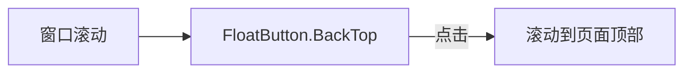

# 回到顶部

- 状态：已建立
- 日期：2026-10-29
- 范围：前端应用壳层的全局回到顶部入口

## 1. 背景与目标

故事库、故事详情、分镜脚本等页面滚动距离较长，目前只能手动滚回顶部。目标是在全站提供一个固定悬浮的回到顶部入口，不改变任何页面布局与业务数据。

## 2. 核心设计决策

1. **使用 antd 原生组件**：`FloatButton.BackTop`（antd 6 的复合组件名，非 `BackToTop`），不自行实现滚动监听与按钮样式。
2. **挂在应用壳层**：放在 `App.tsx` 的外层 `Layout` 内，所有路由共用，不逐页重复挂载。
3. **滚动目标为窗口**：当前布局使用文档滚动（`Layout minHeight: 100vh`，`app-content` 不是独立滚动容器），因此不传 `target`，使用组件默认的 window。
4. **出现阈值**：滚动超过 400px 才显示，短页面不出现。
5. **与主题一致**：使用 `type="primary"`，颜色由 `ConfigProvider` 的 `colorPrimary` 决定；开启 `showProgress` 展示滚动进度。
6. **不参与导出**：回到顶部是纯前端浮层，不进入复制、导出、ZIP、打印或生图内容。

## 3. 数据流

边界约束：

- 全站只挂载一个回到顶部按钮。
- 不读写后端数据，不触发任何接口。
- 不替代页面内锚点或分页导航。

## 4. 业务不变量

| 编号 | 不变量 |
|---|---|
| BT-01 | 回到顶部按钮只存在于应用壳层，页面不得重复挂载。 |
| BT-02 | 按钮不进入任何复制、导出、ZIP 或生图提示词。 |
| BT-03 | 页面使用文档滚动时，按钮必须监听 window，不绑定内部滚动容器。 |

## 5. Impacted Files

- `.ai/blueprints/INDEX.md`
- `frontend/src/App.tsx`

## 6. 风险与遗留

- 若后续把 `app-content` 改成独立滚动容器，需要给 `BackToTop` 传 `target`，否则按钮不会出现。
- 弹窗、抽屉打开时按钮会被遮罩覆盖，这是预期行为，不做额外层级处理。

## 7. 变更历史

- **2026-10-29**：建立蓝图。确定使用 `FloatButton.BackTop`，全局挂在 `App.tsx`，window 滚动，阈值 400px，主题主色并显示进度。
