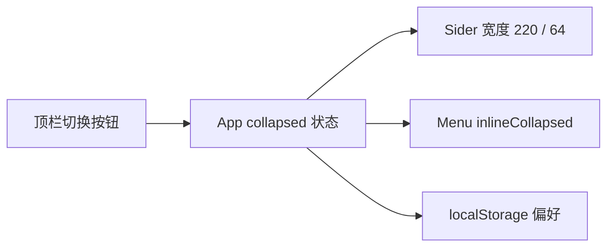

# 侧边栏收起

- 状态：已建立
- 日期：2026-10-29
- 范围：应用壳层左侧导航栏的展开 / 收起

## 1. 背景与目标

故事详情、分镜脚本等页面横向内容较多，固定 220px 的侧边栏会挤压工作区。目标是让用户随时收起侧边栏，只保留图标导航，并在刷新后记住选择。

## 2. 核心设计决策

1. **使用 antd `Layout.Sider` 的受控收起**：`collapsed` 由 `App` 管理，不自行实现宽度动画。
2. **展开 220px / 收起 64px**：收起后保留菜单图标，菜单文字通过 `inlineCollapsed` 隐藏，悬停显示 tooltip。
3. **切换入口放在顶栏左侧**：使用 `MenuFoldOutlined` / `MenuUnfoldOutlined` 图标按钮；不使用 Sider 默认底部触发器，避免与底部说明文字重叠。
4. **收起时隐藏品牌文字与底部说明**：只保留品牌色块；展开后恢复。
5. **记住用户选择**：收起状态写入 `localStorage`，仅作为当前浏览器的界面偏好，不进入数据库、不影响任何业务数据。
6. **路由与页面不变**：收起只改变导航宽度，不改变当前路由、页面状态或接口请求。

## 3. 数据流

边界约束：

- 全站只有一个侧边栏切换入口。
- 收起状态是纯 UI 偏好，不得写后端或影响导出。
- 收起后菜单项仍可点击、当前项仍高亮。

## 4. 业务不变量

| 编号 | 不变量 |
|---|---|
| SB-01 | 侧边栏收起只影响导航宽度，不改变路由与页面数据。 |
| SB-02 | 收起后当前菜单项仍高亮、仍可点击。 |
| SB-03 | 收起状态只存浏览器本地，不进入数据库或导出内容。 |

## 5. Impacted Files

- `.ai/blueprints/INDEX.md`
- `frontend/src/App.tsx`
- `frontend/src/styles.css`

## 6. 风险与遗留

- 极窄屏幕下 64px 仍占空间；如需移动端完全隐藏，另开 `collapsedWidth=0` 的响应式方案。
- localStorage 不可用时忽略读写，不影响默认展开。

## 7. 变更历史

- **2026-10-29**：建立蓝图。确定受控 Sider、220/64 宽度、顶栏切换、菜单 inlineCollapsed 与 localStorage 记忆。
