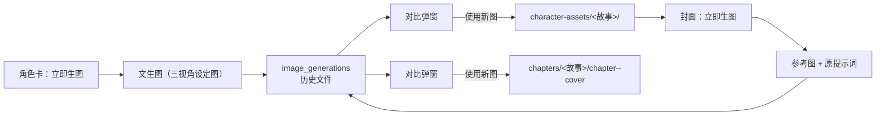

# 生图服务接入

- 状态：实施中（P0 已实现）
- 日期：2026-10-29
- 范围：生图服务配置、角色资产图生成、章节封面生成、参考图垫图、生图历史与对比确认

## 1. 背景与目标

工作台目前只产出提示词，用户需要把提示词复制到外部生图 AI，再手动把图片传回来。目标是在工作台内直接调用生图接口，把结果写入角色卡 / 章节封面，减少复制与回传。

首个试点是章节封面；由于封面与分镜必须靠角色资产图垫图才能保持一致性，角色资产图生成是同一批 P0 范围。

## 2. 核心设计决策

1. **P0 只做同步生成**：不接异步任务、不接批量接口；单次请求超时 600 秒。
2. **模型固定为 `gpt-image-2.5-sunburst`**，可在设置页切换同分组的其他模型。
3. **参考图优先**：封面 / 分镜生成必须使用角色资产图作为参考图；角色没有资产图时拒绝生成，不退回纯文字变量。
4. **角色资产图是一张三视角设定图**：同一张图内包含全身、七分身、半身，带中文标注；这张图同时是角色卡资产图与后续垫图来源。
5. **生成不直接覆盖**：每次生成先写入历史，返回预览；用户确认后才复制到正式路径。
6. **生图历史是正式功能**：每个目标（角色 / 章节封面 / 引导卡 / 分镜页）保留生成记录，可回选、可手动清除；清除历史不删除当前正式图。
7. **对比确认**：接口返回后展示「左原图 / 右新图」，默认选新图；用户可选择使用新图、保留原图或重新生成。
8. **原提示词直接发送**：P0 不做文字剥离，提示词中的文字区、标红规则原样提交；中文文字渲染质量由对比弹窗兜底。
9. **Key 只存服务端**：接口只返回脱敏值；环境变量优先于页面保存。
10. **历史与正式图分离**：历史文件独立存放，正式图由现有 `save_*` 服务写入，清历史不影响正式图。

## 3. 数据流



边界约束：

- 没有角色资产图时，封面生成不得调用上游。
- 生成结果先入历史，未确认前不改变正式图。
- 历史清理不得删除正式图。
- 参考图只来自角色资产图，不接受临时外链。

## 4. 数据模型

### 4.1 `image_generations`

| 字段 | 类型 | 说明 |
|---|---|---|
| `id` | string | UUID，生成与历史唯一 ID |
| `story_id` | int | 外键，随故事删除级联清理 |
| `target_type` | enum | `character_asset` / `chapter_cover` / `chapter_guide` / `page` |
| `character_name` | string? | 角色资产图目标 |
| `chapter_number` | int? | 章节目标 |
| `page_number` | int? | 分镜页目标（全局页码） |
| `model` / `size` / `quality` | string | 本次调用参数 |
| `prompt` | text | 实际发送给上游的提示词 |
| `reference_names` | JSON | 本次使用的角色参考图名称 |
| `filename` | string | 历史文件相对路径 |
| `bytes` | int | 历史文件大小 |
| `status` | enum | `generated` / `used` / `failed` |
| `error_code` / `error_message` | string? | 失败记录 |
| `provider_request_id` | string? | 上游请求 ID（如有） |
| `created_at` / `used_at` | datetime | |

约束：`story_id` 级联删除；历史文件路径不得指向正式图路径。

### 4.2 设置

`app_settings` 新增：

- `image_provider_config`：JSON `{base_url, model, size, quality}`
- `image_provider_api_key`：明文 Key，仅服务端读取

环境变量优先级：`IMAGE_PROVIDER_API_KEY` > 数据库；`IMAGE_PROVIDER_BASE_URL` / `IMAGE_PROVIDER_MODEL` 同理。

## 5. 接口契约

| 方法 | 路径 | 说明 |
|---|---|---|
| GET | `/api/settings` | 增加 `image_provider` 状态，只含脱敏 Key |
| PUT | `/api/settings/image-provider` | 保存 base_url / model / size / quality / 可选 Key |
| DELETE | `/api/settings/image-provider/key` | 清除本地 Key |
| POST | `/api/settings/image-provider/test` | 调 `/v1/models`，不产生生图费用 |
| POST | `/api/stories/{id}/characters/{name}/asset/generate` | 生成角色三视角设定图，返回预览 |
| POST | `/api/stories/{id}/breakdown/chapters/{n}/cover/generate` | 生成章节封面，返回预览 |
| GET | `/api/stories/{id}/image-generations` | 按目标列历史 |
| POST | `/api/stories/{id}/image-generations/{gid}/use` | 使用历史图，写入正式路径 |
| DELETE | `/api/stories/{id}/image-generations` | 按目标清空历史 |
| DELETE | `/api/stories/{id}/image-generations/{gid}` | 删除单条历史 |

预览返回：

```text
{ generation_id, target_type, old_url, new_url, model, size, elapsed_ms }
```

## 6. 参考图映射

1. 从提示词中提取所有 `{{角色名}}`，按首次出现顺序去重。
2. 每个角色必须存在角色卡且有 `asset_filename`；缺失时返回 `409 CHARACTER_ASSET_MISSING`，并列出缺失角色。
3. 参考图按提取顺序传给上游；提示词前追加：
   `【参考图】参考图1：{{角色名}} 的角色设定图；参考图2：……。只取角色的五官、发型、服装、配饰，不要照搬参考图的排版、背景、标注文字和分隔线。`
4. 原文中的 `{{角色名}}` 替换为「参考图N中的角色（角色名）」。
5. 参考图上限 4 张。

## 7. 业务不变量

| 编号 | 不变量 |
|---|---|
| IG-01 | API Key 只在服务端使用，任何响应不得返回明文。 |
| IG-02 | 生成结果先写历史；未确认前不得改变正式角色资产图 / 封面 / 分镜图。 |
| IG-03 | 清除历史不得删除当前正式图；正式图与历史文件必须独立。 |
| IG-04 | 封面 / 分镜生成必须使用角色资产图；缺失时拒绝生成，不退回纯文字变量。 |
| IG-05 | 参考图只来自角色资产图，不得使用任意外链。 |
| IG-06 | 历史文件不进入 ZIP、导出、审计或生图提示词。 |
| IG-07 | 同一目标同一时间只允许一个生成请求。 |
| IG-08 | P0 只允许同步调用，超时 600 秒；不得静默转异步。 |
| IG-09 | 上游返回必须校验为 JPG / PNG / WebP 且不超过 15MB；失败不写历史。 |
| IG-10 | 对比弹窗默认选新图；用户可保留原图或重新生成。 |

## 8. Impacted Files

- `.ai/blueprints/INDEX.md`
- `backend/app/config.py`
- `backend/app/models.py`
- `backend/app/schemas.py`
- `backend/app/crud.py`
- `backend/app/routers/settings.py`
- `backend/app/routers/breakdowns.py`
- `backend/app/routers/image_generation.py`（新增）
- `backend/app/services/image_provider.py`（新增）
- `backend/app/services/image_generations.py`（新增）
- `backend/app/services/files.py`
- `backend/app/main.py`
- `backend/tests/test_image_generation.py`（新增）
- `frontend/src/types.ts`
- `frontend/src/api/client.ts`
- `frontend/src/components/DeepSeekKeyPanel.tsx`
- `frontend/src/components/ImageProviderPanel.tsx`（新增）
- `frontend/src/components/ImageGenerationModal.tsx`（新增）
- `frontend/src/components/CharacterCardsTab.tsx`
- `frontend/src/components/StoryboardChaptersTab.tsx`
- `frontend/src/pages/SettingsPage.tsx`
- `frontend/src/styles.css`
- `README.md`

## 9. 风险与待确认

- **同步耗时**：一次请求可能超过 5 分钟；P0 用 600 秒兜底，前端必须显示生成中状态，关闭弹窗不取消服务端任务。
- **edits 请求格式（已确认）**：单参考图用 `image`，多参考图用 `image[]`，multipart；返回 `data[0].url`。文本生图 21.5 秒，单参考图 42 秒，双参考图 63.8 秒；请求 1024x1536 实际返回 1086x1448（3:4）。图片在 CDN 域名，下载校验不限制 BASE 域名。
- **中文文字渲染**：模型可能错字或漏字；对比弹窗与重抽是唯一兜底，不在 P0 做文字剥离。
- **存储增长**：历史文件会累积；按目标手动清理，列表显示占用空间。
- **并发与计费**：双击、重抽、多角色并发生成都会产生费用；同目标加锁，前端确认弹窗。
- **角色资产图多视角**：多视角参考图可能被模型照搬排版；参考图前缀必须明确禁止照搬。

## 10. 变更历史

- **2026-10-29**：建立蓝图。确定同步生成、600 秒超时、`gpt-image-2.5-sunburst`、角色三视角资产图、参考图垫图、历史与对比确认；P0 范围为角色资产图 + 章节封面。
- **2026-10-29（P0 实现）**：完成生图服务配置、角色资产图生成、章节封面生成、参考图映射、`image_generations` 历史、对比弹窗、历史回选与清除。接口契约实测：文生图 21.5 秒、单参考图 42 秒、双参考图 63.8 秒；返回 `url`，实际输出 1086x1448（3:4）；多参考图字段为 `image[]`。后端测试与前端构建通过，真实页面端到端待验证。
