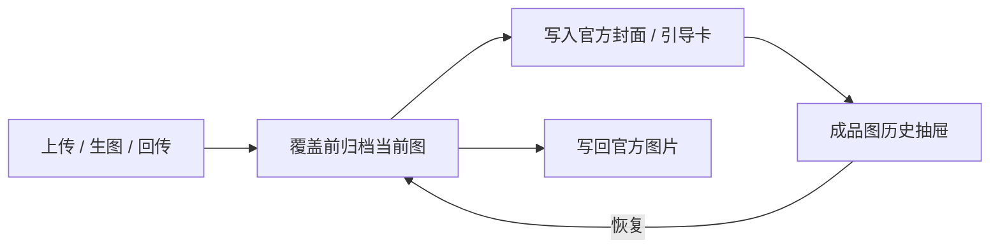

# 章节成品图归档与恢复

- 状态：已建立
- 日期：2026-10-31
- 范围：章节封面 / 引导卡的成品图历史、覆盖前归档、恢复上一张

## 1. 核心设计决策

1. **覆盖前自动归档**：`save_chapter_asset` 写入新图前，把当前封面 / 引导卡复制到 `uploads/chapters-archive/<故事ID>/`。
2. **归档即历史**：归档文件名包含章节、类型、时间戳（微秒）与扩展名；不新增数据库表，按文件系统列表。
3. **恢复前也归档**：恢复旧图前，先把当前图归档，保证恢复本身可再次回滚。
4. **只换图不改提示词**：恢复只替换官方图片文件，不改 `chapters`、`image_prompt` 或其他数据。
5. **类型与路径校验**：只允许 cover / guide；文件名必须匹配 `chapter-<N>-<kind>-<timestamp>.<ext>`，且章节与类型必须一致，拒绝路径穿越。

## 2. 数据流

边界约束：

- 归档失败不得阻断新图写入；当前实现只复制，失败会抛错，由调用方处理。
- 恢复不删除历史归档。
- 恢复不修改提示词、章节结构、mapping、characters。
- 只支持章节封面 / 引导卡；正文页图片历史后续再补。

## 3. 接口

| 方法 | 路径 | 说明 |
|---|---|---|
| GET | `/api/stories/{id}/breakdown/chapters/{n}/assets/{kind}/archives` | 列出归档图 |
| POST | `/api/stories/{id}/breakdown/chapters/{n}/assets/{kind}/archives/{filename}/restore` | 恢复归档图 |

`kind`：`cover` / `guide`。

## 4. 不变量

| 编号 | 不变量 |
|---|---|
| AH-01 | 覆盖章节封面 / 引导卡前必须归档当前图（不存在时跳过）。 |
| AH-02 | 归档文件名必须含章节号、类型、时间戳与合法扩展名；恢复时章节和类型必须匹配。 |
| AH-03 | 恢复前必须归档当前图；恢复不得删除旧归档。 |
| AH-04 | 恢复只改图片文件，不改提示词或章节结构。 |
| AH-05 | 生成图提交不再单独归档，统一由 `save_chapter_asset` 负责，避免重复归档。 |

## 5. Impacted Files

- `backend/app/services/files.py`
- `backend/app/services/image_generations.py`
- `backend/app/routers/breakdowns.py`
- `backend/app/schemas.py`
- `backend/tests/test_chapter_archives.py`
- `frontend/src/types.ts`
- `frontend/src/api/client.ts`
- `frontend/src/components/ChapterAssetHistoryDrawer.tsx`
- `frontend/src/components/StoryboardChaptersTab.tsx`
- `README.md`
- `.ai/blueprints/INDEX.md`

## 6. 变更历史

- **2026-10-31**：建立蓝图。章节封面 / 引导卡覆盖前自动归档；提供历史列表与恢复；恢复前归档当前图；生成图提交改为统一由 `save_chapter_asset` 归档。
