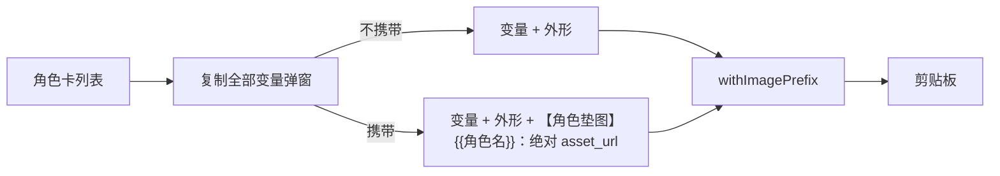

# 角色变量复制：可选携带垫图地址

- 状态：已建立
- 日期：2026-10-31
- 范围：角色卡「复制全部变量」弹窗、复制文本格式、角色资产图地址映射

## 1. 核心设计决策

1. 「复制全部变量」先弹窗，由用户选择是否携带已有角色卡图作为垫图；默认不携带，保持原复制行为。
2. 勾选后，在变量绑定末尾追加 `【角色垫图】` 分块，每行格式为 `{{角色名}}：<本地图片 URL>`。
3. 只列已有 `asset_url` 的角色；没有资产图的角色仍复制变量与外形，不生成空地址行。
4. 图片地址由后端返回的 `asset_url` + 当前页面 origin 拼成绝对 URL；不在前端读取文件系统路径，不新增后端接口。
5. 复制内容仍统一经过全局生图前置提示词 `withImagePrefix`；垫图分块放在变量绑定之后、前置提示词之外。

## 2. 数据流



边界约束：

- 垫图地址只来自角色卡 `asset_url`，不接临时外链或本地文件路径。
- 没有资产图的角色不产生垫图行。
- 变量名必须与角色卡 `name` 完全一致。
- 复制失败时保持弹窗不关闭，用户可重试。

## 3. 复制文本契约

```text
{{我}}：角色外形……

{{王晨安}}：角色外形……

【角色垫图】
{{我}}：http://127.0.0.1:8123/uploads/character-assets/7/xxx.png
{{王晨安}}：http://127.0.0.1:8123/uploads/character-assets/7/yyy.png
```

| 规则 | 内容 |
|---|---|
| CC-01 | 未勾选时，复制文本与改动前完全一致。 |
| CC-02 | 勾选时，只在末尾追加 `【角色垫图】` 分块。 |
| CC-03 | 分块只包含 `asset_url` 非空的角色，按角色卡顺序。 |
| CC-04 | 地址必须是绝对 URL，不能是 `/uploads/...` 相对路径。 |
| CC-05 | 弹窗需要展示将复制的角色与地址，允许用户取消。 |

## 4. Impacted Files

- `frontend/src/components/CharacterCardsTab.tsx`
- `frontend/src/utils/characterCopy.ts`
- `frontend/src/utils/characterCopy.test.ts`
- `README.md`
- `.ai/blueprints/INDEX.md`

## 5. 变更历史

- **2026-10-31**：建立蓝图。「复制全部变量」增加弹窗与可选垫图地址；默认不携带，勾选后追加 `【角色垫图】` 分块。
