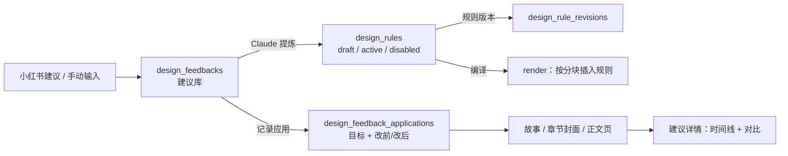

# 设计建议库与优化记录

- 状态：已建立
- 日期：2026-10-31
- 范围：小红书 / 手动设计建议的维护、建议到封面 / 漫画改动的应用记录、改前改后对比

## 1. 核心设计决策

1. **建议是源数据，应用记录是审计数据**：建议原文、分类、范围、状态可编辑；每次应用生成一条不可变的记录，保存改前 / 改后快照。
2. **一条建议可关联多个目标**：故事、章节封面、正文页、引导卡、角色卡或其他设计对象；不限制只能用于一个封面。
3. **封面提示词仍是唯一源**：应用记录里的 `before_prompt` / `after_prompt` 只是当时快照，用于对比和追溯，不反向驱动封面。
4. **状态闭环**：`open` → `applied` → `verified` / `archived`；首次记录应用时自动从 `open` 变为 `applied`，删除最后一条应用记录时回到 `open`。
5. **建议可提炼为多条结构化规则**：规则独立存 `design_rules`，有 kind（正面/负面/文字/审片/硬检查）、target（封面/正文/引导卡/全部）、scope（全局/故事/章节/页面）、priority 与版本；建议本身只保留原始素材与应用记录。
6. **P0 手动记录应用**：页面提供「记录应用」；P1 再让封面优化指令自动带出建议、写回后自动记录。
7. **截图只存本地**：复用 `/api/uploads`，数据库保存文件名；删除建议时同时删除截图文件。
8. **规则编译点唯一**：`POST /api/settings/prompt-templates/render` 按 kind/slot 把规则插入【画面】/【封面模式】/【文字区】/【负面提示词】，并返回 `applied_rules`；正文用 body 规则、封面用 cover 规则，不另写第二套注入逻辑。
9. **Claude Code 负责提炼**：网页只存原始建议和展示草案，不调用 DeepSeek；Claude Code 读取项目规则后通过 API 写 draft，用户在网页逐条激活。
10. **用户只提供原始素材**：截图、建议文字、原文分析是唯一输入；`kind / target / slot / scope / check_spec`、改哪些提示词、影响哪些图全部由 Claude Code 判断。网页不提供手工新建 / 编辑规则的入口，只提供审核动作（激活、停用、回退、核验、写入模板、仅本次）。
11. **默认章节优先**：小红书建议通常只针对某个作品的某一章。先定位故事 + 章节，规则写成 `scope_type=chapter`，先优化这一章的封面或内容并观察效果；效果确认后，才单独评估是否提升为全局规则或写入模板。定位不到故事 / 章节时暂停询问，不得默认写全局。
12. **推广入口在网页，不靠记命令**：章节规则效果确认后，建议详情提供「推广到全局」按钮；点击只复制 `design-rule-promote` 指令，由 Claude Code 改规则范围并同步技能 / 审片 / 检查脚本。规则表是唯一 owner，不写模板；网页不直接改项目文件。

## 2. 数据流

边界约束：

- 建议不直接修改封面提示词；写回仍走 `chapters` / `pages` 接口。
- 应用记录至少要有目标故事和一句改动说明。
- 目标为封面时必须填章节号；目标为正文页时必须填页码。
- 截图只能来自服务端上传，不接受任意外链作为文件。
- 删除故事时建议保留，应用的 `story_id` 随故事删除；P0 不做跨故事迁移。

## 3. 数据模型

### 3.1 `design_feedbacks`

| 字段 | 类型 | 说明 |
|---|---|---|
| `id` | int | 主键 |
| `title` | string(120) | 建议短标题 |
| `content` | text | 小红书原文 / 手动建议 |
| `source` | enum | `xiaohongshu` / `manual` |
| `source_url` | string(500) | 原帖或截图来源链接，可空 |
| `screenshot_filename` | string(64)? | 本地上传截图 |
| `category` | enum | `cover` / `comic` / `title` / `color` / `expression` / `text` / `pacing` / `other` |
| `scope` | enum | `global` / `story` / `chapter` |
| `story_id` | int? | 指定故事时必填 |
| `chapter_number` | int? | 指定章节时必填 |
| `tags` | JSON | 自由标签，最多 20 个 |
| `priority` | enum | `low` / `medium` / `high` |
| `status` | enum | `open` / `applied` / `verified` / `archived` |
| `is_rule` / `rule_text` / `rule_target` / `rule_promoted_at` | 旧字段 | 兼容旧数据；新规则使用 `design_rules` |
| `created_at` / `updated_at` | datetime | |

### 3.2 `design_rules`

| 字段 | 类型 | 说明 |
|---|---|---|
| `id` | int | 主键 |
| `feedback_id` | int | 来源建议，随建议删除级联清理 |
| `title` | string(120) | 规则短标题 |
| `kind` | enum | `prompt` / `negative` / `text` / `review` / `check` |
| `target` | enum | `cover` / `body` / `guide` / `all` |
| `slot` | enum | `scene` / `cover_mode` / `text_zone` / `none` |
| `scope_type` | enum | `global` / `story` / `chapter` / `pages` |
| `story_id` / `chapter_numbers` / `page_numbers` | int? / JSON | 范围定位；pages 只用于 body |
| `priority` | enum | `hard` / `soft` |
| `requirement` / `negative_terms` / `review_check` / `check_spec` | text / JSON | 按 kind 填写 |
| `status` | enum | `draft` / `active` / `disabled` |
| `version` | int | 每次编辑/状态变化递增 |
| `created_by` | enum | `claude` / `user` |
| `template_applied_at` | datetime? | 写入全局模板的时间；写入后规则停用 |
| `created_at` / `updated_at` | datetime | |

### 3.3 `design_rule_revisions`

| 字段 | 类型 | 说明 |
|---|---|---|
| `id` | int | 主键 |
| `rule_id` | int | 外键，随规则删除级联清理 |
| `version` | int | 版本号 |
| `snapshot` | JSON | 当时的规则快照 |
| `change_note` | string(500) | 创建 / 编辑 / 激活 / 停用 / 回滚 |
| `created_at` | datetime | |

### 3.4 `design_rule_results`

| 字段 | 类型 | 说明 |
|---|---|---|
| `id` | int | 主键 |
| `rule_id` | int | 外键，随规则删除级联清理 |
| `story_id` | int | 外键，随故事删除级联清理 |
| `target_type` | enum | `cover` / `body` / `guide` / `other` |
| `chapter_number` / `page_number` | int? | 目标定位 |
| `result` | enum | `passed` / `failed` / `unknown` |
| `message` | string(500) | 判定说明 |
| `image_url` / `snapshot_id` | string? / int? | 生成图或提示词快照 |
| `reviewer` | enum | `claude` / `user` |
| `created_at` | datetime | |

### 3.5 `design_feedback_applications`

| 字段 | 类型 | 说明 |
|---|---|---|
| `id` | int | 主键 |
| `feedback_id` | int | 外键，随建议删除级联清理 |
| `target_type` | enum | `cover` / `page` / `guide` / `character` / `other` |
| `story_id` | int | 外键，随故事删除级联清理 |
| `chapter_number` / `page_number` | int? | 封面 / 正文页定位 |
| `summary` | string(500) | 这次具体改了什么 |
| `before_prompt` / `after_prompt` | text? | 提示词快照 |
| `before_image_url` / `after_image_url` | string(500)? | 本地图片地址 |
| `applied_at` | datetime | 应用时间 |

## 4. 接口契约

| 方法 | 路径 | 说明 |
|---|---|---|
| GET | `/api/design-feedbacks` | 列表；支持 `status` / `category` / `story_id` / `scope` / `keyword` 过滤 |
| POST | `/api/design-feedbacks` | 新建建议 |
| GET | `/api/design-feedbacks/{id}` | 详情含应用记录 |
| PATCH | `/api/design-feedbacks/{id}` | 局部更新 |
| DELETE | `/api/design-feedbacks/{id}` | 删除建议、应用记录与截图 |
| POST | `/api/design-feedbacks/{id}/applications` | 记录一次应用 |
| DELETE | `/api/design-feedbacks/{id}/applications/{application_id}` | 删除应用记录 |
| GET | `/api/design-feedbacks/{id}/rules` | 列出建议的规则草案 / 已启用 / 已停用 |
| POST | `/api/design-feedbacks/{id}/rules` | 创建规则草案（仅 Claude Code 调用） |
| PATCH | `/api/design-rules/{id}` | 编辑规则，生成新版本 |
| POST | `/api/design-rules/{id}/activate` | 激活规则 |
| POST | `/api/design-rules/{id}/disable` | 停用规则 |
| POST | `/api/design-rules/{id}/rollback` | 回退到上一版本 |
| DELETE | `/api/design-rules/{id}` | 删除规则与版本 |
| POST | `/api/design-rules/preview` | 影响预览：封面 / 正文 / 引导卡数量与示例 |
| GET | `/api/design-rules/{id}/results` | 规则核验结果列表（时间线） |
| POST | `/api/design-rules/{id}/results` | 记录一次核验：提示词硬检查 / 生成图审片 |
| POST | `/api/design-rules/{id}/apply-once/preview` | 预览仅本次应用到某张封面 / 正文页的 before / after |
| POST | `/api/design-rules/{id}/apply-once` | 仅本次应用：只改目标提示词，不激活规则 |
| POST | `/api/design-rules/{id}/template-preview` | 预览写入全局模板的 before / after |
| POST | `/api/design-rules/{id}/apply-to-template` | 写入模板、生成模板版本并停用规则 |
| POST/DELETE | `/api/design-feedbacks/{id}/promote` | 旧版兼容入口，内部创建/停用简单规则 |

## 5. 业务不变量

| 编号 | 不变量 |
|---|---|
| DF-01 | `content` 与 `screenshot_filename` 至少有一个；`title` 可空，空时由服务端从 `content` 首行生成，纯截图建议生成「截图建议 · 时间」；`title` ≤120 字。 |
| DF-02 | `scope=global` 不绑定故事；`scope=story` 必须有 `story_id`；`scope=chapter` 必须有 `story_id` 和 `chapter_number`。 |
| DF-03 | 应用的 `story_id` 必须存在；`target_type=cover` 必须有 `chapter_number`；`target_type=page` 必须有 `page_number`。 |
| DF-04 | 首次应用把 `open` 改为 `applied`；删除最后一条应用记录时 `applied` 回到 `open`。 |
| DF-05 | 截图必须是 `/api/uploads` 生成的文件；删除建议时删除截图。 |
| DF-06 | 应用记录中的提示词 / 图片是审计快照，不是封面或正文的源数据。 |
| DF-07 | 规则必须通过 draft → active 才生效；`kind/target/slot/scope_type` 必须合法；页码范围只用于 body。 |
| DF-08 | 渲染器按 kind/slot 插入对应分块并返回 `applied_rules`；规则只影响新渲染的提示词。 |
| DF-09 | 每次编辑 / 激活 / 停用 / 回滚都写 `design_rule_revisions`；回滚不删除历史。 |
| DF-10 | 网页不调用 DeepSeek 提炼规则，也不提供手工新建 / 编辑规则入口；用户只提交截图 / 建议文字 / 原文分析，规则由 Claude Code 通过 API 写 draft。 |
| DF-11 | `kind=check` 的 check_spec 必须是 forbidden_terms / required_terms / max_chars / regex；渲染时执行并返回 rule_checks。 |
| DF-12 | 生成图 / 人工审片结果写 design_rule_results；只记录，不自动改规则或提示词。 |
| DF-13 | 失败核验的返工由 Claude Code 执行：先区分提示词问题 / 生成图问题，改完 render 验证 rule_checks，通过后才写回；不自动重新生图。 |
| DF-14 | 只有全局 active 的 prompt / negative / text 规则可写入模板；target 为 cover / body / all；写入后规则停用、`template_applied_at` 记录时间，并生成模板版本；已写入模板的规则不能直接重新激活。 |
| DF-15 | 自动流水线只支持章节封面；必须用户明确同意生图张数（默认 2 张，前端可选 1–3 张）；到达上限必须停止；每张图写核验结果；不得修改模板、画风、mapping、characters。 |
| DF-16 | 仅本次应用只允许 draft / disabled 的 prompt / negative / text 规则；必须显式指定故事 + 章节（正文再加章内页码）；只改目标 `image_prompt`，写提示词快照和一条 result=unknown 核验，不激活规则、不影响其他图片。 |
| DF-17 | 来自单篇小红书笔记的建议默认绑定具体故事 + 章节，规则先写 `scope_type=chapter`；不得默认写全局。推广为全局规则 / 模板必须是用户在效果确认后的显式要求。 |
| DF-18 | 「推广到全局」只复制 `design-rule-promote` 指令，不直接改数据库或项目文件；推广后规则改为 global，规则表保持唯一 owner，不写模板；推广必须保留规则版本与来源建议。 |

## 6. Impacted Files

- `backend/app/config.py`
- `backend/app/models.py`
- `backend/app/schemas.py`
- `backend/app/services/design_feedbacks.py`
- `backend/app/services/design_rules.py`
- `backend/app/routers/design_feedbacks.py`
- `backend/app/routers/design_rules.py`
- `backend/app/main.py`
- `backend/tests/test_design_feedbacks.py`
- `backend/tests/test_design_rules.py`
- `backend/tests/test_prompt_snapshots.py`
- `frontend/src/types.ts`
- `frontend/src/api/client.ts`
- `frontend/src/pages/DesignFeedbacksPage.tsx`
- `frontend/src/components/DesignRulePanel.tsx`
- `frontend/src/utils/designRules.ts`
- `frontend/src/components/PromptSnapshotDrawer.tsx`
- `frontend/src/components/DesignRuleResultDrawer.tsx`
- `frontend/src/utils/storyBreakdown.ts`
- `frontend/src/App.tsx`
- `backend/app/services/prompt_templates.py`
- `.claude/skills/story-breakdown/SKILL.md`
- `.claude/agents/cover-director.md`
- `.claude/skills/design-rule-extract/SKILL.md`
- `.claude/skills/design-rule-rework/SKILL.md`
- `.claude/skills/design-rule-pipeline/SKILL.md`
- `.claude/skills/design-rule-promote/SKILL.md`
- `frontend/src/components/DesignRulePanel.tsx`
- `backend/app/services/prompt_templates.py`
- `README.md`
- `.ai/blueprints/INDEX.md`

## 7. 变更历史

- **2026-10-31**：建立蓝图。P0 实现建议库、应用记录、改前/改后对比。
- **2026-10-31（结构化规则）**：新增 `design_rules` / `design_rule_revisions`；规则支持 kind / target / slot / 范围（全局/故事/章节/页面）/ priority / 版本；Claude Code 通过 API 写 draft，网页审核激活；渲染器按分块插入并返回 `applied_rules`；支持激活、停用、回退与影响预览。
- **2026-10-31（硬检查与核验）**：`kind=check` 支持 forbidden_terms / required_terms / max_chars / regex，渲染返回 `rule_checks`；新增 `design_rule_results` 记录提示词硬检查与生成图审片结果；规则卡片显示核验通过数。
- **2026-10-31（核验时间线与返工）**：规则详情增加核验时间线；失败项可复制 `design-rule-rework` 指令，由 Claude Code 先判断提示词 / 图片问题，改完重新 render 验证 rule_checks，通过后再写回，不自动重新生图。
- **2026-10-31（写入模板）**：全局 active 规则可预览 before / after 并写入正文 / 封面模板；写入自动生成模板版本、停用规则；已写入模板的规则不能直接重新激活。
- **2026-10-31（自动流水线）**：失败核验可复制 `design-rule-pipeline` 指令，由 Claude Code 串起 render → 生图 → 审片 → 写核验；仅章节封面、需用户同意张数、默认最多 2 张。
- **2026-10-31（仅本次）**：草案 / 停用规则可对指定封面或正文页做一次性提示词应用；不激活规则，写提示词快照与 unknown 核验记录，支持 before / after 预览。
- **2026-10-31（输入边界纠偏）**：明确用户只提供截图 / 建议文字 / 原文分析；网页移除手工新建与编辑规则入口，只保留审核动作；建议表单改为截图 + 自由文字，标题与结构化字段由服务端 / Claude 生成，支持纯截图建议。
- **2026-11-01（章节优先）**：明确小红书建议默认针对具体作品 / 章节；建议记录与规则先绑定 story_id + chapter_number，先优化该章并观察效果；全局规则或模板写入必须等效果确认后由用户显式提出。
- **2026-11-01（一键推广）**：新增「推广到全局」按钮，只复制 `design-rule-promote` 指令；规则表作为唯一 owner，不写模板；由 Claude Code 统一改 scope、技能、审片、检查脚本并验证。
- **2026-11-01（全局推广执行）**：建议 #1 的 5 条章节规则已推广为全局封面规则；影响 32 张封面；故事 3 / 6 / 7 的渲染预览确认 5 条规则全部进入 `applied_rules` 且字数检查通过；建议 #1 标记 `verified`；未写模板，未改已有图片。
- **2026-11-04（背景规则纠偏）**：建议 #1 的“背景只保留一个焦点”规则被泛化成“人物与关键道具周围保持干净”，误伤故事 4 路径的前景冲击线。规则 1 改为只约束背景装饰、背景纹理、背景光效；明确人物/道具周围的漫画冲击线属于封面强化，不计入背景杂乱。规则 3 的负面词“背景杂乱装饰线”改为“背景无关装饰线”。规则仍为全局，不改变范围。
- **2026-11-06（纸底背景标准）**：用户实测故事 9 第 1 章后确认浅米纸底 + 1–3 个淡线元素。规则 1 改为「背景只保留 1–3 个淡线元素」，`target` 从 `cover` 扩到 `all`，删掉「必要氛围人群」；规则 3 改为「背景禁用复杂装饰与暗部」，`target` 扩到 `all`，负面词补「深色背景块 / 背景暗部 / 多余环境元素」。规则表仍是唯一 owner，不写模板；详见 `2026-11-06-background-and-impact-style.md`。
