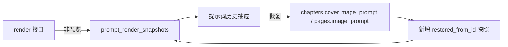

# 提示词渲染快照与恢复

- 状态：已建立
- 日期：2026-10-31
- 范围：每次提示词渲染的审计快照、封面 / 正文页提示词历史、恢复上一版

## 1. 核心设计决策

1. **渲染即快照**：非预览的 `POST /api/settings/prompt-templates/render` 成功后写一条 `prompt_render_snapshots`；设置页预览不写。
2. **快照不可变**：快照保存当时的输入 context、最终 prompt、命中的规则摘要与创建时间；后续编辑不修改旧快照。
3. **恢复 = 追加新快照**：恢复旧版时，把旧 prompt 写回封面 / 正文页，并新增一条 `restored_from_id` 快照，不删除历史。
4. **只恢复提示词**：恢复不会自动重新生图；需要用户再点「立即生图」。
5. **目标定位**：封面按 `story_id + chapter_number`；正文按 `story_id + chapter_number + chapter_page_number`，兼容旧数据的全局页码。
6. **页面入口**：章节封面与正文页的「提示词历史」抽屉，展示时间、命中规则、prompt 摘录与恢复按钮。

## 2. 数据流

边界约束：

- 预览渲染不写快照，避免污染历史。
- 恢复只改提示词，不改 mapping / characters / chapters 结构。
- 恢复不删除旧快照。
- 快照记录命中的规则 id / 版本 / 标题 / 范围，便于追溯。

## 3. 数据模型

### `prompt_render_snapshots`

| 字段 | 类型 | 说明 |
|---|---|---|
| `id` | int | 主键 |
| `story_id` | int | 外键，随故事删除级联清理 |
| `target_type` | enum | `cover` / `body` |
| `chapter_number` / `page_number` | int? | 封面章号 / 正文章内页码 |
| `template_type` | enum | `cover` / `body` |
| `context` | JSON | 渲染输入 |
| `prompt` | text | 最终提示词 |
| `applied_rules` | JSON | 命中的规则摘要（含版本） |
| `rule_checks` | JSON | 本次硬检查结果（passed / message） |
| `restored_from_id` | int? | 恢复来源快照 |
| `created_at` | datetime | |

## 4. 接口

| 方法 | 路径 | 说明 |
|---|---|---|
| GET | `/api/stories/{story_id}/prompt-snapshots` | 按 target_type / chapter_number / page_number / limit 查询 |
| POST | `/api/prompt-snapshots/{id}/restore` | 恢复该快照的提示词并追加恢复快照 |

## 5. 业务不变量

| 编号 | 不变量 |
|---|---|
| PS-01 | `preview=true` 的渲染不得写快照。 |
| PS-02 | 非预览渲染成功后必须返回 `snapshot_id`。 |
| PS-03 | 恢复必须写回对应封面 / 正文页；目标不存在时 404，不静默失败。 |
| PS-04 | 恢复必须新增快照，不能删除或覆盖旧快照。 |
| PS-05 | 恢复只改 `image_prompt`，不得改章节结构、mapping、characters 或图片。 |

## 6. Impacted Files

- `backend/app/models.py`
- `backend/app/schemas.py`
- `backend/app/services/prompt_snapshots.py`
- `backend/app/routers/prompt_snapshots.py`
- `backend/app/routers/settings.py`
- `backend/tests/test_prompt_snapshots.py`
- `frontend/src/types.ts`
- `frontend/src/api/client.ts`
- `frontend/src/components/PromptSnapshotDrawer.tsx`
- `frontend/src/components/StoryboardChaptersTab.tsx`
- `frontend/src/components/StoryboardTab.tsx`
- `README.md`
- `.ai/blueprints/INDEX.md`

## 7. 变更历史

- **2026-10-31**：建立蓝图。非预览渲染写快照；封面 / 正文页提供提示词历史与恢复；恢复追加新快照，图片不自动重生成。
