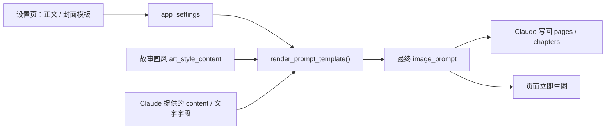

# 正文 / 封面提示词模板

- 状态：实施中（P0/P1 已实现）
- 日期：2026-10-31
- 范围：全局正文模板、全局封面模板、统一渲染器、设置页编辑与预览

## 1. 背景与目标

工作台只有一个画风「韩式唯美彩铅手绘」，但正文页和封面的【画风】文字、文字区、封面模式由每次生成时手写，导致同一画风在不同提示词里被摘要、缩写或改写。目标是把固定结构收进两份全局模板，由同一个渲染器注入画风原文、文字区和负面提示词；Claude 技能与页面生图共用同一份模板。

## 2. 核心设计决策

1. **画风仍然只有一份**：`art_style_content`；正文模板和封面模板都只通过 `{art_style}` 占位符引用它，不复制画风文字。
2. **两份全局模板**：`body_prompt_template`、`cover_prompt_template`，存在 `app_settings`，所有故事共用。
3. **模板只控制固定结构**：画风、文字区、页码、封面模式、负面提示词由渲染器生成；页面特有的画面描述由 Claude 提供 `{content}`。
4. **统一渲染器**：后端 `render_prompt_template()` 是唯一渲染入口；Claude 技能通过 `POST /api/settings/prompt-templates/render` 获取最终 `image_prompt`，不手写固定块。
5. **封面默认专用冲击层路径**：`{cover_mode}` 默认注入「原画风 + 封面专用冲击层」原句：背景保留可识别环境、不得压成纯黑；人物周围加入漫画黑色震动短线、放射状集中冲击线、锯齿情绪漫符；夸张表情、动态张力、手绘涂鸦感；冲击线和关键轮廓用较粗的黑色手绘线，人物面部与皮肤仍保持淡色铅笔的柔和质感，不做全图粗黑描边。另要求冲击线写清起点/方向/密度/保护区；不整体提高对比度、不压暗背景。
6. **页面生图使用已存提示词**：`立即生图` 仍读取 `image_prompt`；模板变更只影响新生成或重新渲染的提示词，不自动改写历史页面。
7. **预览不落库**：设置页「预览」只调用渲染接口，不写任何页面或章节。
8. **设计规则编译**：渲染器按规则类型把规则插到对应分块（正面→【画面】/【封面模式】、文字→【文字区】、负面→【负面提示词】），封面取 cover 规则、正文取 body 规则；返回 `applied_rules` 供审片与追溯。规则只影响新渲染的提示词。
9. **模板版本化**：每次保存模板生成 `prompt_template_versions` 快照；设置页可查看历史并恢复，恢复本身也追加新版本，不删除历史。
10. **规则写入模板**：全局 active 的 prompt / negative / text 规则可预览 diff 后写入正文 / 封面模板；写入生成模板版本并停用规则，规则不再动态编译。

## 3. 模板占位符

| 占位符 | 正文 | 封面 | 来源 |
|---|---|---|---|
| `{art_style}` | ✅ | ✅ | 故事画风原文 `art_style_content` |
| `{content}` | ✅ | ✅ | Claude 生成的【画面】描述 |
| `{character_consistency}` | ✅ | ✅ | Claude 生成的角色一致性说明 |
| `{text_zone}` | ✅ | ✅ | 渲染器根据旁白 / 标红 / 台词生成 |
| `{page_number}` | ✅ | — | 章内页码 |
| `{cover_mode}` | — | ✅ | 默认「原画风 + 冲击层」 |
| `{negative_prompt}` | ✅ | ✅ | 全局默认负面提示词 |
| `【规则要求】` | 条件追加 | 条件追加 | 命中当前范围的设计规则（非模板占位符） |

未知占位符、缺少必填占位符、超过长度上限时拒绝保存或渲染。

## 4. 接口

| 方法 | 路径 | 说明 |
|---|---|---|
| GET | `/api/settings/prompt-templates` | 返回正文 / 封面模板与占位符说明 |
| PUT | `/api/settings/prompt-templates` | 保存两份模板；校验必填占位符 |
| POST | `/api/settings/prompt-templates/render` | 根据模板 + 上下文 + 故事画风返回最终提示词、`applied_rules`、`rule_checks`、`snapshot_id`；`preview=true` 不写快照 |
| GET | `/api/settings/prompt-templates/versions` | 模板历史版本 |
| POST | `/api/settings/prompt-templates/versions/{id}/restore` | 恢复模板版本并追加新版本 |
| POST | `/api/design-rules/{id}/template-preview` | 预览规则写入模板的 before / after |
| POST | `/api/design-rules/{id}/apply-to-template` | 写入模板、生成版本并停用规则 |

渲染请求至少包含：

```text
{template_type: "body"|"cover", story_id, context: {
  content, character_consistency,
  narration_main, narration_sub, narration_highlight,
  dialogues?, page_number?, chapter_number?, label?
}, preview?: boolean
}}
```

## 5. 数据流



边界约束：

- 模板不复制画风原文，只引用 `{art_style}`。
- 渲染器是唯一拼接固定块的地方；Claude 不手写【画风】【文字区】【页码】【负面提示词】。
- 渲染失败不写回任何页面。
- 模板只影响新生成 / 重新渲染的提示词。

## 6. 业务不变量

| 编号 | 不变量 |
|---|---|
| PT-01 | 正文 / 封面模板都只能通过 `{art_style}` 引用画风，不得硬编码画风文字。 |
| PT-02 | 最终提示词的【画风】必须逐字包含 `art_style_content`。 |
| PT-03 | 正文模板必须包含 `{art_style}`、`{content}`、`{text_zone}`、`{page_number}`、`{negative_prompt}`。 |
| PT-04 | 封面模板必须包含 `{art_style}`、`{content}`、`{text_zone}`、`{cover_mode}`、`{negative_prompt}`。 |
| PT-05 | 模板保存时未知占位符必须拒绝；渲染失败不得写回。 |
| PT-06 | 封面 `{cover_mode}` 默认注入「原画风 + 封面专用冲击层」原句（材质分工、空间锚点、密度控制），不得默认提高对比度；不得与画风「避免全图硬边黑描边」冲突。 |
| PT-07 | 设置页预览只读，不写 stories / pages / chapters / mapping。 |
| PT-08 | 命中 active 规则时，按 kind/slot 插入对应分块；响应必须返回 `applied_rules`；正文用 body 规则、封面用 cover 规则，范围按全局/故事/章节/页面匹配。 |
| PT-09 | 命中 `kind=check` 的规则时，渲染后执行 check_spec，并在响应的 `rule_checks` 中返回 passed / message。 |
| PT-10 | 模板每次保存 / 恢复都必须写 `prompt_template_versions`；恢复不得删除旧版本。 |
| PT-11 | 规则写入模板前必须预览；写入后生成模板版本并停用规则；不得自动写入范围非全局的规则。 |
| PT-12 | 封面渲染的负面提示词必须包含冲击线失败模式：铺满全图、糊成脏线、像贴图、美式超级英雄粗线、涂鸦遮挡脸或文字、文字被线条压住、线条穿过眼睛。 |

## 7. Impacted Files

- `.ai/blueprints/INDEX.md`
- `backend/app/config.py`
- `backend/app/schemas.py`
- `backend/app/routers/settings.py`
- `backend/app/services/prompt_templates.py`（新增）
- `backend/app/services/design_feedbacks.py`
- `backend/app/database.py`
- `backend/tests/test_prompt_templates.py`
- `backend/tests/test_prompt_templates.py`（新增）
- `frontend/src/types.ts`
- `frontend/src/api/client.ts`
- `frontend/src/components/PromptTemplatePanel.tsx`（新增）
- `frontend/src/pages/SettingsPage.tsx`
- `.claude/skills/story-breakdown/SKILL.md`
- `README.md`

## 8. 分阶段

- P0：模板存储、设置页编辑/重置/预览、渲染接口、正文/封面默认模板、测试。
- P1：Claude 技能在分镜页/封面生成时调用渲染接口；旧提示词「重新渲染」入口。
- P2：按故事覆盖模板（默认仍全局）。

## 9. 风险与待确认

- 模板会改变新生成提示词的结构；旧页面不会自动更新，需要用户确认是否重新生成。
- 正文模板的 `{content}` 仍由 Claude 生成，模板无法保证画面描述质量；模板只保证固定块一致。
- 封面 `{cover_mode}` 默认「原画风 + 封面专用冲击层」路径；如果以后需要高对比，另行提出，不放进默认模板。

## 10. 变更历史

- **2026-10-31**：建立蓝图。确定全局正文/封面模板、七类占位符、统一渲染器、Claude 技能调用渲染接口、页面立即生图使用已存提示词；封面默认故事 4 的「原画风 + 冲击层」。
- **2026-10-31（P0/P1 实现）**：完成模板存储、校验、渲染器、设置页编辑/重置/预览、后端测试；SKILL 增加「〇、提示词模板」并在分镜页/章节正文/封面模式中要求调用 render 接口，禁止手写固定块。旧提示词不自动改写；页面立即生图仍使用已写回的 `image_prompt`。
- **2026-10-31（设计规则）**：增加结构化规则与规则版本；渲染器按 kind/slot 插入对应分块并返回 `applied_rules`；`PromptRenderContext` 增加 `chapter_number`；封面用 cover 规则、正文用 body 规则；规则草案与激活入口在设计建议库。
- **2026-10-31（提示词快照）**：非预览渲染写 `prompt_render_snapshots` 并返回 `snapshot_id`；设置页预览传 `preview=true`，不落快照。
- **2026-10-31（硬检查）**：渲染响应增加 `rule_checks`；`kind=check` 规则按 forbidden_terms / required_terms / max_chars / regex 执行；结果同时写入快照。
- **2026-10-31（模板版本）**：新增 `prompt_template_versions`；保存 / 恢复模板追加版本；设置页「历史版本」可查看并恢复。
- **2026-10-31（写入模板）**：全局 active 规则可预览并写入正文 / 封面模板；写入生成模板版本、停用规则；已写入模板的规则不能直接重新激活。
- **2026-11-04（故事 4 封面加成）**：封面 `{cover_mode}` 从压缩版“局部加入冲击线”恢复为故事 4 原句，补素材质分工、线条起点/方向/密度/保护区；封面负面提示词增加冲击线失败模式；画风“避免硬边黑轮廓”改为“避免全图硬边黑描边”，避免与粗黑冲击线冲突。
- **2026-11-06（术语纠偏）**：封面 `{cover_mode}` 文案统一改为「原画风 + 封面专用冲击层」；内部试点名「故事 4」不再进入默认模板、技能指令、审片文案或渲染结果。
