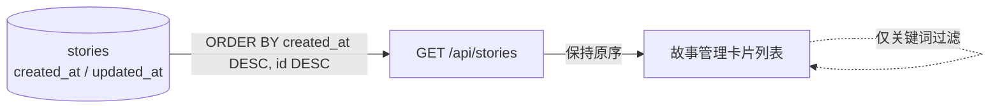

# 故事列表排序契约

- 状态：已建立
- 日期：2026-10-31
- 范围：`GET /api/stories` 的返回顺序、故事管理页卡片顺序

## 1. 核心设计决策

1. 故事列表固定按 **创建时间倒序** 排序：`created_at DESC, id DESC`。
2. 编辑故事、更新封面 / 画风 / 别名等只改变 `updated_at`，**不得改变故事在列表中的位置**。
3. 排序 owner 是后端；前端只按接口返回顺序渲染，不得自行二次排序。
4. `updated_at` 继续作为卡片展示字段，但不参与列表排序。

## 2. 数据流拓扑

边界约束：

- 新建故事出现在列表最前；旧故事编辑后位置不变。
- 创建时间相同时用 `id DESC` 兜底，保证顺序稳定。
- 前端搜索只过滤，不重排。
- 其他读取故事列表的页面（如发文配置下拉）复用同一顺序。

## 3. 不变量

| 编号 | 不变量 |
|---|---|
| S-01 | 列表必须按 `created_at DESC, id DESC` 返回。 |
| S-02 | 更新故事内容、封面、画风、别名不得改变排序位置。 |
| S-03 | 前端不得对故事数组按名称、更新时间或其他字段二次排序。 |

## 4. Impacted Files

- `backend/app/routers/stories.py`
- `backend/tests/test_stories.py`
- `frontend/src/pages/StoriesPage.tsx`（只消费后端顺序，不新增排序）
- `README.md`
- `.ai/blueprints/INDEX.md`

## 5. 变更历史

- **2026-10-31**：建立蓝图。列表排序从 `updated_at DESC` 改为 `created_at DESC`，编辑故事不再把旧故事顶到最前；新增排序回归测试。
