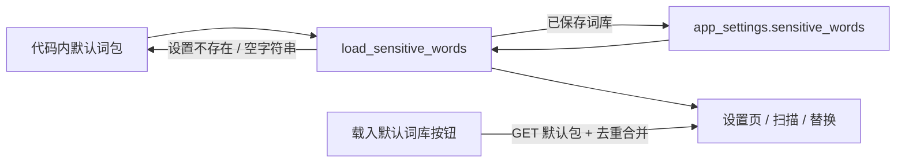

# 敏感词默认词库

- 状态：已建立
- 日期：2026-11-01
- 范围：小红书 / 抖音商业合规默认词包、首次读取、手动载入与合并

## 1. 核心设计决策

1. **默认给商业合规词包，不整库导入通用敏感词**：默认包只覆盖广告法极限词、虚假承诺、医疗功效、金融理财、教育培训、站外导流、诱导消费、美妆护肤、食品保健、迷信违规和低俗违规；不包含政治、暴恐等通用词库。
2. **默认包是初始值，不是锁定值**：词库仍保存在 `app_settings.sensitive_words`；用户可以编辑、停用、删除、导入导出。
3. **缺失时返回默认，显式空列表保持为空**：`sensitive_words` 设置不存在或为空字符串时，读取返回默认包；用户保存过 `[]` 时保持空列表，不强行回填。
4. **手动载入只合并，不覆盖**：设置页提供「载入默认词库」，按词去重追加；不删除、不替换用户已有词条。
5. **宽泛词默认停用**：`第一 / 最好 / 最低 / 绝对 / 100% / 永久 / 万能` 等容易误伤正文的词默认 `enabled=false`；明确违规的短语默认启用。
6. **扫描逻辑不变**：仍按词长优先的精确匹配；默认包不引入单字词，避免大面积误伤。
7. **设置页筛选**：敏感词库支持按关键词（词 / 替换词 / 分类）、分类、启用状态筛选；筛选只影响表格展示，保存、导出和扫描仍使用完整词库。

## 2. 数据流

边界约束：

- 默认包不写数据库；只有用户点击「保存词库」才落库。
- 合并默认包不得删除或改写现有词条。
- 默认包与用户词条使用同一套 `word / replacement / category / enabled` 结构。

## 3. 接口契约

| 方法 | 路径 | 说明 |
|---|---|---|
| GET | `/api/settings/sensitive-words` | 已有词库；设置不存在或为空字符串时返回默认包 |
| GET | `/api/settings/sensitive-words/defaults` | 只读默认包，不落库 |
| PUT | `/api/settings/sensitive-words` | 全量保存；传 `[]` 表示明确清空 |

## 4. 业务不变量

| 编号 | 不变量 |
|---|---|
| SD-01 | 默认包非空、词条唯一，每个词 ≤50 字；不包含单字词。 |
| SD-02 | `sensitive_words` 设置缺失或为空字符串时返回默认包；保存过 `[]` 时返回空列表。 |
| SD-03 | 「载入默认词库」只按 `word` 去重合并，不删除、不覆盖已有词条。 |
| SD-04 | 宽泛 / 易误伤词默认 `enabled=false`；明确商业违规短语默认启用。 |
| SD-05 | 默认包不包含政治、暴恐等通用词库；这些词库由用户自行导入。 |
| SD-06 | 筛选只影响表格展示；保存、导出、扫描始终使用完整词库，不得把筛选结果当成词库源。 |
| SD-07 | 新增词条时清空关键词 / 状态筛选，分类沿用当前分类筛选，避免新行被筛掉。 |

## 5. Impacted Files

- `backend/app/services/sensitive_word_defaults.py`（新增）
- `backend/app/services/sensitive_words.py`
- `backend/app/routers/sensitive_words.py`
- `backend/tests/test_sensitive_words.py`
- `frontend/src/api/client.ts`
- `frontend/src/components/SensitiveWordsPanel.tsx`
- `frontend/src/types.ts`
- `README.md`
- `.ai/blueprints/INDEX.md`

## 6. 外部依据 (REF)

- `wensenlab/xhs-content-checker`：小红书违禁词分类（极限用语、权威背书、诱导点击、刺激消费、医疗效用、迷信、化妆品虚假宣传）。https://github.com/wensenlab/xhs-content-checker
- `CCCpan/chinese-sensitive-words-mcp`：小红书 / 抖音 / 快手 / B 站词库、风险分级与替换建议；部分能力依赖外部服务。https://github.com/CCCpan/chinese-sensitive-words-mcp
- `houbb/sensitive-word-data`：Apache-2.0，6W+ 敏感词 / 违禁词，带「广告」等标签。https://github.com/houbb/sensitive-word-data
- `konsheng/Sensitive-lexicon`：MIT，通用中文敏感词库，含政治 / 色情 / 暴力分类。https://github.com/konsheng/Sensitive-lexicon
- `bigdata-labs/sensitive-stop-words`、`jkiss/sensitive-words`：广告 / 政治 / 色情等分类词库。https://github.com/bigdata-labs/sensitive-stop-words https://github.com/jkiss/sensitive-words

**AI 默认逻辑 vs 外部事实**：通用开源词库体量大、含政治和色情分类，直接导入本项目的精确匹配扫描会大量误伤正文；因此默认包只提取商业合规常用分类，保留导入完整词库的能力，不把通用库作为默认值。

## 7. 变更历史

- **2026-11-01**：建立蓝图。新增商业合规默认词包、缺失时返回默认、手动载入合并，以及宽泛词默认停用的约定。
- **2026-11-01（筛选）**：敏感词库增加关键词、分类、启用状态筛选；筛选只影响展示，保存 / 导出 / 扫描使用完整词库。
