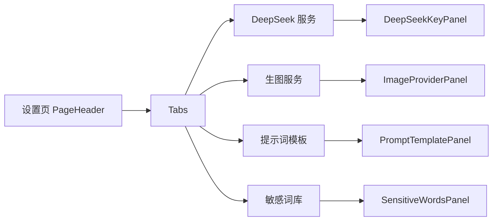

# 设置页标签化

- 状态：已建立
- 日期：2026-11-01
- 范围：设置页四个配置区块改为标签页，减少纵向滚动

## 1. 核心设计决策

1. **四个标签页**：DeepSeek 服务、生图服务、提示词模板、敏感词库；默认打开 DeepSeek。
2. **只改布局，不改数据与接口**：各面板组件、保存逻辑、接口契约保持不变。
3. **记住上次标签**：使用 `localStorage` 记住当前标签；不可用时回退到 DeepSeek，不影响功能。
4. **切换不丢未保存内容**：标签面板保持挂载，切换不销毁组件状态。
5. **敏感词库不再需要滚到底部**：从左侧菜单进入设置后可直接点「敏感词库」。

## 2. 页面结构

边界约束：

- 标签只控制可见性，不改变任何面板的 props 或保存行为。
- 未保存的表单内容在切换标签后保留。
- 不新增路由；设置页仍是单一路由。
- 标签顺序固定为 DeepSeek → 生图 → 模板 → 敏感词。

## 3. 业务不变量

| 编号 | 不变量 |
|---|---|
| ST-01 | 四个面板与改造前使用同一套组件和接口，不复制配置逻辑。 |
| ST-02 | 切换标签不得丢失未保存编辑；面板不得在切换时销毁。 |
| ST-03 | `localStorage` 写入失败只影响标签记忆，不影响设置保存。 |
| ST-04 | 默认标签为 DeepSeek；无效的本地值回退到默认。 |

## 4. Impacted Files

- `frontend/src/pages/SettingsPage.tsx`
- `README.md`
- `.ai/blueprints/INDEX.md`

## 5. 变更历史

- **2026-11-01**：建立蓝图。设置页改为四个标签页，记住上次标签，敏感词库可直接进入。
