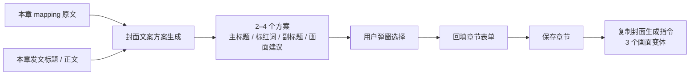

# 章节封面文案方案

- 状态：已建立
- 日期：2026-11-02
- 范围：章节封面主标题 / 标红词 / 副标题的多方案生成、用户选择与画面钩子对齐

## 1. 背景与目标

故事 7 第 1 章的封面写「他偏偏记得我」，发文标题写「我辞职原因：公司禁止办公室恋情」。两边都来自同一章，但封面用了中段「表扬/记得我」的甜点，发文标题用了开头闪前的「辞职/办公室恋情」强钩子，导致封面明显不如发文标题吸引人。

根因不是 12 字限制，而是封面文案没有像发文文案一样先找最强钩子、再出多方案竞争。目标：封面文案也走「本章最强钩子 → 3 个方案 → 用户选 1 个 → 再生成画面」的流程。

## 2. 核心设计决策

1. **多方案竞争**：每章生成 2–4 个封面文案方案（默认 3 个），每个方案包含主标题、标红词、副标题、角度、钩子来源、画面建议与推荐理由。
2. **最强钩子优先**：第 1 章围绕故事核心关系 / 禁忌 / 代价；第 2 章起围绕上一章未解决的后果。优先使用开头闪前、结尾反转、关键台词，不默认用中段最温和的情节。
3. **与发文标题同钩子**：如果本章已有发文配置标题 / 正文，服务端把它作为输入；封面方案必须和发文标题讲同一个钩子，不能一个写辞职/办公室恋情、一个写无关的甜点。
4. **选择后同时回填文案和画面提示词**：用户选定方案后，回填主标题/标红词/副标题，并用该方案的 `visual_content` 调用封面模板 render，生成一份完整 `image_prompt` 一并回填；不自动保存。保存后可直接立即生图，或复制封面生成指令出 3 个画面变体。画面必须服务已定稿的封面文字。
5. **画面建议是提示，不落库**：方案里的 `visual_hint` 只用于展示和指导下一步画面设计，不新增章节字段；最终画面仍由封面模板 render 生成。
6. **不自动写回**：生成方案不写数据库；用户选定后回填表单，保存章节才落库。

## 3. 数据流



边界约束：

- 方案生成不写库、不出图。
- 方案必须能回到本章原文；不得编造事实或跨章剧透。
- 画面变体必须和选定文案同钩子。

## 4. 接口契约

`POST /api/stories/{story_id}/breakdown/chapters/{chapter_number}/cover/copy-options`

请求：

```text
{
  chapter_title, cover_label, cover_main, cover_highlight, cover_sub,
  direction?: string
}
```

响应：

```text
{
  story_id, chapter_number, post_title,
  options: [{
    style, feature, hook_source, visual_hint, visual_content,
    narration_main, narration_highlight, narration_sub,
    recommended, recommend_reason, image_prompt
  }]
}
```

## 5. 业务不变量

| 编号 | 不变量 |
|---|---|
| CC-01 | 主标题 1–12 个汉字；副标题 <35 个汉字（标点不计）。 |
| CC-02 | 标红词必须是对应方案主标题或副标题的连续片段。 |
| CC-03 | 方案主标题不得重复；3 个方案应有不同钩子角度。 |
| CC-04 | 有且只有一个 `recommended=true`；推荐理由仅推荐项必填。 |
| CC-05 | 有发文标题时，封面方案必须与其同钩子；不得选择无关的中段甜点。 |
| CC-06 | 生成方案不写库、不出图；用户选定并保存后才写章节。 |
| CC-07 | 后续画面变体必须服务已定稿的封面文字，不能标题与画面各说各的。 |
| CC-08 | 每个方案的 `visual_content` 必须引用已登记角色变量；`image_prompt` 必须由封面模板 render 生成，不得由 DeepSeek 直接手写固定块。 |

## 6. Impacted Files

- `backend/app/config.py`
- `backend/app/schemas.py`
- `backend/app/services/deepseek.py`
- `backend/app/routers/breakdowns.py`
- `backend/tests/test_cover_copy_options.py`
- `frontend/src/types.ts`
- `frontend/src/api/client.ts`
- `frontend/src/components/CoverCopyOptionsModal.tsx`
- `frontend/src/components/StoryboardChaptersTab.tsx`
- `frontend/src/components/CoverCopyOptionsModal.tsx`
- `frontend/src/styles.css`
- `frontend/src/utils/storyBreakdown.ts`
- `.claude/skills/story-breakdown/SKILL.md`
- `README.md`
- `.ai/blueprints/INDEX.md`

## 7. 变更历史

- **2026-11-02**：建立蓝图。封面文案改为从本章最强钩子生成 2–4 个方案，用户弹窗选择后回填；与发文标题同钩子；画面变体必须服务选定文案。
- **2026-11-02（实现）**：新增 `cover/copy-options` 接口、`CoverCopyOptionsModal` 与章节编辑入口；封面生成指令增加「先读封面文字、画面与文字同钩子」规则；后端测试覆盖发文标题对齐、字数校验与重试。
- **2026-11-02（回填画面提示词）**：方案增加 `visual_content`，后端用封面模板 render 生成 `image_prompt`；用户选定方案时文案和画面提示词一起回填，不再只改文字。
