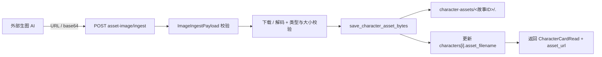

# 角色资产图回传接口与复制指令

- 状态：已建立
- 日期：2026-11-05
- 范围：外部生图 AI 通过 URL / base64 把角色资产图回传到角色卡；角色卡上的「复制回传指令」按钮

## 1. 背景与目标

正文页、章节封面、引导卡已有「生图回传接口」，外部生图 AI 可以直接把成品图写成正式图；角色资产图此前只有浏览器 multipart 上传，外部 AI 无法直接回传。目标是在不改变现有上传 / 生成 / 历史确认路径的前提下，补一个等价的角色资产图回传入口。

## 2. 核心设计决策

1. **复用统一回传载荷**：请求体使用现有 `ImageIngestPayload`，`image_url` 与 `image_base64` 必须且只能提供一个，可选 `filename` 仅用于格式提示。
2. **与 multipart 上传等价**：回传走同一个 `save_character_asset_bytes`，重复回传覆盖旧图并删除旧文件；不新增第二套存储路径。
3. **只改资产图字段**：只更新目标角色的 `asset_filename`，不改 `name` / `role` / `appearance`，不改其他角色。
4. **响应返回角色卡读取模型**：返回 `CharacterCardRead`，包含 `asset_filename` 与服务端计算的 `asset_url`，调用方无需自己拼 URL。
5. **沿用现有校验**：URL 必须是 http/https；图片必须是 JPG / PNG / WebP，≤15MB；角色索引必须存在。
6. **不写历史**：回传是正式图写入，不进入 `image_generations` 历史；历史只记录工作台内生成。
7. **复制回传指令**：每张角色卡提供「复制回传指令」按钮，生成包含故事 ID、角色索引、角色名、接口地址与 URL/base64 示例的文本，给能发 HTTP 的外部生图 AI；按钮不直接调用接口。
8. **批量回传**：新增 `characters/asset-images/ingest` 批量接口，一次最多 20 个角色，逐项返回成功/失败；角色卡页顶部提供「复制批量回传指令」，一次复制全部角色的回传请求。

## 3. 数据流



边界约束：

- 回传只影响目标角色，不能批量写多个角色。
- 新旧图替换必须先写新文件，再删除旧文件。
- 图片地址和 base64 二选一，不能同时提供。
- 失败不得修改角色卡或删除旧图。

## 4. 接口契约

| 方法 | 路径 | 说明 |
|---|---|---|
| POST | `/api/stories/{story_id}/breakdown/characters/{character_index}/asset-image/ingest` | 回传单张角色资产图；URL 或 base64 二选一 |
| POST | `/api/stories/{story_id}/breakdown/characters/asset-images/ingest` | 批量回传角色资产图；一次最多 20 个角色，逐项返回结果 |
| UI | 角色卡「复制回传指令」 | 复制单个角色的接口与示例，不调用接口 |
| UI | 工具栏「复制批量回传指令」 | 复制全部角色的批量请求，不调用接口 |

请求：

```json
{
  "image_url": "https://example.com/character.png"
}
```

或：

```json
{
  "image_base64": "iVBORw0KGgo...",
  "filename": "character.png"
}
```

响应：`CharacterCardRead`

```json
{
  "name": "我",
  "role": "主角",
  "appearance": "……",
  "asset_filename": "<uuid>.png",
  "asset_url": "/uploads/character-assets/9/<uuid>.png"
}
```

错误：

| 状态 | 代码 | 场景 |
|---|---|---|
| 404 | `STORY_NOT_FOUND` | 故事不存在 |
| 404 | `BREAKDOWN_NOT_FOUND` | 还没有拆解结果 |
| 404 | `CHARACTER_NOT_FOUND` | 角色索引不存在 |
| 413 | `FILE_TOO_LARGE` | 图片超过 15MB |
| 422 | `INVALID_IMAGE_URL` | URL 不是 http/https |
| 422 | `INVALID_IMAGE_BASE64` | base64 解码失败 |
| 422 | `INVALID_IMAGE_TYPE` | 不是 JPG / PNG / WebP |
| 422 | `IMAGE_DOWNLOAD_FAILED` | URL 下载失败 |

## 5. 业务不变量

| 编号 | 不变量 |
|---|---|
| CAI-01 | `image_url` 与 `image_base64` 必须且只能提供一个。 |
| CAI-02 | 回传只更新目标角色的 `asset_filename`，不得改角色名、身份、外形或其他角色。 |
| CAI-03 | 重复回传必须删除旧文件，目录里只保留当前正式图。 |
| CAI-04 | 图片必须通过类型与大小校验；失败不得写文件、不得改角色卡。 |
| CAI-05 | 响应中的 `asset_url` 必须由服务端按文件存在性计算，不接受客户端写入。 |
| CAI-06 | 批量回传的 `character_index` 不能重复；单项失败不得回滚其他成功项，成功项必须落库。 |

## 6. Impacted Files

- `.ai/blueprints/INDEX.md`
- `.ai/blueprints/2026-11-05-character-asset-ingest.md`
- `backend/app/routers/breakdowns.py`
- `backend/tests/test_character_assets.py`
- `frontend/src/components/CharacterCardsTab.tsx`
- `frontend/src/utils/imageIngest.ts`
- `frontend/src/utils/imageIngest.test.ts`
- `README.md`

## 7. 变更历史

- **2026-11-05**：建立蓝图。补角色资产图 URL / base64 回传接口，复用现有图片回传载荷与角色资产存储；只更新 `asset_filename`，返回 `CharacterCardRead`。
- **2026-11-05（实现）**：新增 `POST /api/stories/{story_id}/breakdown/characters/{character_index}/asset-image/ingest`；复用 `ImageIngestPayload`、`_read_ingested_image` 与 `save_character_asset_bytes`；补充 base64 回传、覆盖旧图、双来源拒绝、非法 base64、角色/拆解不存在测试；后端全量测试通过。
- **2026-11-05（按钮）**：角色卡增加「复制回传指令」按钮，`imageIngest` 支持 `character_asset` 目标，复制故事 ID、角色索引、角色名、接口与 URL/base64 示例；补充前端工具测试，前端测试与构建通过。
- **2026-11-05（批量）**：新增 `POST /api/stories/{story_id}/breakdown/characters/asset-images/ingest`；一次最多 20 个角色，`character_index` 不重复，逐项返回成功/失败，成功项独立落库；角色卡工具栏增加「复制批量回传指令」；后端全量测试与前端测试/构建通过。
