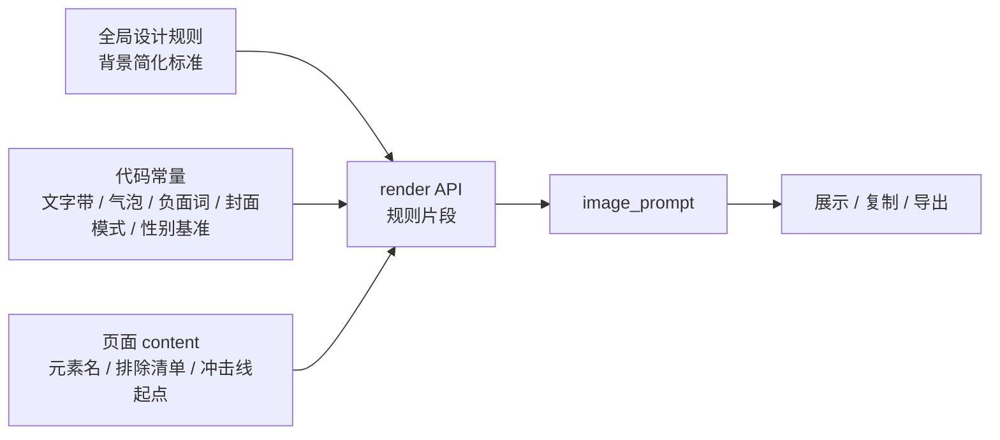

# 纸底简化背景与封面冲击层强度

- 状态：实施中
- 日期：2026-11-06
- 范围：正文页 / 章节封面 / 引导卡的背景标准，封面冲击层最低执行力度，渲染器 / 规则表 / 页面内容的归属边界

## 1. 背景与目标

用户与生图模型实测得出：浅米色素描纸底 + 只用 1–3 个关键环境的淡棕褐色线轮廓 + 逐项列出不要的杂项，能显著减少「背景铺满、压暗、抢主体」。同一轮实测还发现封面冲击线偏细、锯齿情绪漫符偏小、线条像均匀速度线。

目标：把这两条标准落到工作台，新生成的封面 / 正文 / 引导卡自动遵守，不再依赖每次手动粘贴模板。

## 2. 核心设计决策

1. **三层归属**：
   - 结构常量（渲染器代码）：文字带纸色、气泡纯白、负面词、封面模式、角色性别基准；
   - 内容标准（全局设计规则表）：背景简化标准的通用条款；
   - 单页事实（页面 `content`）：本页 1–3 个环境元素名、排除清单、冲击线起点/方向/保护区。
2. **背景标准进规则表，不写模板**：规则表是「实测 → 推广」的唯一 owner，可版本化、可停用、审片可查；模板只负责结构与固定块。
3. **改现有规则，不叠加覆盖句**：现有全局规则「封面背景只保留一个场景焦点」与新标准冲突，直接改写该规则并扩到 `target=all`；不再使用「本段背景指令优先于模板规则」的覆盖写法。
4. **冲击层量化下限写进 `DEFAULT_COVER_MODE`**：封面模式是冲击层的唯一 owner；不新增重复规则。
5. **负面词按正文 / 封面拆分**：正文需要页码与对话气泡，封面禁止；共用一份会互相压制。
6. **角色性别基准由渲染器追加**：画风原文可能写死女性基准（鹅蛋脸、女性曲线），男性角色必须按角色卡处理。
7. **手部比例不纳入本轮标准**：属于生图模型能力问题，负面词与审片都控制不住；用户明确不做。
8. **存量提示词不自动改写**：迁移必须逐章定向重写 `content` 后重新渲染，不使用「整章重做」指令。

## 3. 归属与数据流

边界约束：

- 背景标准只存在于规则表；技能文档与模板不得复制整段背景模板。
- 渲染器只追加固定块，不生成每页元素名与排除清单。
- 旧提示词不自动改写；迁移逐章确认。
- 引导卡不走 render API，由技能按同一标准手写。

## 4. 契约

### 4.1 背景标准（全局规则，`target=all`，`slot=scene`）

- 背景底色与顶部文字带同为浅米色素描纸，不压暗、不发黑、无暗部、无深色背景块。
- 只保留 1–3 个点明地点与动作的关键环境元素，用浅棕褐色淡铅笔线轮廓轻轻勾出，像素描纸上的草稿线，不是深色块、不是剪影。
- 其余环境元素一律不画；`content` 必须逐项列出本页排除的元素。
- 人物与关键道具保持完整上色，只有背景环境元素是淡线。
- 背景不得纯黑；夜景统一用浅灰或浅米表达。

### 4.2 封面冲击层最低力度（`DEFAULT_COVER_MODE`）

- 至少 3 条粗黑集中的手绘射线，从关键道具 / 动作 / 视线出发。
- 线条有手绘抖动感，不是细线、不是均匀速度线。
- 至少 2 处尺寸清晰可辨的锯齿情绪漫符，不是小点。
- 射线与漫符都避开眼睛、脸、文字区和关键道具轮廓。
- 材质分工不变：只有冲击线与关键轮廓用粗黑线，脸和皮肤保持淡彩铅。

### 4.3 负面词拆分

| 类型 | 必须包含 | 不得包含 |
|---|---|---|
| 正文 | 纯黑背景、额外页码、重复页码、多余对话气泡、气泡与纸底同色 | 裸的「页码」「对话气泡」 |
| 封面 | 纯黑背景、页码、对话气泡、冲击线失败模式 | 额外页码 / 多余对话气泡 |

### 4.4 角色性别基准

渲染器在 `character_consistency` 末尾追加：角色性别、年龄与体态以角色卡和参考垫图为最高优先级；男性角色按男性五官、脸型与体态处理，不得套用画风描述中的女性基准。

## 5. 业务不变量

| 编号 | 不变量 |
|---|---|
| BG-01 | 新渲染的正文 / 封面提示词必须带全局背景规则分块。 |
| BG-02 | 背景规则只允许 1–3 个淡线元素；不得出现「氛围人群」「复杂场景」或压暗要求。 |
| BG-03 | 正文负面词不得出现裸「页码」「对话气泡」；封面必须出现。 |
| BG-04 | 封面提示词必须含「至少 3 条」射线、「手绘抖动」、「至少 2 处」锯齿漫符。 |
| BG-05 | 男性角色不得套用女性基准；性别以角色卡 / 垫图为准。 |
| BG-06 | 旧提示词不自动改写；迁移逐章确认，只改背景段与冲击线段。 |

## 6. Impacted Files

- `.ai/blueprints/INDEX.md`
- `.ai/blueprints/2026-10-24-prompt-contract-and-rendering.md`
- `.ai/blueprints/2026-10-27-cover-quality-gate.md`
- `backend/app/config.py`
- `backend/app/services/prompt_templates.py`
- `backend/tests/test_prompt_templates.py`
- `.claude/skills/story-breakdown/SKILL.md`
- `.claude/skills/story-breakdown/cover_check.py`
- `.claude/agents/cover-director.md`
- `README.md`

## 7. 风险与遗留

- 规则表是数据；测试库没有规则，单元测试只能验证渲染器部分，规则效果需要真实数据库渲染预览。
- 规则文案与技能文案可能漂移；`cover_check.py` 通过关键短语做回归检查。
- 正文提示词长度增加约 150–250 字，仍低于 8000 字上限。
- 背景简化不等于留白：夜景、回忆页仍需保留可识别的 1–3 个淡线元素。
- 手部比例问题本轮不处理。

## 8. 变更历史

- **2026-11-06**：建立蓝图。根据用户在故事 9 第 1 章的实测，固化浅米纸底 + 1–3 个淡线元素 + 逐项排除的背景标准；封面冲击层增加「至少 3 条粗黑射线 + 手绘抖动 + 至少 2 处锯齿漫符」的下限；拆分正文 / 封面负面词；新增男性角色性别基准；明确背景标准归规则表、不写模板。
