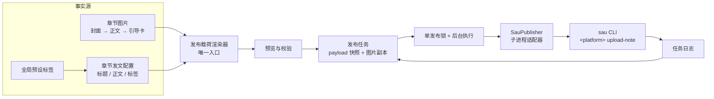
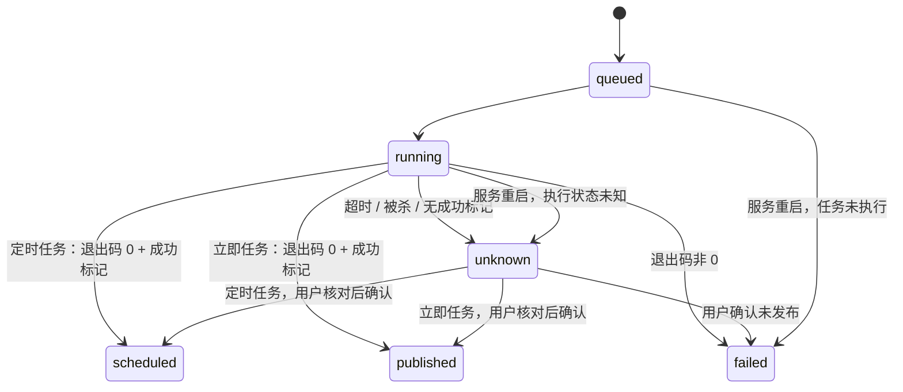

# 多平台发布（抖音 / 小红书）

- 状态：已实施
- 日期：2026-11-09
- 范围：章节成品图与文案 → 发布载荷预览 → 定时 / 立即发布任务 → 外部 `sau` 子进程 → 状态与日志回填

## 1. 核心设计决策

1. **抖音 + 小红书同适配层**：两个平台都走外部 `sau` 子进程；差异只在子命令名、平台限额、账号 Cookie 与登录入口，载荷渲染、快照、执行与状态机共用一套。
2. **外部发布器**：`social-auto-upload`（下称 `sau`）是独立项目，固定在 `E:\workbenchs\social-auto-upload`，使用 Python 3.12 虚拟环境；工作台只通过 CLI 子进程调用，不 import 其模块。
3. **定时 + 立即两种模式**：默认定时发布（`--schedule`，窗口为当前时间 + 2 小时 ～ + 14 天）；立即发布不带 `--schedule`，由 `sau` 创建后立刻提交。两种模式共用预览、快照与状态机，都必须预览并显式确认；立即发布不可撤回。
4. **发布前必须预览**：用户确认的载荷必须与实际发布内容完全一致；工作台不做无人值守自动发布。
5. **载荷快照**：创建任务时复制图片到任务目录并冻结 JSON，运行中不再读取可变源。
6. **预设标签**：全局维护一组常用标签；未保存过时默认返回「画一个故事、小说推文、漫画故事」3 个；章节发布配置保存本章选中的标签，不调用 AI 生成标签。
7. **知乎别名前缀保留**：小红书 / 抖音正文继续使用现有 `【最终别名】` 开头，不新增剥离逻辑。
8. **作品链接由独立蓝图负责**：`sau` 图文命令只确认发布成功，不返回作品 URL；链接回填与一键抓取见 [`2026-11-10-published-link-capture.md`](2026-11-10-published-link-capture.md)，抓取不改任务状态。
9. **发文配置与图文发布左右并列**：文案编辑在左、发布面板在右，宽屏按 1:1（五五开）等宽并列，同屏完成「改文案 → 预览 → 建任务」；无章节的旧版整篇配置仍为单栏。窄屏上下堆叠；两栏都不承担对方的数据计算。
10. **全局发布任务页**：侧边栏「发布任务」跨故事查看全部任务，可按故事与状态筛选；详情、日志、回填链接与人工修正复用同一详情组件，不复制业务逻辑。该页不提供重发入口，重发仍回到章节发布面板走预览。
11. **发布时间统一相对显示**：任务列表、面板记录、检查弹窗与详情里的创建 / 定时时间都只经过 `formatPublishTime()`。前三天显示「前天 / 昨天 / 今天」，未来三天显示「今天 / 明天 / 后天」，其余显示 `YYYY-MM-DD HH:mm`；不新增日期库，用已有 `dayjs` 按自然日差计算。

## 2. 发布拓扑

边界约束：

- 图片顺序只由 `collect_chapter_images()` 生成，ZIP 导出与发布共用。
- 发布载荷只由渲染器生成，前端不得自行拼接标题、正文或图片顺序。
- 任务创建后不可修改载荷；重发必须新建任务。
- `sau` 账号与 Cookie 只存在于外部项目，工作台只保存 `account_name` 与检测状态。
- 同一时间只允许一个发布进程。

## 3. 关键契约

### 3.1 发布载荷

| 字段 | 类型 | 约束 |
|---|---|---|
| `platform` | `douyin` \| `xiaohongshu` | 决定子命令、限额与账号文件 |
| `mode` | `scheduled` \| `immediate` | 决定是否传 `--schedule` 与成功后的状态 |
| `account_name` | `string` | 对应 `cookies/<platform>_<name>.json` |
| `title` | `string` | 非空，≤18 字（沿用现有配置上限） |
| `note` | `string` | ≤1000 字 |
| `tags` | `string[]` | 去重、去 `#`、无空白项；≤10 个 |
| `images` | `string[]` | 任务快照内的绝对路径，封面第一、引导卡最后 |
| `schedule_at` | `datetime \| null` | `scheduled` 时必填且晚于当前 2 小时、不超过当前 14 天；`immediate` 时必须为空 |

平台差异：

| 项目 | 抖音 | 小红书 |
|---|---|---|
| sau 子命令 | `douyin upload-note` | `xiaohongshu upload-note` |
| 参数 | `--account/--images/--title/--note/--tags`；定时任务再加 `--schedule` | 同左，参数名完全一致 |
| 标题上限 | 18 字（平台允许更长，配置表单统一 18） | 20 字（配置表单仍按 18 校验） |
| 正文上限 | 1000 字 | 1000 字 |
| 图片上限 | 35 张 | 18 张（章节本身最多 18 张） |
| 成功标记 | 「图文发布成功」 | 「图文发布成功」 |
| 账号文件 | `cookies/douyin_<name>.json` | `cookies/xiaohongshu_<name>.json` |

### 3.2 任务状态

| 状态 | 含义 |
|---|---|
| `queued` | 已创建，等待执行 |
| `running` | 子进程运行中 |
| `scheduled` | 定时任务：平台确认定时发布 |
| `published` | 立即任务：平台确认已发布；或定时任务经用户核对后确认已发布 |
| `failed` | 子进程非 0 退出 |
| `unknown` | 超时、被杀或未观察到成功标记；禁止自动重试 |

状态机：

重启恢复：启动时把遗留 `queued` 标记为 `failed`（提示重新创建），`running` 标记为 `unknown`（提示人工核对），不做自动重试。

### 3.3 写入口

| 方法 | 路径 | 作用 |
|---|---|---|
| `GET` | `/api/publishing/tag-presets` | 读取全局预设标签；`publish_tag_presets` 设置缺失或损坏时返回默认 3 个，保存过空数组则返回空 |
| `PUT` | `/api/publishing/tag-presets` | 保存全局预设标签 |
| `GET` | `/api/publishing/accounts` | 按 `platform` 返回账号与最近检测状态；首次访问按平台补种默认账号 |
| `POST` | `/api/publishing/accounts/{id}/check` | 调用 `sau <account.platform> check` |
| `POST` | `/api/publishing/accounts/{id}/login` | 后台打开 `sau <account.platform> login --headed` 扫码窗口 |
| `POST` | `/api/publishing/preview` | 按 `publish_mode` 渲染载荷并返回错误 / 警告，不落库；账号平台必须与载荷一致 |
| `POST` | `/api/publishing/jobs` | 创建任务并启动后台执行；立即任务创建后马上上传 |
| `GET` | `/api/publishing/jobs` | 按故事 / 章节 / 状态 / 平台筛选任务，创建时间倒序，`limit` ≤ 100 |
| `PATCH` | `/api/publishing/jobs/{id}` | 回填作品链接或人工修正状态 |
| `GET` | `/api/publishing/jobs/{id}/log` | 读取任务日志尾部 |

不提供 `retry` 接口：`failed` 任务重发时重新预览并新建任务，`unknown` 必须人工核对，避免绕过预览与幂等判断。

预览响应同时返回 `schedule_min_at` 与 `schedule_max_at`，供界面日期选择器限制可选范围；最终判定仍以后端预览的 `errors` 为准。

「重新发起」只是前端便捷入口：读取上一条 `failed` 任务的账号、发布方式与定时，回填到面板并立即调用 `POST /api/publishing/preview`，不新增后端接口、不直接创建任务；用户仍需确认预览后手动创建任务。`unknown` 不提供该按钮。

## 4. 数据模型

### `publish_accounts`

| 字段 | 说明 |
|---|---|
| `id` | 主键 |
| `platform` | `douyin` \| `xiaohongshu` |
| `account_name` | 传给 `sau --account` 的本地别名 |
| `display_name` | 页面显示名 |
| `status` | `unknown` / `valid` / `invalid` |
| `last_checked_at` | 最近检测时间 |

唯一约束：`(platform, account_name)`。

### `publish_jobs`

| 字段 | 说明 |
|---|---|
| `id` | 主键 |
| `story_id` | 关联故事 |
| `chapter_number` | 章节号 |
| `platform` | `douyin` \| `xiaohongshu` |
| `account_id` | 关联账号 |
| `status` | 见状态机 |
| `scheduled_at` | 定时任务的平台发布时间；立即任务存创建时刻，仅作执行锚点，展示以载荷 `mode` 为准 |
| `payload_json` | 冻结载荷，含 `mode` 与 `schedule_at` |
| `payload_hash` | 规范化 JSON 哈希，用于幂等提示 |
| `source_hash` | 创建时源图片与文案哈希 |
| `snapshot_dir` | 图片快照目录，相对 `uploads/publish-jobs/<job_id>/` |
| `external_url` | 用户回填的作品链接 |
| `exit_code` | 子进程退出码 |
| `stdout_excerpt` | 日志尾部摘要 |
| `error_message` | 失败原因 |
| `started_at` / `finished_at` | 执行时间 |
| `created_at` / `updated_at` | 审计 |

### `story_chapter_post_configs.tags`

新增 `tags JSON NOT NULL DEFAULT []`，保存本章选中的发布标签。全局预设标签只作为选择来源，不是第二份章节标签。

## 5. 业务不变量

| 编号 | 不变量 |
|---|---|
| PB-01 | 发布图片必须由 `collect_chapter_images()` 生成，顺序为封面 → 章内页码 → 引导卡。 |
| PB-02 | 任务创建后载荷与图片快照不可变；重发必须新建任务。 |
| PB-03 | 抖音标题非空且 ≤18 字、图片 ≤35 张；小红书标题非空且 ≤18 字、图片 ≤18 张；两平台正文均 ≤1000 字，且不含 GIF。 |
| PB-04 | 定时任务必须选择晚于当前时间 2 小时、且不超过当前时间 14 天的发布时间；立即任务必须不传 `schedule_at`，传了即视为校验失败。 |
| PB-05 | 预览有阻塞级错误时禁止创建任务。 |
| PB-06 | `unknown` 状态不得自动重试，必须人工核对原作品。 |
| PB-07 | 退出码非 0 记为 `failed`；退出码 0 但无成功标记记为 `unknown`，不得当作成功。 |
| PB-08 | 同一平台同一时间只允许一个 `running` 任务。 |
| PB-09 | 账号 Cookie 文件不得通过 API 返回、不得写入数据库。 |
| PB-10 | 删除故事时保留发布任务历史或先阻止删除，不得静默级联删除已发布记录。 |
| PB-11 | 同一章节 + 平台 + 账号 + `payload_hash` 已存在 `queued/running/scheduled` 任务时，默认阻止重复创建。 |
| PB-12 | 前端不得自行拼接标题、正文、标签或图片顺序，一律使用预览返回的载荷。 |
| PB-13 | 预设标签只作为候选项；章节标签以 `story_chapter_post_configs.tags` 为唯一来源。 |
| PB-14 | 「重新发起」只对 `failed` 任务出现，只回填账号与定时并触发预览，不得跳过预览或直接创建任务；`unknown` 不提供。 |
| PB-15 | 全局发布任务页只做查看与人工修正（状态、作品链接），不得在该页创建任务或重发；故事名只作显示，从故事列表读取，任务表不保存第二份故事名。 |
| PB-16 | 发布账号的平台必须与载荷 `platform` 一致；账号列表、检测与登录都按账号自己的平台调用对应 `sau` 子命令。 |
| PB-17 | 默认预设标签只在 `publish_tag_presets` 设置缺失或损坏时由读取接口回填；用户保存过空数组即视为「不要预设」，不得再次补默认值。默认值不写入数据库。 |
| PB-18 | 立即发布同样必须经过预览、`preview_hash` 与 `confirm`；成功后状态直接记为 `published`，定时任务成功仍记为 `scheduled`。立即任务不可撤回，仍受同一平台单任务锁约束。 |
| PB-19 | 发布任务的所有时间展示必须走 `formatPublishTime()`；界面不得各自 `dayjs().format()`，也不得把相对时间当作业务判定依据。 |

## 6. 失败处理

- 子进程统一超时 600 秒；超时后终止进程树并标记 `unknown`。
- `sau` 的日志同时捕获 stdout 与 stderr，落盘到 `data/publish-logs/<job_id>.log`；日志原文保留 ANSI 颜色码，回显给页面的 `error_message` 与日志文本必须去掉颜色码。
- 成功标记：输出包含「图文发布成功」（两个平台一致）。定时任务记为 `scheduled`；立即任务记为 `published`。
- 小红书发布步骤在失败时会无限重试，必须依赖 600 秒硬超时兜底并进入 `unknown`；不要让线程无限等待。
- 抖音短信验证：预留 `verify_code.txt` 写入入口；本期先记录提示，不自动处理。
- 账号失效：`check` 返回 `invalid` 时阻止创建任务。

## 7. Impacted Files

- `.ai/blueprints/INDEX.md`
- `.ai/blueprints/2026-11-09-multi-platform-publishing.md`
- `backend/app/config.py`
- `backend/app/database.py`
- `backend/app/models.py`
- `backend/app/schemas.py`
- `backend/app/routers/publishing.py`
- `backend/app/routers/post_configs.py`
- `backend/app/routers/breakdowns.py`
- `backend/app/routers/stories.py`
- `backend/app/services/files.py`
- `backend/app/services/publishing/`
- `backend/app/main.py`
- `backend/tests/test_publishing.py`
- `frontend/src/api/client.ts`
- `frontend/src/types.ts`
- `frontend/src/components/ChapterPublishPanel.tsx`
- `frontend/src/components/PublishJobDetailModal.tsx`
- `frontend/src/pages/PublishJobsPage.tsx`
- `frontend/src/utils/publishing.ts`
- `frontend/src/utils/publishing.test.ts`
- `frontend/src/App.tsx`
- `frontend/src/components/PostConfigTab.tsx`
- `frontend/src/components/PublishSettingsPanel.tsx`
- `frontend/src/pages/SettingsPage.tsx`
- `frontend/src/styles.css`
- `README.md`
- `.ai/sau-patches/2026-11-09-douyin-image-title-selector.md`
- `.ai/sau-patches/2026-11-09-douyin-stealth-upload.md`
- `.ai/sau-patches/2026-11-10-xiaohongshu-declaration-collection.md`

## 8. 风险与遗留

- `sau` 页面选择器可能随平台改版失效；固定 commit `3847fff`，升级前做真实冒烟测试。2026-11-09 已实测两处平台改版：抖音图文页标题占位符改为「添加作品标题」；stealth 初始化脚本会让发布页图片上传卡在 0% 并整批失败（服务端 200，前端判定失败）。本地 `sau` 已打两处补丁，见 `.ai/sau-patches/`，重新安装 `sau` 后需重新应用。
- 小红书图文的内容声明与合集已在本地 `sau` 工作区实现（未 commit、未 push，`--declaration` / `--repost-source` / `--collection`）。工作台已接入故事级设置与本蓝图载荷链路，契约见 `2026-11-10-xiaohongshu-publish-settings.md`；本蓝图只保留「载荷含 declaration / collection 字段」这一事实。
- 小红书定时发布链路已于 2026-11-09 由用户实测通过；仍保留 `upload()` 的 `set_init_script` 风险：若出现上传卡 0%，按抖音补丁记录排查。
- `sau` 小红书流程在发布失败时会无限重试；抖音同理需要硬超时兜底。
- 立即发布没有撤回接口，成功即对读者可见；创建前必须确认预览，创建后不可修改或取消。
- 定时窗口按「2 小时 ～ 14 天」硬校验；平台若调整上限或账号权限不同，超出部分由平台 / `sau` 报错并进入 `failed`。
- 抖音可能触发短信二次验证，本期只提示，不自动填写。
- 定时发布仍会占用平台定时名额；用户需在创作中心确认或取消。
- 不返回作品链接：发布确认与链接抓取分离，抓取见 `2026-11-10-published-link-capture.md`。
- 平台反自动化风控：单账号、低频、人工确认，不做矩阵批量。

## 9. 变更历史

- **2026-11-09**：建立蓝图。确定抖音优先、外部 `sau` 子进程、定时发布先行、预览强制、图片与载荷快照、预设标签、保留知乎别名前缀。
- **2026-11-09**：落地实现。补充账号扫码登录接口、默认账号补种、服务重启状态恢复；明确不提供 `retry` 接口（失败重发走全新预览 + 新建任务）。图片清单统一由 `collect_chapter_images(upload_dir, story_id, chapter, pages)` 从文件系统推导，ZIP 导出与发布共用；`scheduled_at` 统一按 UTC 入库，避免 SQLite 丢时区导致偏移。
- **2026-11-09**：真实任务首次执行失败（`failed`，退出码 1）。原因：抖音图文发布页标题占位符由「填写作品标题」改为「添加作品标题」，`sau` 旧选择器等待 120 秒超时。已在本地 `sau` 增加双占位符兼容选择器，并用真实登录态验证标题、描述、话题、定时时间与发布按钮；补丁与复现步骤记录在 `.ai/sau-patches/2026-11-09-douyin-image-title-selector.md`。
  - **外部依据 (REF)**: 本地实测 `input[placeholder="添加作品标题"]`；上游 PR #225 `Fix/uploader dom 202606` 仅覆盖视频页「填写作品标题」
- **2026-11-09**：界面修复。发布记录的「结果」列改为换行显示（`pre-wrap` + `overflow-wrap: anywhere`），不再用单行 ellipsis 撑破表格；`error_message` 与日志回显统一去掉 sau 输出的 ANSI 颜色码，落盘日志保持原样。
- **2026-11-09**：定位第二次真实任务卡死（「小人正在冲刺发布图文」无限循环）。根因不是按钮选择器，而是 `sau` 的 stealth 初始化脚本导致图文页图片上传全部停在 0%，60 秒后标记上传失败，封面为空，点「发布」反复提示「没有选择封面」。已在本机 `sau` 的抖音发布路径去掉 `set_init_script`，并记录在 `.ai/sau-patches/2026-11-09-douyin-stealth-upload.md`。
  - **外部依据 (REF)**: 本地实测（有 stealth 必失败、无 stealth 15 张图 15 秒成功）；上传 API `ApplyImageUpload` / TOS `POST /upload/v1/...` / `CommitImageUpload` 均返回 200
- **2026-11-09**：真实任务 `d7a4fca6…`（故事 9 第 1 章）执行成功，状态进入 `scheduled`，蓝图状态改为「已实施」。新增「重新发起」：`failed` 记录可一键回填上次账号与定时并自动预览，仍须确认预览后才能建任务；不新增后端接口，`unknown` 不提供该入口。
  - **外部依据 (REF)**: `data/workbench.db` 中 `publish_jobs` 最新记录 `status=scheduled`；用户确认发布功能可用
- **2026-11-09**：「发文配置」改为左右布局，左侧标题 / 正文 / 标签与保存按钮，右侧抖音图文发布面板；窄屏（<1200px）自动上下堆叠。别名条与章节选择仍全宽，作为两栏共同上下文。窄栏里的本章发布记录改为卡片列表（状态、定时、标题、错误、详情 / 重新发起），替代会横向滚动的表格。
- **2026-11-09**：预设标签增加默认值「画一个故事 / 小说推文 / 漫画故事」。默认值只在读取接口发现设置缺失或损坏时回填，不落库；用户保存过空数组后仍返回空。同步更新测试与 README。
- **2026-11-09**：新增全局「发布任务」页：侧边栏入口、故事 / 状态筛选、状态标签与日志详情复用；`GET /api/publishing/jobs` 增加 `status` 筛选。详情弹窗从章节面板抽成共享组件，避免两处维护修正逻辑。
- **2026-11-09**：「发文配置」宽屏左右两栏改为 1:1 等宽（五五开），原右侧栏 `minmax(440px, 600px)` 限制移除；窄屏堆叠规则不变。
- **2026-11-09**：接入小红书图文定时发布。`platform` 扩展为 `douyin | xiaohongshu`；账号按平台分别补种（抖音主账号 / 小红书主账号），检测、登录与上传共用同一套 `sau` 适配器，仅子命令名不同；小红书图片上限 18 张，标题 / 正文上限沿用配置表单；`GET /jobs` 增加 `platform` 筛选；章节发布面板增加平台切换，发布记录与全局任务页按平台展示。
  - **外部依据 (REF)**: `social-auto-upload/sau_commands/xiaohongshu.py`（`upload-note` 参数与抖音一致：`--account/--images/--title/--note/--tags/--schedule`）；`social-auto-upload/uploader/xiaohongshu_uploader/main.py`（成功标记「图文发布成功，小人开心收工」，发布步骤 `while True` 无限重试，`upload()` 调用 `set_init_script`）；`cookies/` 下只有 `xiaohongshu_uploader` 空目录，`xiaohongshu_default.json` 尚未生成，尚无小红书登录态
- **2026-11-09**：开放立即发布。`publish_mode` 扩展为 `scheduled | immediate`；立即任务不带 `--schedule`，创建后立刻上传，成功后状态为 `published`；定时任务保持 `scheduled`；立即任务必须预览 + 确认，传 `schedule_at` 直接校验失败；`payload_hash` 包含 `mode`，立即任务哈希不随当前时间变化。用户确认小红书定时链路可用后开放。
  - **外部依据 (REF)**: `social-auto-upload/sau_commands/douyin.py` 与 `sau_commands/xiaohongshu.py`（`publish_strategy = ... if args.schedule else ..._IMMEDIATE`；缺少 `--schedule` 时走立即发布分支）
- **2026-11-10**：立即发布兼容旧任务与旧后端。历史任务的 `payload` 可能没有 `mode`，前端统一按 `scheduled` 兜底展示，避免任务列表崩溃；后端读取旧载荷时同样按 `scheduled` 回填。
- **2026-11-10**：作品链接抓取拆到独立蓝图 `2026-11-10-published-link-capture.md`，发布蓝图只保留 `external_url` 字段归属；抓取不触发发布流程、不改任务状态。
- **2026-11-10**：定时发布窗口增加最远 14 天校验。预览对超过「当前 + 14 天」的定时返回阻塞错误，并返回 `schedule_max_at`；前端日期选择器同步限制可选范围。用户确认按固定 14 天实现，不做设置项。
  - **外部依据 (REF)**: 抖音创作中心时间选择器提示「支持 2 小时后及 14 天内的定时发布」（体验分析截图 https://www.woshipm.com/ucd/6269378.html）；小红书公开资料多为「1 小时～14 天内」，另有 7 天 / 30 天说法，未见官方统一文档
  - **AI 默认逻辑与外部事实的冲突**: 外部资料对上限存在 7 / 14 / 30 / 90 天多种说法，未自行选定；由用户确认固定 14 天。
- **2026-11-10**：发布时间改为相对显示。`formatPublishTime()` 按自然日差输出「前天 / 昨天 / 今天 / 明天 / 后天 + HH:mm」，超出 ±2 天仍显示完整 `YYYY-MM-DD HH:mm`；非法日期返回 `—`。不新增依赖，沿用已有 `dayjs`；列表、面板、检查弹窗与详情共用同一函数，并补充单元测试。
  - **外部依据 (REF)**: `frontend/src/utils/publishing.ts`（现有 `formatPublishTime`）；`dayjs` 已在 `frontend/package.json` 依赖中；`dayjs` 的 `calendar` 插件只有今天 / 昨天 / 明天，`relativeTime` 输出「2 天前」，均无「前天」，故未直接套用插件
- **2026-11-10**：外部依赖能力变化。本地 `sau` 新增小红书图文 `--declaration` / `--repost-source` / `--collection`（工作区改动，未 commit、未 push），并移除原先无条件选择「来源转载」且来源为空的调用。约束：声明 fail-closed（显式传入但设置失败即拒绝发布），合集 warn-and-skip（找不到时告警并跳过）。工作台已在该基础之上接入故事级小红书设置，见 `2026-11-10-xiaohongshu-publish-settings.md`。
  - **外部依据 (REF)**: `social-auto-upload/uploader/xiaohongshu_uploader/main.py`（`apply_content_declaration` / `apply_collection`）；`docs/CLI.md`；`.ai/sau-patches/2026-11-10-xiaohongshu-declaration-collection.md`；上游 Issue #185 将「原创申明 / 加入合集」列为待开发
  - **AI 默认逻辑与外部事实的冲突**: 原实现把「来源转载」写成每条图文的固定声明，导致空来源声明；现改为默认不触碰声明，声明默认值与开关位置由用户确认后落在故事级，见新蓝图。
