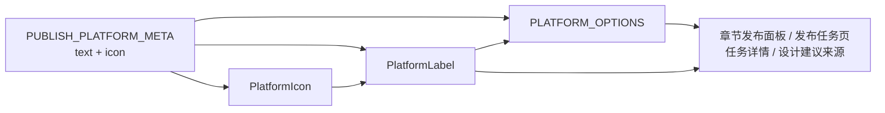

# 平台图标

- 状态：已实施
- 日期：2026-11-10
- 范围：抖音 / 小红书品牌图标的资产位置、统一组件、平台名与图标的单一映射，以及各界面应用边界

## 1. 背景与目标

多平台发布上线后，平台名散落在章节发布面板、发布任务页、任务详情弹窗与设计建议来源等处，仅靠中文名区分抖音 / 小红书。目标：平台名作为独立标识出现时统一带品牌图标，全部由同一个组件渲染，避免各处自行贴图、各自维护一份平台名与图片路径。

## 2. 核心设计决策

1. **图标资产进仓**：放在 `frontend/public/icons/`，由 Vite 原样复制到 `dist/`，构建后经后端静态服务以 `/icons/*` 访问；不引入 CDN、不在线拉取品牌图。
2. **单一组件**：`PlatformIcon` 只渲染图标，`PlatformLabel` 渲染「图标 + 平台名」；界面不得直接写 `` 指向图标资产。
3. **平台名与图标同源**：`PUBLISH_PLATFORM_META` 增加 `icon` 字段，仍是平台中文名与图标路径的唯一 owner；组件只读它。
4. **下拉选项同源**：平台下拉选项由 `PUBLISH_PLATFORM_META` 派生，label 直接是 `PlatformLabel`，筛选与表单共用一份，不再维护纯文本选项数组。
5. **应用边界**：平台名作为**独立标识**时带图标——标题、Tag、表格列值、下拉项、表单标签、详情字段值；嵌在句子里的平台名（说明、警告、toast、placeholder、tooltip 等纯文本容器）保持纯文本。
6. **设计建议来源复用**：`DesignFeedbackSource.xiaohongshu` 与发布平台字面量一致，复用同一组件，不新建第二套图标映射。

## 3. 组件契约

```ts
type PublishPlatform = 'douyin' | 'xiaohongshu'

interface PlatformIconProps {
  platform: PublishPlatform
  size?: number // 默认 16，只在组件内定尺寸
  className?: string
}

interface PlatformLabelProps extends PlatformIconProps {
  suffix?: ReactNode // 接在平台名后，如「图文发布」
}
```

平台映射（唯一来源 `PUBLISH_PLATFORM_META`）：

| `platform` | `text` | `icon` |
|---|---|---|
| `douyin` | 抖音 | `/icons/douyin.png` |
| `xiaohongshu` | 小红书 | `/icons/xiaohongshu.png` |

## 4. 渲染拓扑



边界约束：

- 只有 `PUBLISH_PLATFORM_META` 能写平台中文名与图标路径，其他位置只能引用。
- 界面不得绕过组件直接引用 `/icons/*`。
- 图标为装饰元素：`alt` 为空，平台名由相邻文本提供。
- 图标尺寸只由组件 `size` 参数决定，页面不得各写像素。
- 图标不进入复制、导出、ZIP 与生图提示词。

## 5. 业务不变量

| 编号 | 不变量 |
|---|---|
| PI-01 | 平台中文名与图标路径必须来自 `PUBLISH_PLATFORM_META`，不得在组件或页面重复定义。 |
| PI-02 | 平台独立标识必须使用 `PlatformLabel`；不得只放图标不放平台名，也不得只放文字。 |
| PI-03 | 平台下拉（筛选、切换）的选项必须由同一份派生选项生成，标签带图标。 |
| PI-04 | 图标不得参与复制、导出、ZIP、生图提示词等文本产物。 |
| PI-05 | 图标为装饰元素，必须 `alt=""`；读屏只读平台名，不重复朗读图标。 |
| PI-06 | 句子内嵌的平台名保持纯文本，不因图标改造而重写文案。 |

## 6. Impacted Files

- `.ai/blueprints/INDEX.md`
- `.ai/blueprints/2026-11-10-platform-icons.md`
- `frontend/public/icons/douyin.png`
- `frontend/public/icons/xiaohongshu.png`
- `frontend/src/components/PlatformIcon.tsx`
- `frontend/src/utils/publishing.ts`
- `frontend/src/components/ChapterPublishPanel.tsx`
- `frontend/src/components/PublishPreflightModal.tsx`
- `frontend/src/components/PublishJobDetailModal.tsx`
- `frontend/src/pages/PublishJobsPage.tsx`
- `frontend/src/pages/DesignFeedbacksPage.tsx`
- `frontend/src/components/PostConfigTab.tsx`
- `frontend/src/styles.css`

## 7. 风险与遗留

- 源图仅 40×40，超过约 24px 会发虚；当前只用于 14–18px 的标注位。
- 「发文配置」的「小红书标题」是抖音 / 小红书共用字段，暂不加小红书图标，避免把共用字段标成单平台；是否改名为「发布标题」留待产品决策。
- 新增平台时需同时补 `PUBLISH_PLATFORM_META` 的 `text` / `icon` 与对应资产文件，蓝图表格同步更新。
- 品牌图标仅用于本地单机工作台的界面识别，不对外分发。

## 8. 变更历史

- **2026-11-10**：建立蓝图。图标资产入 `frontend/public/icons/`；新增 `PlatformIcon` / `PlatformLabel` 与派生选项；平台名与图标路径统一由 `PUBLISH_PLATFORM_META` 提供；明确「独立标识带图标、句子内嵌纯文本」的应用边界。
- **2026-11-10**：落地实现。接入章节发布面板（标题、平台切换、登录按钮）、发布前检查弹窗标题、发布任务页（平台列、平台筛选）、任务详情平台字段、设计建议来源；`PUBLISH_PLATFORM_OPTIONS` 由纯文本选项改为组件内派生的 `PLATFORM_OPTIONS`。
