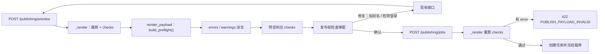

# 发布前检查（Preflight）

- 状态：已实施
- 日期：2026-11-10
- 范围：发布预览响应、创建任务门禁、章节发布面板的检查弹窗

## 1. 背景与目标

现有发布预览只返回平铺的 `errors` / `warnings`，文案长度、图片数量、定时窗口和账号状态之外，别名是否配置、图片是否加过别名、是否已发布过本章都没有门禁。目标是在创建发布任务前给出一份分组、可修复、可阻断的检查清单，并把同一套检查作为后端的唯一发布门禁。

## 2. 核心设计决策

1. **检查项是唯一事实源**：`services/publishing/preflight.py` 的 `build_preflight()` 产出 `checks`；`errors` / `warnings` 由它派生，预览响应同时返回两者，创建任务用派生 `errors` 阻塞。前端不得自行推导任何检查结论。
2. **预览与创建共用 `_render`**：检查在预览和创建时各算一次，不缓存在浏览器；哈希不一致时创建仍会被拒绝。
3. **检查分级**：`pass` / `warning` / `error`。`error` 禁止创建；`warning` 需在弹窗勾选确认后才能创建。
4. **别名水印检测只读**：复用 `alias-backups/<故事ID>` 下的 `.alias.json`，用 `stamped_sha256` 与当前图片哈希比对；当前哈希复用 `render_payload` 为 `source_hash` 已经算过的那一份，不重复读盘。只能识别“工作台加的水印”。
5. **同一章节同一账号只发一次**：同故事 + 同章节 + 同平台 + 同账号存在 `queued / running / scheduled / unknown / published` 任一任务时，检查项为 `error`，前端与创建接口同时拦截；`failed` 允许重新发起。替代原先只看 `payload_hash` 的 `PUBLISH_JOB_DUPLICATE` 分支，避免两套重复判定。
6. **弹窗替代原有确认框**：创建按钮直接打开检查弹窗，确认后仍走 `POST /api/publishing/jobs` + `preview_hash`，不再叠一层 `modal.confirm`。
7. **弹窗内可修复**：`stamp_alias`（本章一键加别名）与 `check_login` 直接调用现有接口，完成后自动重新预览刷新哈希与检查结果；`open_zhihu` / `open_chapters` 切到对应标签页，`open_post_config` 关闭弹窗回到文案表单。

## 3. 检查清单与级别

| 组 | key | 检查 | pass / warning / error |
|---|---|---|---|
| 文案 | `content.config` | 本章发文配置已保存 | error |
| 文案 | `content.title` | 标题非空且 ≤18 字 | error |
| 文案 | `content.note` | 正文非空 | warning |
| 文案 | `content.length` | 正文与标签总长 ≤1000 | error / warning |
| 文案 | `content.tags` | 标签 1–10 个 | error |
| 文案 | `content.sensitive` | 标题/正文命中已启用敏感词 | warning |
| 别名 | `alias.configured` | 已设置最终别名 | error |
| 别名 | `alias.valid` | 别名 6–8 汉字、不复用故事名连续两字 | error |
| 别名 | `alias.note_prefix` | 正文以【最终别名】开头 | warning |
| 别名 | `alias.images` | 封面/正文/引导卡均已加当前别名 | warning（逐图明细） |
| 图片 | `images.chapter` | 章节存在 | error |
| 图片 | `images.cover` | 章节封面已上传且文件存在 | error |
| 图片 | `images.guide` | 引导卡已上传且文件存在 | warning |
| 图片 | `images.pages` | 正文页图片齐全 | error |
| 图片 | `images.count` | 有图且不超过平台上限 | error |
| 图片 | `images.format` | 格式为 JPG / PNG / WebP | error |
| 图片 | `images.order` | 封面 → 正文 → 引导卡 | pass（只展示） |
| 账号 | `account.login` | 登录失效 error / 未检测 warning | 同左 |
| 平台 | `platform.schedule` | 定时 2 小时–14 天；立即不带定时 | error |
| 平台 | `platform.duplicate` | 同章同平台同账号已有未失败任务 | error |

## 4. 数据流



边界约束：

- 浏览器只展示 `checks`，不自行判定别名、图片或重复发布。
- 修复动作会改图片或账号状态，完成后必须重新预览，不能沿用旧哈希。
- 检查不写库、不创建任务，除修复动作外无副作用。

## 5. 契约

```ts
type PreflightStatus = 'pass' | 'warning' | 'error'
type PreflightGroup = 'content' | 'alias' | 'images' | 'account' | 'platform'

interface PreflightCheckItem {
  label: string
  status: PreflightStatus
}

interface PreflightCheck {
  key: string
  group: PreflightGroup
  label: string
  status: PreflightStatus
  message: string
  action: 'stamp_alias' | 'check_login' | 'open_zhihu' | 'open_chapters' | 'open_post_config' | null
  action_label: string | null
  items: PreflightCheckItem[]
}
```

`PublishPreviewRead` 新增 `checks: PreflightCheck[]`；`errors` / `warnings` 保留，内容完全来自 `checks`。

## 6. 业务不变量

| 编号 | 不变量 |
|---|---|
| PF-01 | 检查项只由后端 `build_preflight()` 计算，前端不得自行判定或过滤结论。 |
| PF-02 | `errors` / `warnings` 必须由 `checks` 派生，不得单独追加。 |
| PF-03 | 创建任务必须重新计算检查并以 `error` 项阻塞，不能信任预览时的结果。 |
| PF-04 | 别名水印检测不得修改图片或备份；当前别名与 `zhihu_alias` 不一致时按提醒处理。 |
| PF-05 | 同故事 + 同章节 + 同平台 + 同账号只允许一个非失败任务。 |
| PF-06 | 修复动作后旧预览哈希失效，必须重新预览才能创建。 |
| PF-07 | 检查结果不进入发布载荷与任务快照，不影响 `source_hash` / `payload_hash`。 |

## 7. Impacted Files

- `.ai/blueprints/2026-11-10-publish-preflight.md`、`.ai/blueprints/INDEX.md`、`README.md`
- `backend/app/services/publishing/preflight.py`（新增）
- `backend/app/services/publishing/payload.py`、`backend/app/services/publishing/__init__.py`
- `backend/app/services/alias_stamp.py`
- `backend/app/routers/publishing.py`、`backend/app/routers/alias_stamp.py`
- `backend/app/schemas.py`
- `backend/tests/test_publishing.py`、`backend/tests/test_preflight.py`（新增）
- `frontend/src/types.ts`、`frontend/src/components/PublishPreflightModal.tsx`（新增）
- `frontend/src/components/ChapterPublishPanel.tsx`、`frontend/src/components/PostConfigTab.tsx`
- `frontend/src/pages/StoryDetailPage.tsx`、`frontend/src/styles.css`

## 8. 风险与遗留

- 别名水印只能识别工作台生成的水印；外部工具加的别名会显示“未检测到”，不会误判为已加。
- 图片哈希每次预览都会重算（与 `source_hash` 同一次），图片很多时预览略慢，可接受。
- 旧图片在加别名后被替换，会被判为未加别名，需要重新加别名。
- 同章同账号一次发布规则不覆盖“不同账号各发一次”，这是有意的。
- 设计规则核验、审片结果、页码连续与对照段归属不在本期范围：分别缺少稳定关联记录或已有写入口保证。

## 9. 变更历史

- **2026-11-10**：建立蓝图。检查项统一由后端计算并驱动弹窗；20 项分级检查；同章同平台同账号只允许一次发布；弹窗内提供加别名与检测登录。
- **2026-11-10**：实施完成。新建 `preflight.py` 与 `PublishPreflightModal.tsx`，预览接口返回 `checks`，创建接口复用同一份检查做门禁；`test_preflight.py` 覆盖缺别名 / 加别名 / 别名变更 / 重复任务 / 敏感词 / 平台不匹配；后端全量测试、前端单测与构建通过。旧 `PUBLISH_JOB_DUPLICATE` 载荷哈希去重逻辑已移除，由 PF-05 取代。
- **2026-11-10**：`content.tags` 由「≤10 个」收紧为「1–10 个」。0 个标签同样阻塞创建，提示到发文配置补充标签。
