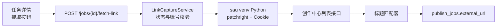

# 作品链接自动抓取

- 状态：已实施
- 日期：2026-11-10
- 范围：发布任务详情 → 按需抓取创作中心作品链接 → 写入 `publish_jobs.external_url`

## 1. 核心设计决策

1. **按需触发，不后台轮询**：只在任务详情弹窗点「抓取作品链接」时执行。立即任务发布成功后由用户点一次；定时任务必须等平台实际发布后再抓，避免定时未生效时误报。
2. **复用 `sau` 浏览器环境**：用 `sau` 虚拟环境的 Python + patchright 与已有 Cookie 打开创作中心列表页，拦截列表接口返回 JSON；工作台只解析结构化结果，不读页面 DOM，也不 import `sau` 模块。
3. **链接只写 `external_url`**：沿用 `publish_jobs.external_url`，不新增第二份链接字段；抓取不修改任务状态（`unknown` 仍需用户确认后手动标记）。
4. **标题匹配，取最新一条**：以发布载荷的 `title` 匹配平台列表标题；同一标题多条时取发布时间最新的一条。找不到就明确失败，不做模糊猜测。
5. **只允许已提交平台的任务抓取**：`scheduled / unknown / published` 可抓；`queued / running / failed` 拒绝。

## 2. 抓取拓扑

边界约束：

- 浏览器只读列表接口，不点击发布、编辑或删除。
- Cookie 只作为子进程参数传入，不写日志、不经 API 返回。
- 抓取失败不改变任务状态、不清空已有链接。

## 3. 关键契约

### 3.1 接口

| 方法 | 路径 | 作用 |
|---|---|---|
| `POST` | `/api/publishing/jobs/{job_id}/fetch-link` | 按任务平台 / 账号 / 标题抓取作品链接，成功回填并返回任务 |

错误码：

| code | HTTP | 场景 |
|---|---|---|
| `PUBLISH_LINK_STATUS_INVALID` | 409 | 任务状态不允许抓取 |
| `PUBLISH_LINK_CAPTURE_BUSY` | 409 | 已有抓取进程在运行 |
| `PUBLISH_LINK_TITLE_MISSING` | 422 | 任务载荷缺少标题，无法匹配 |
| `PUBLISH_LINK_ACCOUNT_MISSING` | 404 | 任务关联账号不存在 |
| `PUBLISH_LINK_CAPTURE_UNAVAILABLE` | 503 | sau 浏览器环境或 Cookie 缺失 |
| `PUBLISH_LINK_NOT_FOUND` | 404 | 列表中没有匹配标题的已发布作品 |
| `PUBLISH_LINK_CAPTURE_FAILED` | 502 | 浏览器启动、超时或接口解析失败 |

### 3.2 抓取器输出

工作台以子进程运行 `link_capture_worker.py`，标准输出最后一行必须是单个 JSON：

| 字段 | 类型 | 说明 |
|---|---|---|
| `platform` | `string` | 本次抓取的平台 |
| `count` | `int` | 各页列表接口返回的作品条数合计（含跨页重复） |
| `items` | `object[]` | 各页已发布作品；未发布作品直接丢弃；跨页重复保留，由工作台合并 |
| `reason` | `string` | 无法抓取时的原因（如登录态失效） |

`items[]` 字段：

| 字段 | 类型 | 说明 |
|---|---|---|
| `title` | `string` | 平台标题原文：抖音 `desc`，小红书 `display_title` |
| `url` | `string` | 已拼接好的作品链接 |
| `created_at` | `int` | 平台发布时间戳（秒），用于多条命中时取最新 |

标题匹配不放在抓取器里：抓取器只负责提取字段，匹配由工作台的单一匹配器完成（见 LC-04）。

翻页：抓取器在首屏列表出现后，滚动页面内层列表容器触发加载更多，最多 10 轮或 120 条；连续两轮没有新请求即认为到底。跨页重复项由工作台按链接去重后参与匹配。

### 3.3 平台字段

| 项目 | 抖音 | 小红书 |
|---|---|---|
| 列表接口 | `/janus/douyin/creator/pc/work_list` | `/api/galaxy/v2/creator/note/user/posted` |
| 标题字段 | `desc`（以标题开头） | `display_title` |
| ID 字段 | `aweme_id` | `id` |
| 已发布判定 | 列表接口 `status=0` 返回的作品 | `tab_status == 1` 且无未来 `schedule_post_time` |
| 链接 | `https://www.douyin.com/note/<aweme_id>`（视频用 `/video/`） | `https://www.xiaohongshu.com/explore/<id>?xsec_token=<token>&xsec_source=pc_user` |

## 4. 业务不变量

| 编号 | 不变量 |
|---|---|
| LC-01 | `publish_jobs.external_url` 是作品链接唯一来源；抓取只写该字段。 |
| LC-02 | 抓取不得修改任务状态、载荷、快照或日志。 |
| LC-03 | 只有 `scheduled / unknown / published` 状态允许抓取。 |
| LC-04 | 抖音按 `desc` 首行的原始标题做前缀匹配（标题后可能紧跟「。【别名】」）；小红书按 `display_title` 去空白与首尾标点后精确匹配；多条命中取发布时间最新的一条。 |
| LC-05 | 只返回平台已发布的作品；定时未生效、审核中或已删除的作品不返回。 |
| LC-06 | 抓取超时 120 秒；失败不自动重试，不清空已有链接。 |
| LC-07 | Cookie 只传给子进程，不写入日志、响应或数据库。 |
| LC-08 | 同一时间只运行一个抓取进程；并发请求直接返回 `PUBLISH_LINK_CAPTURE_BUSY`。 |
| LC-09 | 抓取返回的链接必须是 `https` 且属于对应平台正式域名，否则视为未匹配。 |
| LC-10 | 翻页只通过滚动页面触发，不直接重放列表接口（避免缺少平台签名）；跨页重复由统一合并器按链接去重。 |

## 5. 风险与遗留

- 创作中心列表接口可能随平台改版；改版时抓取返回失败，不影响发布与已有链接。
- 抓取器最多滚动 10 轮 / 合并前 120 条；作品更多或标题重复时仍可能找不到，需人工回填。
- 定时任务在平台发布时间之前抓取会返回「未找到已发布作品」。
- 小红书链接依赖 `xsec_token` 才能直接打开；重新抓取会刷新 token。
- 浏览器自动化仍受平台风控影响，只做低频、用户主动触发的只读访问。

## 6. Impacted Files

- `.ai/blueprints/INDEX.md`
- `.ai/blueprints/2026-11-09-multi-platform-publishing.md`
- `.ai/blueprints/2026-11-10-published-link-capture.md`
- `backend/app/config.py`
- `backend/app/routers/publishing.py`
- `backend/app/services/publishing/__init__.py`
- `backend/app/services/publishing/link_capture.py`
- `backend/app/services/publishing/link_capture_worker.py`
- `backend/app/services/publishing/link_parsing.py`
- `backend/tests/test_publishing.py`
- `frontend/src/api/client.ts`
- `frontend/src/components/PublishJobDetailModal.tsx`
- `README.md`

## 7. 变更历史

- **2026-11-10**：建立蓝图。确定按需抓取、复用 sau 浏览器环境、只写 `external_url`、标题匹配且不改状态。
  - **外部依据 (REF)**: 只读探测 `creator.xiaohongshu.com/api/galaxy/v2/creator/note/user/posted`（返回 `notes[].id/display_title/time/schedule_post_time/tab_status/xsec_token`）与 `creator.douyin.com/janus/douyin/creator/pc/work_list`（返回 `aweme_list[].aweme_id/desc/create_time/status/share_url`）；探测使用既有 `cookies/<platform>_default.json`，未执行任何写操作
- **2026-11-10**：抓取器输出从「已匹配链接」改为「作品条目列表」，标题匹配收敛到工作台单一匹配器，避免抓取脚本与后端各算一遍；已发布判定补充抖音 `status` 子字段。
  - **外部依据 (REF)**: 抖音实测 `desc` 首行为「标题。【最终别名】」，标题与别名连写，因此抖音改为前缀匹配；小红书 `display_title` 只含标题
- **2026-11-10**：两个平台的抓取器只读实测通过（小红书 11 条已发布、抖音 8 条已发布；定时未生效的小红书笔记被正确排除）。
- **2026-11-10**：落地实现。新增 `POST /api/publishing/jobs/{job_id}/fetch-link`；抓取子进程用 `settings.sau_python` 运行，单飞锁防并发；解析与匹配集中在 `link_parsing.py`，后端单测覆盖标题匹配、域名校验、错误码与路由回填。
- **2026-11-10**：支持列表翻页。抓取器首屏加载后滚动内层列表容器，最多 10 轮 / 120 条；跨页条目合并到同一次抓取，工作台按链接去重后再匹配。
  - **外部依据 (REF)**: 只读实测小红书 `note-manager` 的 `.content` 内层容器滚动后依次请求 `page=0`（12 条）、`page=1`（14 条）、`page=3`（0 条），滚窗口本身不触发加载；抖音 `content/manage` 的 `.list-scroll-*` 内层容器滚动会触发 `work_list`，接口用 `has_more` / `max_cursor` 翻页，本账号当前 8 条、`has_more=false`，未能实测第二页
- **2026-11-10**：翻页版抓取器只读实测通过。小红书输出 26 条原始条目（12 + 14，与接口分页一致），合并后 26 条；抖音输出 9 条原始条目，其中首条跨页重复，合并后 8 条，说明列表滚动与跨页合并均按预期工作。
- **2026-11-10**：重启后端后接口层实测：`POST /jobs/{id}/fetch-link` 对 `scheduled` 的小红书任务 13 秒返回 200 并回填链接，任务状态保持 `scheduled`；`failed` 任务返回 `409 PUBLISH_LINK_STATUS_INVALID` 且不启动浏览器；预览返回 `schedule_max_at`，`+20 天` 定时被列为阻塞错误、`+3 小时` 通过。
