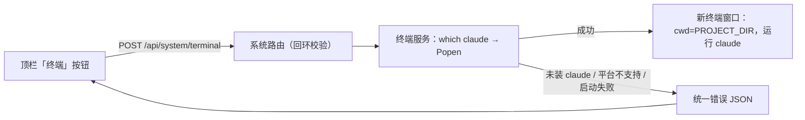

# 工作台终端启动器（打开本机终端并运行 Claude Code）

- 状态：已建立
- 日期：2026-11-10
- 范围：应用壳层顶栏按钮 + 后端系统接口，启动本机终端进程

## 1. 背景与目标

浏览器的安全沙箱不允许网页直接打开本机终端或执行 `claude` 命令。用户需要在任意页面点顶栏按钮，就在工作台项目根目录弹出终端并直接进入 Claude Code 会话，省去手动切目录。

## 2. 核心设计决策

1. **由后端启动进程**：只有本机后端进程能创建子进程；前端只发一个固定路径的请求，不接触 shell。
2. **命令完全固定**：不接受任何请求参数参与命令拼接，无命令注入面。
3. **优先 Windows Terminal，缺失回退 `cmd`**：
   - 找到 `wt` → `wt -d <PROJECT_DIR> cmd.exe /k claude`，`CREATE_NO_WINDOW` 避免宿主闪出多余控制台；
   - 找不到 `wt` → `cmd.exe /k claude` + `CREATE_NEW_CONSOLE`；
   - 两种方式都靠 `/k` 保证 `claude` 退出后窗口保留，能看到报错；后端不接管 stdio。
4. **工作目录固定为 `PROJECT_DIR`**：即仓库根目录（`config.PROJECT_DIR`），不取服务进程 cwd，也不允许前端指定。
5. **`Popen` 后立即返回**：不等待进程结束、不捕获输出、不写日志、不建任务记录；终端生命周期与工作台解耦。
6. **仅 Windows 本地**：非 Windows 返回明确错误，不伪装成功。
7. **`claude` 必须先可用**：后端用 `shutil.which("claude")` 预检，找不到返回带修复提示的错误，而不是打开一个空终端。
8. **仅限回环调用**：只接受本机客户端，避免服务被改成公网监听后变成远程开 shell 的入口。

## 3. 数据流



边界约束：

- 只有后端能创建终端进程，前端不得尝试自行拉起 shell。
- 终端输出不回流到工作台，页面不显示 claude 会话内容。
- 接口不读写数据库、不产生发布任务、不写日志文件。

## 4. 契约

响应（200）：

```ts
interface TerminalLaunchResult {
  terminal: 'windows-terminal' | 'cmd' // 本次实际使用的启动方式
  directory: string // 实际工作目录（PROJECT_DIR）
  message: string // 中文提示，前端可直接展示
}
```

`wt` 查找顺序：环境变量 `WINDOWS_TERMINAL_EXECUTABLE` → `config.WINDOWS_TERMINAL_EXECUTABLE`（本机便携版路径）→ PATH 中的 `wt` / `wt.exe` → `%LOCALAPPDATA%\Microsoft\WindowsApps\wt.exe` 应用执行别名；前一个路径不存在时继续往后找，全部不存在时回退 `cmd`。

| 场景 | 状态码 | code |
|---|---|---|
| 非本机客户端 | 403 | `TERMINAL_LOCAL_ONLY` |
| 非 Windows | 501 | `TERMINAL_UNSUPPORTED` |
| PATH 中找不到 `claude` | 409 | `CLAUDE_NOT_FOUND` |
| 子进程创建失败 | 500 | `TERMINAL_LAUNCH_FAILED` |

## 5. 业务不变量

| 编号 | 不变量 |
|---|---|
| TL-01 | 终端按钮只存在于应用壳层顶栏，全站一份。 |
| TL-02 | 工作目录只来自 `PROJECT_DIR`，不接受请求参数或前端指定。 |
| TL-03 | 启动命令不接受任何用户输入拼接。 |
| TL-04 | 接口不写数据库、不产生任务或日志记录。 |
| TL-05 | 失败必须显式报错，不得静默打开空终端或返回假成功。 |
| TL-06 | 只允许回环客户端调用。 |

## 6. Impacted Files

- `.ai/blueprints/2026-11-10-terminal-launcher.md`、`.ai/blueprints/INDEX.md`、`README.md`
- `backend/app/routers/system.py`、`backend/app/services/terminal.py`
- `backend/app/config.py`（便携版 `wt.exe` 路径）
- `backend/app/schemas.py`、`backend/app/main.py`
- `backend/tests/test_terminal.py`
- `frontend/src/App.tsx`、`frontend/src/styles.css`、`frontend/src/api/client.ts`、`frontend/src/types.ts`

## 7. 风险与遗留

- 后端若以无桌面会话（服务 / 计划任务）方式运行，新终端窗口不会出现在用户桌面；当前仅支持用户手动 `start.sh` / `dev.sh` 启动。
- 每次点击都新开一个窗口，不做单例去重。
- 本机 Windows Terminal 是**免安装便携版**（`D:\Microsoft.WindowsTerminalPreview_...\wt.exe`），不在 PATH、也没有 Store 别名，因此路径写在 `config.WINDOWS_TERMINAL_EXECUTABLE`；升级或移动目录后必须同步修改，否则会静默回退 `cmd`（可用环境变量 `WINDOWS_TERMINAL_EXECUTABLE` 覆盖）。
- 真机已验证：`wt -d <PROJECT_DIR> cmd.exe /k claude` 会在 Windows Terminal 中开新窗口，`claude.exe` 作为子进程启动；`CREATE_NO_WINDOW` 没有额外弹出控制台。新窗口会复用已运行的 Windows Terminal 进程（预览版行为），不代表没开窗口。
- Store 版 `wt` 若不在 PATH，会继续查 `%LOCALAPPDATA%\Microsoft\WindowsApps` 别名；都不存在时回退 `cmd`。
- `claude` 启动后的失败（未登录、无权限等）发生在终端内部，后端无法感知，只在终端窗口里展示。

## 8. 变更历史

- **2026-11-10**：建立蓝图。确定后端 `Popen` 启动 `cmd.exe /k claude`、工作目录固定 `PROJECT_DIR`、回环调用限制与四条错误码。
- **2026-11-10**：接入 Windows Terminal。`wt` 存在时优先 `wt -d <PROJECT_DIR> cmd.exe /k claude`（`CREATE_NO_WINDOW`），缺失时回退 `cmd`；响应 `terminal` 返回实际方式。影响 `services/terminal.py` 与单测，接口契约其余不变。
