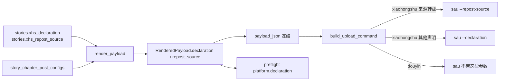

# 小红书发布设置：AI 声明与合集（2026-11-10）

状态：已实施（合集暂时下线，只留内容声明）

## 1. 背景与决策

`sau` 已支持小红书图文的 `--declaration`（fail-closed）与 `--repost-source`；合集 `--collection` 目前只在独立补丁里、尚未应用，因此工作台本期只接入声明。

| 决策 | 结论 |
|---|---|
| 归属层级 | **故事级**：一个故事一个内容声明，所有章节共用 |
| 声明取值 | 只能是平台的固定文案之一或「不声明」；默认「笔记含AI合成内容」 |
| 声明文案 | 不允许自由文本录入：平台改文案时选项即失效，必须同步枚举 |
| 来源转载 | 选中「来源转载」时必须同时提供媒体名；其他声明下媒体名无效 |
| 合集 | **暂停接入**：`sau` 工作区还没有 `--collection`（只在补丁 0002 里），工作台暂不提供入口、不传参、不做预检提醒；列与载荷字段保留，待 PR2 合入后接回 |
| 抖音 | 不传这些参数；抖音 `upload-note` 没有对应 CLI 参数 |

约束：

1. 声明与合集只有一个 owner：`stories` 表字段；其他位置只能引用。
2. 前端不拼接 CLI 参数，只展示后端 `preview` 返回的声明与合集。
3. 声明失败由 `sau` 直接拒绝发布，工作台不得吞掉该错误。
4. 合集名按精确文本匹配 `sau` 侧合集列表，不做模糊匹配。
5. 历史任务 `payload_json` 没有这两个字段时按「不声明、不加入合集」处理。
6. 声明值必须命中 `XHS_DECLARATION_CHOICES`；写入口拒绝枚举外的文案。
7. 「来源转载」缺媒体名一律拒绝写入，不允许发出空来源声明。
8. 暂停期间工作台不得发出 `--collection`：命令构造、写入口、预检三处都不出现合集。

## 2. 数据流



边界约束：

1. 声明与来源媒体名同源：只有 `xhs_declaration == 来源转载` 时 `repost_source` 才进入载荷。
2. `--declaration` 与 `--repost-source` 在 `sau` 侧互斥，命令构造函数必须二选一。
3. 抖音载荷里各项恒为 `None`，不进入预检项。
4. 声明与来源媒体名都进 `payload_hash`，不进 `source_hash`。

## 3. 契约

### 3.1 数据模型（`stories`）

| 字段 | 类型 | 默认 | 说明 |
|---|---|---|---|
| `xhs_declaration` | `String(32)` | `笔记含AI合成内容` | 内容声明文案；空串表示「不声明」；取值必须是 `XHS_DECLARATION_CHOICES` 之一 |
| `xhs_repost_source` | `String(64)` | `""` | 「来源转载」的媒体名；仅当声明为「来源转载」时生效 |
| `xhs_collection` | `String(64)` | `""` | **暂停使用**：列保留、不再有写入口、不进入命令；PR2 合入后接回 |

`XHS_DECLARATION_CHOICES`（与平台发布页文案逐字一致，`sau` 按精确文案点击）：

| 取值 | sau 参数 |
|---|---|
| `""`（不声明） | 不传，发布页保持「添加内容类型声明」 |
| `虚构演绎，仅供娱乐` | `--declaration` |
| `笔记含AI合成内容` | `--declaration` |
| `内容包含营销广告` | `--declaration` |
| `来源转载` | `--repost-source`（同时传媒体名） |

`自主拍摄` 不在枚举内：它需要拍摄地点与拍摄日期，`sau` 未实现。

### 3.2 接口

```python
class StoryXiaohongshuUpdate(BaseModel):
    declaration: str = Field(default=XHS_DEFAULT_DECLARATION, max_length=32)
    repost_source: str = Field(default="", max_length=MAX_XHS_REPOST_SOURCE_LENGTH)
```

`PATCH /api/stories/{story_id}/xiaohongshu` → `StoryRead`；`StoryRead` 增加 `xhs_collection`、`xhs_declaration`、`xhs_repost_source`。写入口校验：声明不在枚举内 → 422；声明为「来源转载」且媒体名为空 → 422。媒体名在非「来源转载」声明下原样保存但不生效。写入口不再接收 `collection`。

### 3.3 载荷

`RenderedPayload` 增加 `declaration: str | None`、`repost_source: str | None`、`collection: str | None`：

- 仅 `platform == xiaohongshu` 时赋值；抖音恒为 `None`。
- `declaration` 取 `xhs_declaration`，空串归一为 `None`。
- `repost_source` 仅在 `declaration == 来源转载` 时取 `xhs_repost_source`，否则为 `None`。
- `collection` 在暂停期间恒为 `None`（没有写入口），字段与哈希位置保留，PR2 合入后接回。
- 三者写入 `payload_json` 与 `payload_hash`（改变发布结果），不进入 `source_hash`（不属于正文内容）。

### 3.4 检查项

| key | 组 | 平台 | 通过条件 | 阻塞 |
|---|---|---|---|---|
| `platform.declaration` | platform | 小红书 | 恒 pass，文案说明所选声明（来源转载附媒体名）/ 未声明 | 否 |

`platform.collection` 暂停期间不再产出，避免每次发布都要勾选「我已确认提醒」。

## 4. Impacted Files

- `.ai/blueprints/2026-11-10-xiaohongshu-publish-settings.md`
- `.ai/blueprints/INDEX.md`
- `backend/app/config.py`
- `backend/app/models.py`
- `backend/app/database.py`
- `backend/app/schemas.py`
- `backend/app/routers/stories.py`
- `backend/app/routers/publishing.py`
- `backend/app/services/publishing/payload.py`
- `backend/app/services/publishing/preflight.py`
- `backend/app/services/publishing/runner.py`
- `backend/tests/test_publishing.py`
- `backend/tests/test_migrations.py`
- `frontend/src/types.ts`
- `frontend/src/api/client.ts`
- `frontend/src/components/ChapterPublishPanel.tsx`
- `frontend/src/components/PublishPreflightModal.tsx`
- `frontend/src/utils/publishing.ts`
- `frontend/src/utils/publishing.test.ts`
- `frontend/src/components/PostConfigTab.tsx`
- `README.md`

## 5. 风险与遗留

- 合集必须先在平台侧创建；工作台只选择，不创建。小红书合集只能在**发布页**创建（用户 2026-11-10 确认），不是创作中心；`sau` 只精确匹配已存在合集，新账号首次发布没有可选合集，只能留空。
- 平台合集名可改可删，设置里的名字失效时 `sau` 告警并跳过，发布继续但不进合集。
- 声明文案由平台固定，`XHS_DECLARATION_CHOICES` 必须与之逐字一致；平台改文案后旧值会被写入口拒绝，需同步枚举。
- 平台内容类型声明的真实结构是「3 个直接选项 + 内容来源声明（二级菜单：来源转载 / 自主拍摄）」。工作台接入 3 个直接选项与来源转载；`来源转载` 走 `--repost-source`；`自主拍摄` 需要拍摄地点与拍摄日期，`sau` 未实现，因此不在枚举内。
- 历史小红书图文曾被旧版 `sau` 无条件标记「来源转载（来源为空）」，本期不处理历史内容。
- **合集暂时下线**：`sau` 工作区只含声明实现，合集在独立补丁 `0002-xiaohongshu-collection.patch` 里且未应用。工作台因此不提供合集入口、不传 `--collection`、不产出合集检查项，否则每次发布都要勾选提醒且误填会导致未知参数失败。PR2 合入后按本蓝图原有约定接回：写入口、`--collection` 传参、`platform.collection` 提醒。

## 6. 变更历史

- **2026-11-10**：建立蓝图。用户确认：默认开启 AI 声明且可关闭；合集归属故事级；合集缺失只提醒；`sau` 改动只留本地，暂不提 PR。
  - **外部依据 (REF)**: `social-auto-upload/docs/CLI.md`（`--declaration` fail-closed、`--collection` warn-and-skip）；`.ai/sau-patches/2026-11-10-xiaohongshu-declaration-collection.md`；本地实测发布页声明与合集均生效
- **2026-11-10**：补记平台事实并纠正文档。小红书合集只能在**发布页**创建（此前文档建议的「先去创作中心建合集」不成立）；`sau` 只精确匹配已存在合集，新故事首次发布时若账号还没有合集，只能留空发布，等合集建好后再为后续章节设置。合集缺失仍为提醒，不阻塞发布。
  - **外部依据 (REF)**: 用户 2026-11-10 本机确认小红书创建合集的入口只在发布页
  - **AI 默认逻辑与外部事实的冲突**: 原默认按「创作中心可建合集」编写流程说明，与平台实际不符，已按事实改写 README、sau 补丁文档与本蓝图。
- **2026-11-10**：实施完成，蓝图状态改为「已实施」。`stories` 新增两列并完成旧库迁移回填（旧故事 `xhs_ai_declaration=1`、合集为空）；新增 `PATCH /api/stories/{id}/xiaohongshu`；`RenderedPayload` / `payload_json` / `payload_hash` 纳入声明与合集；`build_upload_command()` 仅对小红书追加 `--declaration` / `--collection`；前端在发布面板提供故事级设置与保存门禁。验证：后端 345 项测试通过（含新增预览、载荷冻结与迁移回填用例），前端 27 项测试与 `npm run build` 通过；真实库迁移后 `GET /api/stories` 返回新字段，故事 9 第 1 章小红书预览返回 `declaration=笔记含AI合成内容`、`platform.collection` 为提醒。
- **2026-11-10**：sau 侧改动改为不提交。原先的本地提交已撤回（`git reset --mixed`），6 个文件保留在工作区，便于用户本地逐行检查；不 commit、不 push、不提 PR。
- **2026-11-10**：sau 侧按能力拆分。声明（`--declaration` / `--repost-source`）留在工作区作为 PR1；合集（`--collection`）导出为独立补丁 `0002-xiaohongshu-collection.patch`，叠在 PR1 之上作为 PR2，工作区暂不应用。测试与文档同步按能力拆成互不重叠的块，两个补丁可独立评审。
- **2026-11-10**：声明从前端「AI 声明开关」升级为平台选项选择。`stories.xhs_ai_declaration: Boolean` 退役，改为 `xhs_declaration: String(32)` + `xhs_repost_source: String(64)`；迁移时 `xhs_ai_declaration = 0` 的故事回填为空串（不声明），其余保持默认文案，随后删除旧列。枚举 `XHS_DECLARATION_CHOICES` 与平台四个可选项逐字一致；「来源转载」改由 `--repost-source` 传递并强制要求媒体名。原因：工作台此前只用了 PR1 三种直接声明中的一种，来源转载完全没接，无法验证 PR1 的完整能力。
  - **外部依据 (REF)**: 2026-11-10 真实发布页实测选项结构；`.ai/sau-patches/2026-11-10-xiaohongshu-declaration-collection.md`（PR1 行为约定表）
- **2026-11-10**：合集暂时下线，只保留声明。工作台移除合集写入口（`StoryXiaohongshuUpdate.collection` 删除）、`build_upload_command()` 不再传 `--collection`、预检不再产出 `platform.collection`；`stories.xhs_collection` 列、`RenderedPayload.collection` 与载荷字段保留（暂停期间恒为 `None`），PR2 合入后按原约定接回。原因：`sau` 工作区没有 `--collection`，合集空值提醒会逼用户每次发布都勾选确认，误填则因未知参数发布失败，妨碍声明侧的联调测试。

